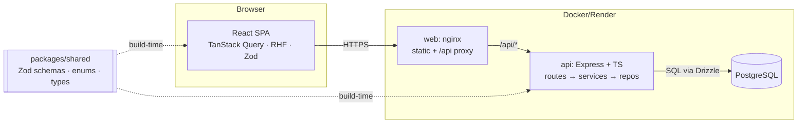
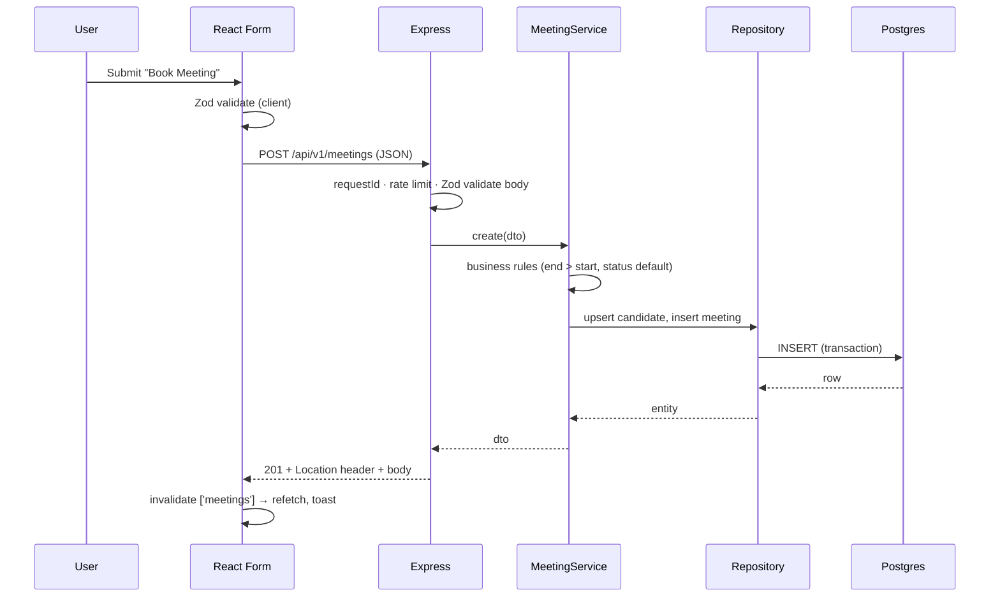
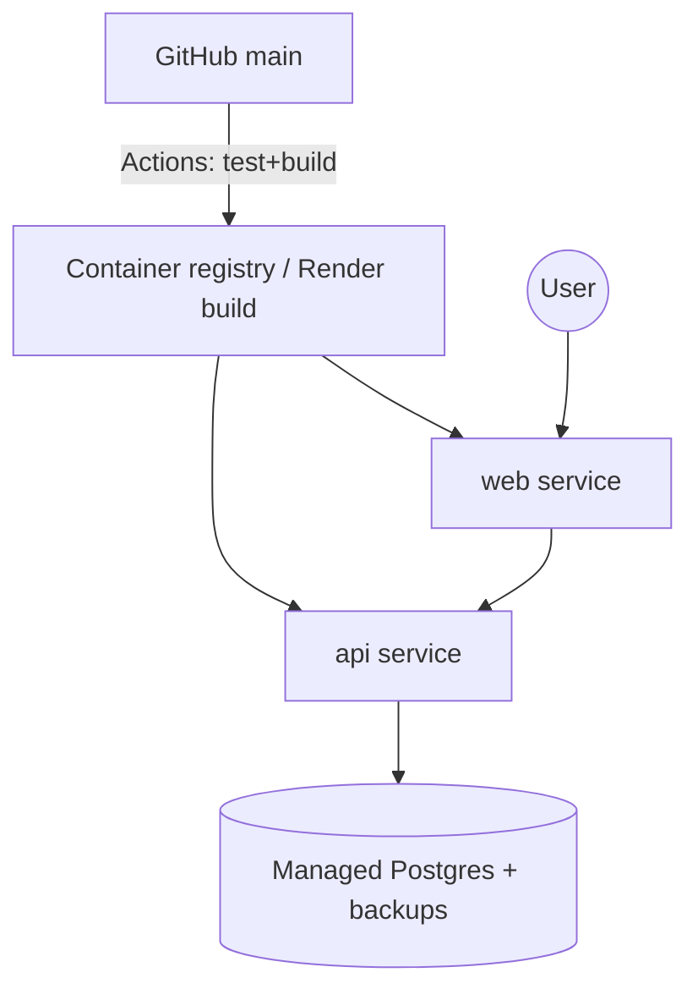
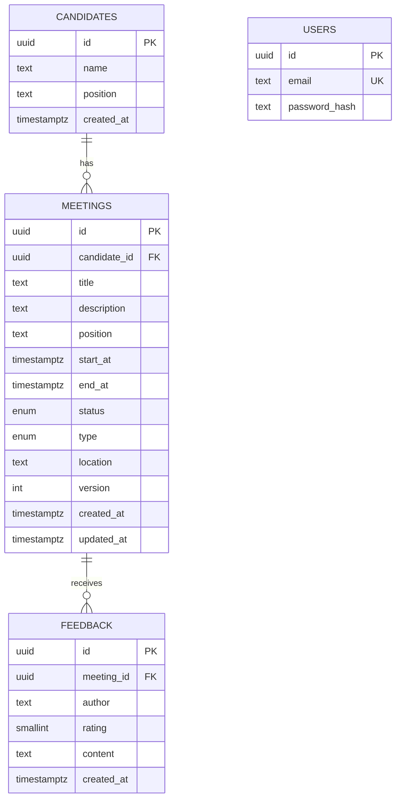
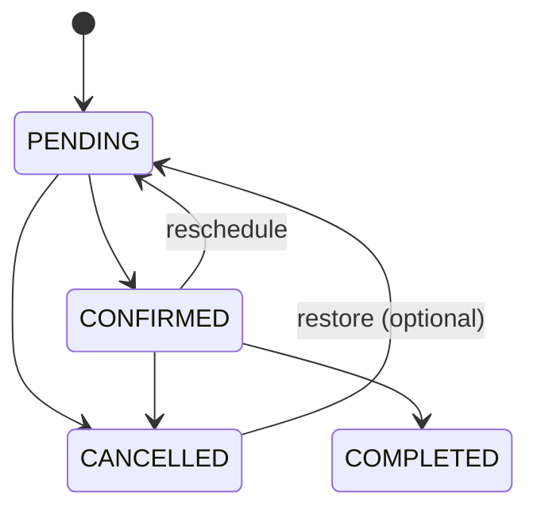

# ARCHITECTURE_PROPOSAL — Meeting Manager (Candidate Meeting Scheduler)

> Status: **Planning only. No application code has been written.** Awaiting architecture review.
> Legend used throughout: **[REQ]** = explicit in the assignment · **[ASM]** = my engineering assumption · **[REC]** = my recommendation.

---

## 1. Executive Summary

The assignment asks for a Meeting CRUD web app (React/Vue + Node/Python, REST, containerised, deployed), but its wireframes describe a richer **candidate interview scheduler** (candidate, position, time range, meeting type, notes, feedback, history). These two descriptions conflict, and the conflict drives most design decisions.

**Recommendation (Approach B — Balanced):**

- One `meetings` resource that satisfies the core fields (`title`, `description`, `due date`, `status`) **and** the wireframe fields (candidate, position, start/end, type, notes), plus a small `feedback` sub-resource. Candidate is a lightweight table so the "Candidate Summary / History" page is real, not faked.
- **React + TypeScript + Vite** frontend, **Node + Express + TypeScript** backend, **PostgreSQL**, shared **Zod** schemas in an npm-workspaces monorepo.
- `docker compose up` brings up db + api + web. Deployed on Render (Docker web services + managed Postgres) or a single VPS.
- GitHub Actions: lint → typecheck → test → build images (→ deploy on `main`).
- Auth (login/logout + "Continue as Guest") is a **bonus built last**, as thin as possible.

Core principle: *mandatory first, wireframe second, bonus last; every layer small and testable.*

---

## 2. Assignment Understanding

Build a Meeting Manager where a user can create, list (paginated/infinite), edit and delete meetings, persisted somewhere, with a REST API, README, Docker (frontend + backend + DB), and a public deployment. Delivered as a public GitHub repo with a clean commit history. About one week of effort; "doesn't need to be perfect" — the evaluators look at **how I structure and reason**, so the design rationale (this document → README/ADRs) is itself a deliverable.

Wireframe pages: (1) Login/Logout (optional), (2) Dashboard "Upcoming Meetings" cards, (3) Booking form, (4) Candidate Summary (meeting info, interview notes, history; buttons Edit / Cancel / Add Feedback).

---

## 3. Requirements Matrix

| # | Requirement | Source | Class | Notes |
|---|---|---|---|---|
| 1 | Create meeting (title, description, due date, status) | Core | **Mandatory** | |
| 2 | List meetings with pagination or infinite scroll | Core | **Mandatory** | Pick one: pagination |
| 3 | Edit meeting | Core | **Mandatory** | |
| 4 | Delete meeting | Core | **Mandatory** | |
| 5 | Persistence (memory/JSON/SQLite/DB) | Core | **Mandatory** | |
| 6 | Frontend React or Vue | Tech | **Mandatory** | |
| 7 | Backend Express or FastAPI/Flask | Tech | **Mandatory** | |
| 8 | REST CRUD API ("DB can mockup") | Tech | **Mandatory** | |
| 9 | README with setup | Tech | **Mandatory** | |
| 10 | Containerise Frontend + Backend + DB | Tech | **Mandatory** | |
| 11 | Deploy app | Tech | **Mandatory** | |
| 12 | Public GitHub, clear commits, run-locally steps | Deliverable | **Mandatory** | |
| 13 | Auth login/logout | Bonus (+ wireframe 1 "optional") | Optional | |
| 14 | UI design (Figma/Penpot…) | Bonus | Optional | Low-fi only |
| 15 | Tests | Bonus | Optional but **strongly recommended** | Cheap, high signal |
| 16 | CI/CD (GitHub Actions) | Bonus | Optional but **recommended** | |
| 17 | Dashboard cards: candidate+role, date/time range, status Confirmed/Pending, "View Details" | Wireframe 2 | Wireframe-derived | |
| 18 | Booking form: candidate (autocomplete/free text), position dropdown, date, start/end time, type (Onsite/Online Zoom/Meet), notes | Wireframe 3 | Wireframe-derived | |
| 19 | Candidate Summary: profile, meeting info, interview notes, history | Wireframe 4 | Wireframe-derived | |
| 20 | Buttons Edit Meeting / Cancel Meeting / Add Feedback | Wireframe 4 | Wireframe-derived | |
| 21 | "Continue as Guest" | Wireframe 1 | Optional | |
| 22 | Company logo | Wireframe 1 | Optional | Placeholder |

**Potential scope creep (deliberately avoided):** real Zoom/Meet link generation, calendar/ICS sync, email notifications, role-based access, multi-tenant, candidate CRUD UI, file uploads/CVs, infinite-scroll *and* pagination, i18n, real-time updates, Kubernetes, microservices, GraphQL.

---

## 4. Ambiguities and Assumptions

### 4.1 Core vs. wireframe conflict (not silently resolved)

| Topic | Core says | Wireframe says | Options | **[REC]** |
|---|---|---|---|---|
| Entity | generic "meeting" (title, description, due date, status) | candidate interview (name, role, time range, type, notes) | (a) Generic only; (b) Wireframe only; (c) Superset | **(c) Superset**: keep all core fields; add wireframe fields. Satisfies both graders. |
| "Due date" vs date + start/end time | single `due date` | date + start + end | (a) date only; (b) `startAt`/`endAt` timestamps | Store `startAt`,`endAt`. API field `dueDate` is **not** kept separately; document that *due date ≙ startAt* (the meeting's scheduled date). Avoids two sources of truth. |
| Status values | `status` (unspecified) | Confirmed / Pending (+ implied Cancelled via "Cancel Meeting") | free text vs enum | Enum `PENDING`, `CONFIRMED`, `CANCELLED`, `COMPLETED`. Completed is needed for History. |
| Delete vs Cancel | "delete" | "Cancel Meeting" | same thing? | **Different:** *Cancel* = status → `CANCELLED` (kept in history). *Delete* = hard delete (`DELETE`). Both exposed. |
| Title | required field | not on form | user types / derived | Form has optional "Title"; if blank, auto-fill `"{Candidate} – {Position}"`. Keeps core field without cluttering the wireframe form. |
| Description | required field | "Notes" textarea | same? | `description` ≙ booking **Notes**. *Interview notes* (recruiter notes after the fact) are separate → `feedback` entries. |
| Upcoming Meetings | list all | only current/upcoming | filter | List endpoint takes `status`, `from`, `to`, `q`, `sort`; dashboard calls it with `upcoming=true`. |
| Candidate | absent | profile page, history | embedded string vs table | Small `candidates` table (name, position-at-application). Needed to group history. |
| Positions | absent | dropdown "Software Engineer, Backend, Frontend…" | enum vs table | Static constant list shared FE/BE (in shared package). No table. |
| Meeting type | absent | Onsite / Online (Zoom, Google Meet) | | `type` enum: `ONSITE`, `ZOOM`, `GOOGLE_MEET`; optional `location` (room or URL). No link generation. |
| Feedback | absent | "Add Feedback", "Interview Notes", "evaluations" | | `feedback` rows: author, rating 1–5 (optional), text. Keep minimal. |
| Auth | bonus | optional page | | See 13. |

### 4.2 Assumptions and impact

| ID | Assumption | Impact if wrong |
|---|---|---|
| A1 | Superset model is acceptable to reviewers | Low – can drop wireframe fields; core still works |
| A2 | Single organisation, no per-user data ownership | If per-user needed: add `ownerId` + filters (moderate) |
| A3 | Times stored UTC, displayed in browser's local zone | If a fixed company zone is required, add `timezone` setting (small) |
| A4 | No overlap/double-booking rules | If required, add interviewer concept + overlap query (moderate) — I recommend *not* doing this |
| A5 | Hard delete is acceptable | If audit needed → soft delete column (small) |
| A6 | Pagination = offset/limit with total count | At scale switch to keyset (list endpoint contract changes) |
| A7 | Guest = read/write demo access with no account | If guest must be read-only, add role claim (small) |
| A8 | English UI | i18n would be additive |
| A9 | Deployment target free-tier PaaS may cold-start | Documented in README |

---

## 5. Proposed Solution Approaches

### Approach A — Minimal MVP
Single Express app (JS or TS) serving a static React build; SQLite file or JSON; generic meeting model only (title/description/dueDate/status); Docker single container; no tests beyond a few; no auth.
Misses the wireframes → looks like it ignored half the brief.

### Approach B — Balanced Production-Minded *(recommended)*
Monorepo: `apps/web` (React+TS+Vite), `apps/api` (Express+TS), `packages/shared` (Zod schemas/types/constants). PostgreSQL + Drizzle migrations. Layered API (routes → controller → service → repository). Zod validation, central error handler, OpenAPI doc, pino logging, health checks. Vitest + Supertest + RTL + one Playwright smoke. Docker Compose, GitHub Actions. Thin JWT-cookie auth as final-day bonus.

### Approach C — Extensible Architecture
Modular monolith with domain/application/infrastructure layers, ports/adapters, DI container, CQRS-lite, event bus for notifications, Redis cache, RBAC, feature flags, Playwright full e2e, IaC, observability stack.
Impressive on paper, but for a one-week CRUD assignment it signals poor judgement about scope and adds review burden.

---

## 6. Architecture Comparison Matrix

Effort estimates assume one experienced full-stack dev, focused hours, ±30% uncertainty.

| Dimension | A — Minimal | B — Balanced | C — Extensible |
|---|---|---|---|
| Dev complexity | Low | Medium | High |
| Effort | ~2–3 days | ~5–6 days (+1 buffer) | 9–12 days |
| Maintainability | Fair (single file sprawl) | Good | Very good *if* it grows; otherwise ceremony |
| Testability | Low–Med | High | High (but more mocks) |
| Deployment complexity | Very low | Low–Med (3 containers) | High |
| Performance | Fine | Fine | Fine (cache unneeded) |
| Security | Basic | Good (validation, helmet, CORS, rate limit) | Good+ (RBAC) |
| Scalability | Poor | Adequate (stateless API, indexed DB) | High but unneeded |
| Wireframe coverage | Weak | Full | Full |
| Main risk | Looks under-engineered; ignores wireframes | Time pressure on bonus items | Overengineering; unfinished core |
| Interview story | "Got it working" | "Pragmatic, structured, tested, deployed" | "Overbuilt" |

---

## 7. Recommended Technology Stack

Respecting the allowed list (React/Vue, Express/FastAPI/Flask).

| Concern | Choice | Why | Rejected (why) |
|---|---|---|---|
| Frontend | **React 18 + Vite** | Allowed; fastest dev loop; wide familiarity | Vue (equally valid; I'm picking one stack to go deep), Next.js (SSR unnecessary, heavier deploy) |
| Language | **TypeScript** (both sides) | Shared types/schemas eliminate FE/BE drift; senior signal | JS (more runtime bugs) |
| UI | **Tailwind CSS** + a few hand-written components (optionally shadcn/ui primitives, Radix for a11y dialogs) | Small bundle, fast, consistent | MUI/Ant (heavy, look generic), custom CSS (slow) |
| Routing | **React Router** | Four simple routes | TanStack Router (more setup) |
| Server state | **TanStack Query** | Caching, loading/error states, invalidation, retries | Redux (overkill), hand-rolled fetch hooks |
| Client state | React state / URL search params | List filters live in URL → shareable | Zustand/Redux (no global client state needed) |
| Forms | **react-hook-form + Zod resolver** | Same Zod schema as backend | Formik (heavier), manual |
| Dates | **date-fns** (+ native `<input type=date/time>`) | Light | Moment (deprecated), Luxon (fine, bigger), custom pickers (scope creep) |
| Backend | **Node 20 + Express + TypeScript** | Allowed; same language as FE → shared package | FastAPI (great, but loses shared schemas), NestJS (too much structure), Fastify (nicer, but Express explicitly named) |
| Validation | **Zod** | Single source of truth | Joi/class-validator |
| DB | **PostgreSQL 16** | Real DB satisfies "DB" + container requirement; `timestamptz`, enums, constraints | SQLite (simplest; viable fallback—file volume, single-writer; weaker "database container" story), JSON file (no integrity), Mongo (schema-less not helpful) |
| Data access | **Drizzle ORM + drizzle-kit migrations** | Typed SQL, light, readable SQL migrations | Prisma (heavier engine, bigger image), raw `pg` (more boilerplate), TypeORM (decorators, quirks) |
| API docs | **OpenAPI 3 served at `/docs`** (generated from Zod via `zod-to-openapi`, or handwritten YAML) | Reviewers can try endpoints | Swagger comments scattered in code |
| Logging | pino + pino-http | Structured logs, request IDs | morgan only |
| Security middleware | helmet, cors (allow-list), express-rate-limit | Cheap, expected | — |
| Testing | **Vitest** (both), **Supertest**, **React Testing Library**, **Playwright** (1–2 smoke tests, CI only) | One runner, fast | Jest (extra config), Cypress |
| Test DB | Real Postgres via CI service container / docker compose (or Testcontainers) | Tests the real SQL | In-memory fake (hides bugs) |
| Containers | Multi-stage Dockerfiles; web = nginx serving static + reverse proxy `/api` | Same-origin → no CORS in prod | Single fat container (violates "FE, BE, DB" spirit) |
| Hosting | **Render** (Docker web services + managed Postgres) primary; Fly.io/VPS alternative | Free/cheap, Dockerfile-native, simple | Vercel (serverless API/DB split awkward), Heroku (no free tier) |
| CI/CD | **GitHub Actions** | Repo is on GitHub | — |
| Lint/format | ESLint + Prettier, `tsc --noEmit` | Baseline hygiene | — |

---

## 8. System Architecture

### 8.1 Component diagram



### 8.2 Request lifecycle (create meeting)



### 8.3 Deployment topology



Local: `docker compose up --build` → `web:8080`, `api:3000`, `db:5432` (volume `pgdata`).

---

## 9. Data Model


`users` is standalone (bonus auth only). `feedback.author` is a plain display-name string in the base design.

**Fields and constraints**

- `meetings.title` NOT NULL, 1–120 chars. `description` ≤ 2000, nullable.
- `start_at < end_at` via `CHECK`; duration cap (e.g. ≤ 8h) enforced in service, not DB.
- `status` enum: `PENDING` (default), `CONFIRMED`, `CANCELLED`, `COMPLETED`.
- `type` enum: `ONSITE`, `ZOOM`, `GOOGLE_MEET`. `location` ≤ 300 (room or URL; URL scheme validated `http(s)` only).
- `position` is denormalised on the meeting (role applied *for this meeting*), constants validated against shared list.
- `meetings.candidate_id` FK `ON DELETE RESTRICT` (candidates are never deleted in this scope). `feedback.meeting_id` FK `ON DELETE CASCADE`.
- `version` integer incremented per update → optimistic locking.
- `feedback.rating` nullable, CHECK 1–5; `content` required ≤ 2000.
- **[ASM]** Candidate name collisions are possible in reality; for this scope, free-text name is matched case-insensitively to an existing candidate (autocomplete suggests), otherwise created. Documented limitation.

**Indexes (justified by queries):**
`meetings(start_at)` – dashboard/sort; `meetings(status, start_at)` – filtered lists; `meetings(candidate_id, start_at desc)` – history; `feedback(meeting_id)`. Trigram search not needed; `ILIKE` on a small table is fine.

**Status lifecycle**


Transitions enforced in the service (`409` on illegal ones). *Optional simplification:* allow any status via edit and document it — I recommend enforcing, it is ~20 lines.

**Date/time:** all instants stored `timestamptz` (UTC); API uses ISO-8601 with offset (`2025-10-12T03:00:00.000Z`); form collects local date + start + end and converts using the browser zone; display via `Intl.DateTimeFormat`. "Upcoming" = `end_at >= now()` and status ≠ CANCELLED.

**Migrations:** drizzle-kit generated SQL files committed; api container runs `migrate` on boot (idempotent) before listening; seed script (dev + demo) separate and idempotent.

---

## 10. API Design

Base: `/api/v1` (versioning in path — cheap now, painful later). JSON only.

| Method | Path | Purpose | Success |
|---|---|---|---|
| GET | `/meetings` | list/filter/paginate | 200 |
| POST | `/meetings` | create | 201 + `Location` |
| GET | `/meetings/:id` | detail (includes candidate, feedback count) | 200 |
| PATCH | `/meetings/:id` | partial update (requires `version`) | 200 |
| DELETE | `/meetings/:id` | hard delete | 204 |
| POST | `/meetings/:id/cancel` | status → CANCELLED | 200 |
| GET | `/meetings/:id/feedback` | list | 200 |
| POST | `/meetings/:id/feedback` | add feedback | 201 |
| GET | `/candidates` | `?q=` autocomplete (limit 10) | 200 |
| GET | `/candidates/:id` | profile + meetings (history) | 200 |
| GET | `/health` | liveness (+ `/health/ready` with DB ping) | 200/503 |
| POST | `/auth/login`, `/auth/logout`, `GET /auth/me`, `POST /auth/guest` | bonus | |

Positions/types/statuses come from the shared package constants (no `/meta` endpoint needed). PUT is omitted: PATCH with partial body is enough; edit form sends changed fields plus `version`.

**List query:** `page` (default 1), `pageSize` (default 10, max 50), `status`, `type`, `q` (title/candidate), `from`, `to`, `upcoming=true`, `sort` (`startAt` | `-startAt` | `createdAt`; default `startAt`). Response:

```json
{
  "data": [ { "id": "…", "title": "Alice – Software Engineer", "candidate": {"id":"…","name":"Alice"},
              "position": "Software Engineer", "startAt": "2025-10-12T03:00:00.000Z",
              "endAt": "2025-10-12T04:00:00.000Z", "status": "CONFIRMED", "type": "ZOOM",
              "location": "https://…", "description": "…", "version": 3 } ],
  "meta": { "page": 1, "pageSize": 10, "total": 37, "totalPages": 4 }
}
```
**Pagination decision:** classic page-based with stable ordering (`start_at, id`). Chosen over infinite scroll (assignment allows either; pagination has simpler tests, URL-addressable, deterministic). Offset-vs-keyset trade-off recorded in ADR; offset is fine at this scale.

**Create body:** `{ candidateName, position, startAt, endAt, type, location?, title?, description?, status? }`.
**Validation rules:** required fields as above; `endAt > startAt`; not required to be in the future (editing past meetings must work) but create warns client-side if past; strings trimmed; unknown keys stripped; `id` must be UUID (else 400 not 404).

**Error format (stable shape):**
```json
{ "error": { "code": "VALIDATION_ERROR", "message": "Request validation failed",
             "details": [ { "field": "endAt", "message": "must be after startAt" } ],
             "requestId": "…" } }
```
Codes: `VALIDATION_ERROR` 422 (400 for malformed JSON/params) · `UNAUTHORIZED` 401 · `NOT_FOUND` 404 · `VERSION_CONFLICT` 409 · `INVALID_TRANSITION` 409 · `RATE_LIMITED` 429 · `INTERNAL` 500 (no stack leakage) · `UNAVAILABLE` 503.

Idempotency: `DELETE` of a missing id → 404 (documented; client treats it as success after a refetch). Duplicate submit mitigated client-side (disabled button) — see edge cases.

---

## 11. Frontend Design

**Routes**

| Path | Page | Wireframe |
|---|---|---|
| `/login` | Login (+ Continue as Guest) | 1 |
| `/` | Dashboard – "Upcoming Meetings" cards + filters + pagination | 2 |
| `/meetings/new` | "Schedule a New Meeting" | 3 |
| `/meetings/:id/edit` | Same form, prefilled | 3 |
| `/meetings/:id` | "View Details" → Candidate Summary for that meeting's candidate | 4 |
| `*` | Not found | — |

Navigation decision: "View Details" opens `/meetings/:id`, which renders the candidate profile header, this meeting's info, interview notes/feedback, and the candidate's history list. One page, fewer routes.

**Component hierarchy (sketch)**
```
App (QueryClientProvider, Router, AuthProvider*)
├─ AppLayout (header, logout*)
├─ DashboardPage → MeetingFilters, MeetingCard[], Pagination, EmptyState, ErrorState, Skeletons
├─ MeetingFormPage → MeetingForm (CandidateAutocomplete, PositionSelect, DateInput, TimeRange, TypeRadio, Notes)
├─ MeetingDetailPage → CandidateHeader, MeetingInfo, FeedbackList, FeedbackDialog, HistoryList, ConfirmDialog
└─ LoginPage*
src/api/ (typed client + query hooks) · src/lib/ (date utils) · src/components/ui/ (Button, Dialog, Badge, Toast)
```

**Data fetching:** one typed `apiFetch` wrapper (JSON, error normalisation to the error shape, `credentials: 'include'`); TanStack Query hooks per resource; mutations invalidate relevant keys; `keepPreviousData` for pagination; list filters synced to URL search params.

**States:** skeleton while loading; inline error with Retry; empty state ("No upcoming meetings – Schedule one"); mutation pending disables submit; success toast; field-level server errors mapped back into the form; 409 version conflict shows "Updated elsewhere – reload" action.

**Validation:** shared Zod schema in RHF; time-range cross-field check; inline messages tied via `aria-describedby`.

**Accessibility/UX:** semantic landmarks, labelled inputs, visible focus, keyboard-operable dialogs, status not colour-only (badge text + icon), contrast ≥ AA, responsive cards (mobile first). Confirm dialog before Delete/Cancel.

**UI design bonus:** 4 low-fi wireframes in Penpot/Figma exported as PNG into `docs/design/` (≈1–2h, Day 1). No pixel-perfect work.

---

## 12. Backend Design

```
apps/api/src
├─ app.ts                # express app factory (testable, no listen)
├─ server.ts             # listen + graceful shutdown
├─ config/env.ts         # zod-parsed env, fail fast
├─ db/ (client.ts, schema.ts, migrations/, seed.ts)
├─ middleware/ (requestId, errorHandler, validate, auth*, rateLimit, notFound)
├─ modules/
│  ├─ meetings/ (routes.ts, controller.ts, service.ts, repository.ts, mapper.ts, *.test.ts)
│  ├─ candidates/
│  ├─ feedback/
│  ├─ auth/*
│  └─ health/
└─ lib/ (errors.ts: AppError subclasses, logger.ts)
```

- **Routes** declare path + `validate({ body, query, params })` with shared Zod schemas.
- **Controller**: thin; HTTP ⇄ DTO only.
- **Service**: business rules (status transitions, candidate resolve-or-create, default title, optimistic version check). No Express types.
- **Repository**: all SQL/Drizzle; transactions for create (candidate + meeting).
- **Errors**: throw `AppError(code, status, details)`; single error middleware formats output, logs 5xx with `requestId`.
- **Config**: `PORT`, `DATABASE_URL`, `CORS_ORIGINS`, `JWT_SECRET*`, `NODE_ENV`, `LOG_LEVEL`. `.env.example` committed; real secrets never.
- **Optimistic concurrency:** `UPDATE … SET version = version+1 WHERE id=$1 AND version=$2`; 0 rows → check existence → 404 vs 409.
- **Graceful shutdown** on SIGTERM (close server, drain pool).
- No DI container; plain function composition (`createMeetingService(repo)`) keeps unit tests trivial.

---

## 13. Security Considerations

| Area | Plan |
|---|---|
| Input validation | Zod on every body/query/param; length caps; enum checks; strip unknown keys |
| SQL injection | Parameterised queries via Drizzle only; `ILIKE` input escaped (`%`/`_`) |
| XSS | React escapes by default; never `dangerouslySetInnerHTML`; `location` URLs restricted to `http/https` and rendered with `rel="noopener noreferrer"` |
| CORS | Prod: same-origin through nginx proxy → CORS closed; dev: explicit allow-list from env |
| Headers | `helmet`; nginx adds CSP basics |
| Rate limiting | Global modest limit; stricter on `/auth/*` |
| Secrets | Env only, `.env` gitignored, `.env.example` committed, platform secret store in deploy; no secrets in CI logs |
| Body size | `express.json({ limit: '100kb' })` |
| Data exposure | Explicit response mappers (never return raw rows); error handler hides internals; password hash never serialised; PII (candidate names, feedback) is the sensitive part — logs avoid bodies |
| Dependencies | `npm audit` + Dependabot, lockfile committed, `npm ci`, pinned base image tags, non-root container user |

**Authentication decision:** *Defer to Day 6, implement only if mandatory + tests + deploy are green.* Minimal design: seeded user(s) in `users` (bcrypt/argon2), `POST /auth/login` → signed JWT in **httpOnly, SameSite=Lax, Secure** cookie (no localStorage tokens); `/auth/guest` issues a limited-claims token; middleware protects write routes. CSRF: SameSite + custom header requirement for mutating requests. No registration, password reset or roles. If time runs out, the app is fully functional open and the README says so. Demo credentials printed in README (demo data only).

---

## 14. Testing Strategy

| Level | Scope | Tools | Count (target) |
|---|---|---|---|
| Unit – backend | status transition rules, default-title logic, date-range validation, pagination math, error mapper | Vitest | ~20 |
| Integration – API | every endpoint against real Postgres: happy path, validation 4xx, 404, 409 conflict, pagination boundaries, filter combos, delete cascade | Vitest + Supertest, DB reset per test file | ~30 |
| Unit/component – frontend | form validation, MeetingCard rendering, empty/error/loading states, pagination control | Vitest + RTL + MSW | ~12 |
| E2E | create → appears in list → edit → delete (and login if built) | Playwright against compose stack, CI only | 1–2 |
| Static | `tsc`, ESLint, Prettier check | CI | — |

Coverage goal: meaningful (service + routes ≈ 80%+), not a vanity 100%.

**Manual checklist (pre-submit):** fresh clone → `docker compose up` works; seed visible; CRUD each path; invalid forms; past dates; end < start; delete confirm; pagination at 0/1/N pages; 404 route; restart containers, data survives; mobile viewport; keyboard-only flow; deployed URL smoke; cold-start behaviour.

---

## 15. Docker and Deployment Strategy

**Dockerfiles (multi-stage)**
- `apps/api/Dockerfile`: `node:20-alpine` build stage (`npm ci`, `tsc`) → runtime stage with prod deps only, `USER node`, `HEALTHCHECK` on `/api/v1/health`, entrypoint runs migrations then starts.
- `apps/web/Dockerfile`: build stage (Vite build) → `nginx:alpine` serving static files, `nginx.conf` with SPA fallback (`try_files … /index.html`), `location /api/ { proxy_pass http://api:3000; }`, gzip + cache headers for hashed assets.
- Shared package built in each build stage (monorepo root as build context). `.dockerignore` for node_modules, .git, env files.

**docker-compose.yml:** services `db` (postgres:16-alpine, named volume `pgdata`, healthcheck `pg_isready`), `api` (`depends_on: db: condition: service_healthy`), `web` (depends on api). Config from `.env`. Optional override file for dev hot-reload. Seed via `SEED_DEMO=true`.

**Environment variables:** `DATABASE_URL`, `PORT`, `NODE_ENV`, `CORS_ORIGINS`, `JWT_SECRET`, `SEED_DEMO`, `POSTGRES_USER/PASSWORD/DB`.

**Hosting options**

| Option | Pros | Cons |
|---|---|---|
| **Render** (recommended) | Docker-native, managed Postgres, blueprint `render.yaml`, auto-deploy from GitHub | Free tier cold starts; free Postgres expiry — note in README |
| Fly.io | Fast, Docker-native | CLI/config learning curve, card required |
| VPS + compose + Caddy | Full control, mirrors local exactly | Manual ops/TLS/updates |
| Vercel (FE) + Render (API) | Great FE hosting | Split topology → CORS/cookie complexity |

**Deployment risks:** cold starts (friendly loading state, README note); free DB retention limits (seed on boot makes demo recoverable); cross-origin cookie problems (avoided via same-origin proxy); migration failure at boot (healthcheck blocks traffic; migration idempotent); image size (alpine + multi-stage).

---

## 16. CI/CD Strategy

`.github/workflows/ci.yml` (on PR + push):
1. Setup Node 20 + npm cache → `npm ci`
2. Lint, `tsc --noEmit`
3. Unit + integration tests (Postgres `services:` container)
4. Build web + api images (buildx, cache) — validates Dockerfiles
5. (Optional) Playwright smoke against compose

`deploy.yml` (on `main`, after CI): trigger Render deploy hook (secret `RENDER_DEPLOY_HOOK`) or rely on Render auto-deploy gated by CI. Dependabot weekly.

**Git hygiene:** Conventional Commits (`feat(api): …`), small logical commits per layer, optionally one PR per day-milestone.

---

## 17. Seven-Day Implementation Plan

Effort ≈ 5–6 focused hours/day; Day 7 is deliberate buffer.

| Day | Milestone | Tasks | Deliverable / DoD | Checkpoint |
|---|---|---|---|---|
| **1** | Foundations & design | Confirm decisions (this doc); repo scaffold (workspaces, tsconfig, eslint, prettier); shared Zod schemas; DB schema + first migration; low-fi wireframes; CI skeleton (lint+typecheck) | `npm run dev` boots empty api (`/health`) + web shell; migration runs; CI green | Schema reviewed |
| **2** | Backend core | Meetings repo/service/controller/routes; validation; error middleware; list w/ pagination+filters; PATCH + version; delete; seed | All meeting endpoints work via curl/OpenAPI; integration tests for happy + main error paths | **Test gate 1** |
| **3** | Backend complete + Docker | Candidates + feedback + cancel + transitions; OpenAPI docs; api Dockerfile; compose (db+api); trial deploy | Full API test suite green; `docker compose up` serves API with persistent volume | **Docker gate 1** |
| **4** | Frontend core | API client + Query hooks; Dashboard (cards, filters, pagination, empty/error/loading); Booking/Edit form with validation; delete/cancel confirm | Create/list/edit/delete usable end-to-end in browser | Manual CRUD pass |
| **5** | Wireframe completion + full stack containers | Detail/Candidate Summary page (info, feedback, history, Add Feedback); web Dockerfile + nginx; full compose; component tests; a11y pass | All wireframe pages (minus login) work from `docker compose up`; **mandatory scope complete** | **Docker gate 2 / feature freeze** |
| **6** | Deploy + CI/CD + bonus | Deploy to Render; CI build + deploy workflow; Playwright smoke; auth (login/logout/guest) *only if on schedule*; README first full draft | Public URL works; pipeline green | **Deploy gate** |
| **7** | Buffer & polish | Fix issues, edge cases from checklist, README (setup, decisions, API, trade-offs, screenshots), ADR files, tidy commits, fresh-clone test, demo seed check | Fresh clone verified; repo public; link submitted | Final manual checklist |

**Dependencies:** shared schemas (D1) → API (D2–3) and forms (D4). Deploy needs both Dockerfiles (D3, D5). Auth needs API + FE stable (D6).
**Cut order if behind:** Playwright → auth → OpenAPI polish → design files → feedback ratings → candidate autocomplete (fallback free text). **Never cut:** CRUD, pagination, persistence, Docker, deploy, README.
**Deploy early rule:** push a hello-world deployment on Day 3 if possible to de-risk Day 6.

---

## 18. Risks and Mitigations

| Risk | Likelihood | Impact | Mitigation |
|---|---|---|---|
| Scope blow-up from wireframes | High | High | Superset model, feature-freeze Day 5, explicit cut order |
| Deployment surprises (cold start, DB limits, proxy) | Med | High | Early trial deploy; same-origin proxy; seed-on-boot |
| Timezone bugs | Med | Med | UTC storage, ISO in/out, shared date util, tests across zones (`TZ=`) |
| Monorepo/Docker build friction | Med | Med | Root build context, simple workspaces, test builds in CI from Day 3 |
| Reviewer perceives wireframe/core mismatch as ignored | Med | Med | Document interpretation in README ("Design decisions") |
| Over/under-testing | Low | Med | Test pyramid targets above |
| Auth rushed and insecure | Med | Med | Optional, minimal, cookie-based, or omit with note |
| Free-tier availability at review time | Med | High | README includes local run + screenshots/GIF as fallback |

---

## 19. Trade-offs and Rejected Alternatives

- **Superset model vs strict generic meeting:** more fields/tests, but covers both rubrics.
- **Postgres vs SQLite:** SQLite is simpler and would pass, but a real DB container and proper types/constraints better match "Frontend, Backend, and Database" containerisation. *Fallback if time-pressed: SQLite file on volume (repository layer isolates the change).*
- **Monorepo with shared package vs separate repos:** shared Zod contract prevents drift; cost is build wiring.
- **Express vs FastAPI:** FastAPI has built-in OpenAPI, but shared TS schemas outweigh it.
- **Drizzle vs Prisma:** Drizzle lighter/closer to SQL; Prisma has better docs/GUI. Reversible.
- **Offset vs keyset pagination:** offset for simplicity/page-jump; keyset only needed at scale.
- **Pagination vs infinite scroll:** pagination (testable, linkable).
- **Hard delete + cancel status:** matches both wordings; no audit trail for deletes (acceptable).
- **No global state library, DI container, CQRS, cache, queues, microservices:** nothing in the requirements justifies them.
- **E2E minimal:** slow/flaky tests have poor ROI for a take-home.
- **Next.js / SSR:** no SEO or SSR need.
- **Vercel serverless:** awkward with a long-lived Express+Postgres topology.

**Reversibility**
- *Cheap to change:* UI library/styling, ORM (behind repository), hosting provider, CI details, pagination UI, logging.
- *Moderate:* auth mechanism, status enum values, API shapes (versioned path helps).
- *Expensive:* language/framework choice, data model split (candidate vs embedded), timestamp semantics (UTC `timestamptz`), shared-schema monorepo layout.

**Deliberately NOT implemented:** double-booking/availability engine, calendar/ICS, email, real Zoom/Meet integration, roles/permissions, candidate management UI, file uploads, real-time, i18n, soft-delete/audit log, caching, observability stack.

**Acceptable technical debt:** offset pagination; denormalised `position` on meeting; free-text candidate matching by name; no audit trail; in-memory rate limiter; demo-grade auth; minimal e2e.

**With more time:** keyset pagination, interviewer entity + conflict detection, ICS export + email reminders, soft delete + audit log, RBAC, Testcontainers, OpenTelemetry, visual regression, blue/green deploy, proper design system.

**Interview talking points:** how I resolved the spec conflict and why; shared-schema contract; UTC handling; optimistic concurrency; why Postgres container + same-origin nginx; what I cut and in what order; how I would scale/evolve each piece.

---

## 20. Open Questions

(Defaults in brackets are what I'll do absent an answer.)

1. Are the wireframes **expected** or illustrative? [Treat as expected for dashboard/form/summary; login as bonus.]
2. Should "due date" map to meeting start? [Yes, `startAt`.]
3. Is a Candidate a first-class entity or just a name on the meeting? [Lightweight entity.]
4. Is Vue acceptable if preferred? [Using React.]
5. Must the deployment stay public permanently or only during review? [Render free tier; README notes limits.]
6. Is guest mode read-only? [Guest can do everything on demo data.]
7. Are overlapping meetings a problem? [Out of scope.]
8. Company logo/branding assets? [Placeholder logo.]
9. Preferred timezone? [Browser-local display, UTC storage.]

---

## 21. Final Recommendation

Adopt **Approach B**:
**React + TS + Vite + Tailwind + TanStack Query + RHF/Zod** ⟷ **Express + TS + Zod + Drizzle + PostgreSQL**, shared schema package, nginx same-origin proxy, Docker Compose, Render deploy, GitHub Actions CI, ~60–70 focused tests, thin cookie auth as the last optional item.

Rationale: it is the smallest architecture that fully covers mandatory requirements **and** the wireframes, demonstrates senior-level judgement (clear boundaries, validation, error contract, concurrency, tests, CI, deploy) without ceremony, and leaves a full buffer day. Documented fallbacks (SQLite, drop auth/e2e) keep delivery safe.

---

## 22. Architecture Decision Records (Proposed)

| ADR | Decision | Status | Context → Consequence |
|---|---|---|---|
| 001 | Single `meetings` resource as superset of core + wireframe fields; `dueDate` ≙ `startAt` | Proposed | Resolves spec conflict; one source of truth for time |
| 002 | Cancel (status) and Delete (hard) are distinct operations | Proposed | Preserves history; satisfies both wordings |
| 003 | TypeScript monorepo with shared Zod package | Proposed | No contract drift; slightly more build config |
| 004 | PostgreSQL (container) over SQLite/JSON | Proposed | Real DB story & constraints; extra service. Fallback SQLite |
| 005 | Drizzle ORM with SQL migrations, run at API boot | Proposed | Light, typed; migration-on-boot acceptable for single instance |
| 006 | REST under `/api/v1`, PATCH + optimistic `version`, stable error shape | Proposed | Predictable contract; 409 on conflicts |
| 007 | Page-based (offset) pagination with `meta.total` | Proposed | Simple/testable; revisit at scale |
| 008 | UTC `timestamptz` storage, local display | Proposed | Avoids timezone corruption |
| 009 | nginx serves SPA and proxies `/api` (same origin) | Proposed | No CORS/cookie issues in prod |
| 010 | TanStack Query for server state; no global store | Proposed | Less code, built-in caching/states |
| 011 | Render for hosting; GitHub Actions for CI | Proposed | Docker-native, low ops; free-tier limits documented |
| 012 | Auth as last-priority bonus: httpOnly JWT cookie, seeded user, guest mode | Proposed | Optional; safe if omitted |
| 013 | Testing pyramid: integration-heavy API tests with real Postgres, minimal e2e | Proposed | Highest value per hour |

---

### Appendix — Edge Case Matrix

| Case | Safeguard | Level |
|---|---|---|
| Invalid data (blank title, bad enum, oversized text) | Zod on client + server → 422 with field details | **Essential** |
| `endAt <= startAt` | Zod refine + DB CHECK | **Essential** |
| Past dates | Allowed on edit; warn on create | Optional |
| Timezones / DST | UTC store, ISO with offset, local display, tests with varied `TZ` | **Essential** |
| Missing resource / malformed UUID | 404 / 400, FE not-found page | **Essential** |
| Concurrent updates | `version` check → 409 + reload prompt | **Essential (cheap)** |
| Duplicate submissions | Disable button while pending; (optional `Idempotency-Key`) | Essential (client) / Optional (server) |
| Pagination out of range / `pageSize` abuse | Clamp, empty `data` with correct `meta`, FE goes to last page after deleting last item on a page | **Essential** |
| DB unavailable | `/health/ready` 503, error middleware 503 `UNAVAILABLE`, FE error state with Retry, compose healthchecks | **Essential** |
| Network failure | Limited query retry, error banner, preserve form input | Essential |
| Delete behaviour | Confirm dialog; cascade feedback; 404 on repeat; list refetch | **Essential** |
| Empty states | Dashboard, history, feedback | **Essential** |
| Illegal status transition | 409 `INVALID_TRANSITION` | Essential |
| Candidate name case/whitespace dupes | Trim + case-insensitive match | Optional |
| Double-booking | Not handled (documented) | Out of scope |
| XSS in notes/location | React escaping; URL scheme allow-list | **Essential** |
