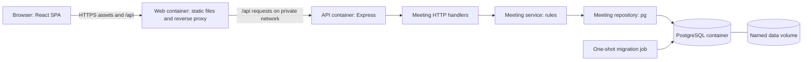
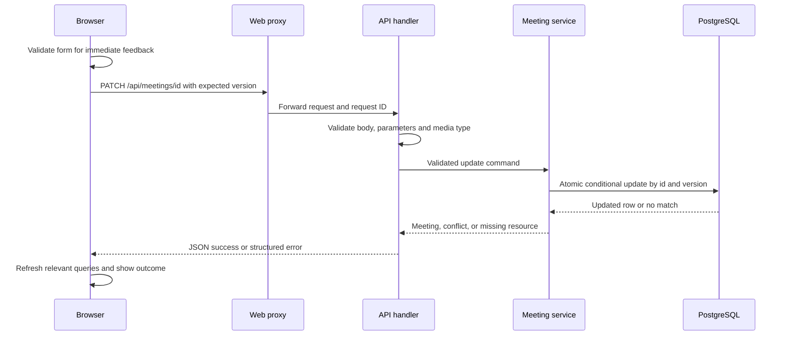
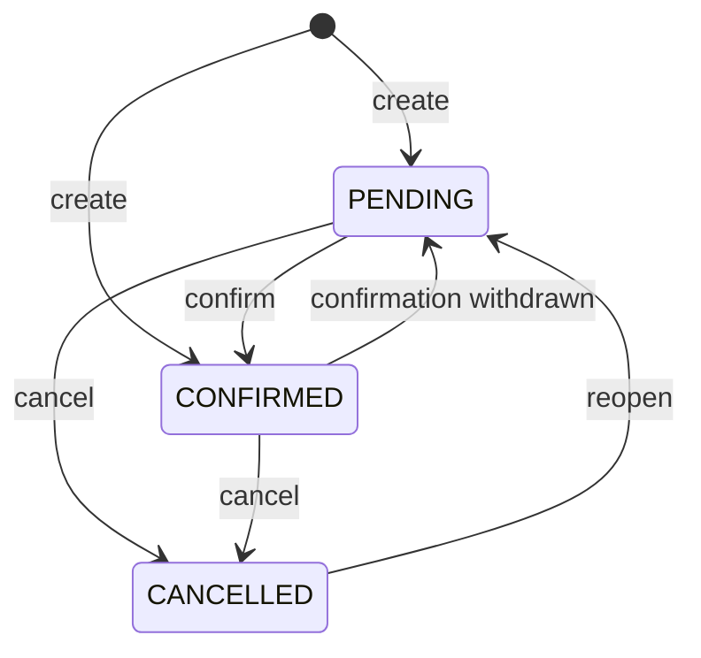
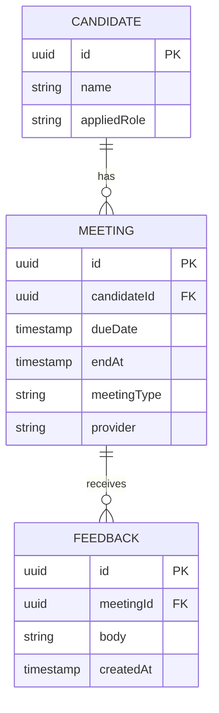

# Architecture Proposal — Meeting Manager

Author: Codex · Prepared: 12 November 2026 · Status: proposed; implementation not started

This document is newly authored for architecture review. Its requirement sources are the supplied assignment, `requirement/20251009_Software Engineer_WebApp_Interview.md`, and the user's Master Prompt. Technical references are linked where used. Other AI proposals are not used as design sources or templates, and no passages are copied or adapted from them. For provenance transparency, the opening of the previously misplaced document was inspected earlier to investigate authorship; this is not a claim that no previous proposal text was ever seen. That document is not a source for this proposal. An attempted archive of the earlier file was not present at final verification; this deliverable makes no claim about its current location.

Throughout this document:

- **Requirement** means an explicit core, technical, or deliverable instruction in the assignment.
- **Wireframe expectation** means behavior shown in the supplied app flow, whose acceptance priority is unclear.
- **Assumption** means a working interpretation requiring confirmation.
- **Recommendation** means an engineering choice, not an additional assignment requirement.

## 1. Executive Summary

Recommend **Approach B: a small modular application**, with React and TypeScript in the browser, Express and TypeScript for the REST API, and PostgreSQL for persistence. Use one repository, one backend process, and Docker Compose with separate web, API, and database services. A web container serves the frontend and forwards `/api` requests to the API, giving the browser one origin.

Deliver complete, deployed Meeting CRUD before adding features inferred from the candidate interview wireframes. Use a single `Meeting` entity for the baseline. Keep explicit fields named `title`, `description`, `dueDate`, and `status`; avoid making candidate data a prerequisite for creating an ordinary meeting.

The largest risk is **scope interpretation**, not traffic or database capacity. The core describes a generic meeting manager, while the wireframes imply candidate identity, time intervals, meeting types, feedback, and history. Those are different product scopes. The recommended baseline does not satisfy every candidate wireframe, and must not be represented as doing so. Section 4 specifies the decision, alternatives, and a costed extension if the evaluator expects all wireframe behavior.

Assuming one experienced developer, approximately 40 focused hours across seven days, familiarity with the selected tools, and an available deployment account, plan 34 hours of delivery work and six hours of contingency. A reasonable estimate range for Approach B is 34–42 hours. Full candidate workflows add approximately 10–16 hours. Authentication is optional and excluded from the baseline.

Success means reviewers can open a public deployment, perform all CRUD operations, paginate persisted records, clone the public repository, and reproduce the application with documented commands. Tests and CI are worthwhile bonus investments after those mandatory paths work. This proposal contains design contracts and examples, not application implementation.

## 2. Assignment Understanding

The assignment evaluates the ability to structure and deliver a simple full-stack web application in about a week. The explicitly permitted frontend choices are React or Vue. The backend must be Node.js with Express, or Python with FastAPI/Flask. REST CRUD, containerization of frontend/backend/database, deployment, local instructions, a public GitHub repository, and clear commit history are required.

Persistence is permissive: memory, JSON, SQLite, or another database are allowed, and the API may use a mock database. However, the separate instruction to containerize the database is more restrictive in practice. A dedicated PostgreSQL service is a conservative way to meet both instructions without arguing whether a file inside the API container counts as a database container.

The wireframes introduce a second domain: recruiting and interviews. Candidate identity, an applied role, a start/end interval, online/onsite classification, interview notes, historical evaluations, cancellation, and feedback are not defined in the core schema. Authentication is explicitly optional even though a login page appears in the flow. The remaining wireframes are not explicitly labelled optional; their status must be clarified rather than silently downgraded to bonus features.

Expected users, traffic, authorization boundaries, browser support, timezone, deployment budget, data retention, and exact status values are unspecified. Estimates and implementation rules below are recommendations under stated assumptions.

## 3. Requirements Matrix

| ID | Requirement or expectation | Source/classification | Proposed treatment and acceptance evidence |
|---|---|---|---|
| M01 | Add a meeting with title, description, due date, status | Core; mandatory | Form and POST API; record appears after reload |
| M02 | List meetings with pagination or infinite scroll | Core; mandatory | Numbered pagination; verify more than one page |
| M03 | Edit all four core fields | Core; mandatory | Prefilled form and PATCH API; reload confirms changes |
| M04 | Delete a meeting | Core; mandatory | Confirmed permanent deletion and DELETE API |
| M05 | Persist meetings using an allowed mechanism | Core; mandatory | PostgreSQL; restart services and verify data remains |
| M06 | React or Vue frontend; styling unrestricted | Technical; mandatory | React, semantic HTML, ordinary CSS |
| M07 | Express/Node or FastAPI/Flask/Python backend | Technical; mandatory | Express on Node.js |
| M08 | Simple REST API for CRUD; mock DB allowed | Technical; mandatory | Documented collection and resource endpoints |
| M09 | README and setup instructions | Technical; mandatory | Fresh-clone Docker and development instructions |
| M10 | Containerize frontend, backend, database | Technical; mandatory | Three persistent runtime services; Compose smoke test |
| M11 | Deploy the application | Technical; mandatory | Reachable deployment URL; Docker images alone are insufficient evidence |
| M12 | Public GitHub repository with clear commit history | Deliverable; mandatory | Public access checked without repository credentials; meaningful commits |
| M13 | Instructions to run locally | Deliverable; mandatory | Document prerequisites, environment, migration, startup, tests, shutdown |
| O01 | Login/logout | Bonus; optional | Defer; public demonstration uses synthetic data |
| O02 | UI design artifact, e.g. Figma or Penpot | Bonus; optional | Defer separate design file; functional UI remains necessary |
| O03 | Unit or integration tests | Bonus; optional | Recommend focused integration tests and a few unit tests |
| O04 | Testing and deployment CI/CD | Bonus; optional | Recommend CI; automate deployment only after manual deployment works |
| W01 | Login logo/title, email/password, login button | Optional login wireframe | Only if authentication is approved; no decorative fake login |
| W02 | Continue as Guest | Explicitly optional wireframe item | Unnecessary when baseline has no login |
| W03 | Upcoming Meetings/current meetups heading | Dashboard wireframe | Clarify filtering; baseline lists all meetings with neutral heading |
| W04 | Candidate name and applied role on cards | Dashboard wireframe | Candidate extension; not silently encoded into the title |
| W05 | Date plus start/end time | Dashboard wireframe | Baseline due instant; end time requires extension |
| W06 | Confirmed/Pending status labels | Dashboard wireframe | Adopt these labels as the initial status vocabulary assumption |
| W07 | View Details action | Dashboard wireframe | Include meeting details in baseline; candidate profile differs |
| W08 | Schedule a New Meeting/Book Meeting wording | Booking wireframe | Use generic Create Meeting until candidate scope agreed |
| W09 | Candidate name, autocomplete or free text | Booking wireframe | Free text sufficient if extension selected; autocomplete is not required |
| W10 | Position dropdown | Booking wireframe | Small documented list in extension; no position administration |
| W11 | Date picker and start/end pickers | Booking wireframe | Date/time input baseline; validate end only in extension |
| W12 | Onsite/Online with Zoom/Google Meet | Booking wireframe | Classification in extension; provider integration is not specified |
| W13 | Notes textarea | Booking wireframe | Map booking notes to description if confirmed |
| W14 | Candidate profile and applied role | Summary wireframe | Requires candidate identity and route; extension |
| W15 | Upcoming meeting(s) for candidate | Summary wireframe | Candidate relationship and time-based query; extension |
| W16 | Recruiter/engineer interview notes | Summary wireframe | Separate from booking description; extension |
| W17 | Previous interviews/evaluations | Summary wireframe | Real persisted meetings/feedback; no fabricated history |
| W18 | Edit Meeting | Summary wireframe | Core edit provided from meeting details |
| W19 | Cancel Meeting | Summary wireframe | Status change in extension; distinct from core deletion |
| W20 | Add Feedback | Summary wireframe | Persisted feedback in extension; not a nonfunctional button |
| A01 | Approximately one week; demonstrate structure and approach | Time expectation | Use explicit scope gates; not a promise of unlimited hours |

Potential scope creep: calendar synchronization, real video meeting creation, reminder delivery, candidate resume storage, interviewer availability, conflict detection, multi-tenant access, search, arbitrary sorting, recurring meetings, dashboards with analytics, and a full recruiting system. None is stated as mandatory. A date/time example does not establish a resource booking or overlap-prevention rule.

## 4. Ambiguities and Assumptions

### Scope decisions

| Issue | Alternatives | Recommended assumption | Impact if wrong |
|---|---|---|---|
| Generic CRUD versus candidate flows | Core only; full candidate product; staged delivery | Core first, explicitly disclose wireframe gaps and ask acceptance priority | Full wireframe acceptance requires extra entities/pages and 10–16 hours; reduce other bonuses or extend budget |
| Persistence versus containerized database | Mock/in-memory; SQLite inside API; dedicated DB container | PostgreSQL service | Adds operational setup but removes ambiguity around database containerization |
| Due date means date or instant | Calendar date; scheduled start instant; arbitrary deadline | `dueDate` is a scheduled instant including offset in the API | Date-only expectations require SQL `date` and a different UI/API contract; decide before migrations |
| Required fields versus optional values | All fields nonempty; optional description/status defaults | Title and dueDate required; description field always present but may be empty; status required on create | Small form/validation change; document rather than infer mandatory description length |
| Status vocabulary | Free text; task states; interview states | `PENDING`, `CONFIRMED`, `CANCELLED`; creation initially permits first two | Enum vocabulary and transition tests change if task lifecycle intended |
| Delete versus cancel | Both delete; both soft-delete; separate operations | DELETE removes record; cancel changes status and retains it | Retention/audit requirements would change deletion model |
| Upcoming dashboard versus general list | Only upcoming records; all records; separate view/filter | Baseline lists all; add explicit Upcoming filter if candidate scope approved | Hiding past records would obscure core listing and make editing old records difficult |
| Notes and feedback | One editable description; separate interview notes and feedback history | Description stores booking notes; feedback is distinct extension data | Combining them destroys provenance/history; separation adds table/endpoints |
| Candidate identity | Match by name; meeting snapshot; stable candidate ID | No candidate in baseline; stable ID in full extension | Names are not unique; a single text field cannot reliably support candidate history |
| Meeting type/provider | Label only; required URL; create external video session | Classification only when extension selected | Provider API integration changes credentials, testing, and scope substantially |
| Authentication and ownership | Open shared demo; single account; per-user records | Shared synthetic-data demo, no login | Real candidate data or private ownership requires auth and server authorization before release |
| Timezone and past meetings | One locale; browser-local; selectable timezone; future-only | Browser-local input/display, explicit zone label, UTC transport/storage; past instants allowed | Fixed business zone or DST scheduling requires revised conversion rules and potentially timezone storage |
| Expected scale | Dozens; thousands; millions | Small evaluator dataset, one API replica | Offset pagination and single-host deployment need reconsideration at larger scale |

### Two reviewable delivery profiles

**Baseline, recommended within the stated time budget:** generic Meeting CRUD, details page, pagination, persistence, containers, public deployment, README, targeted tests and CI. Dashboard candidate cards, complete booking intervals/types, candidate summaries, feedback, and interview history remain explicitly unimplemented wireframe expectations. The submission README must list these gaps. This is a prioritization proposal, not an assertion that the evaluator has waived them.

**Candidate profile, if wireframes are acceptance criteria:** keep baseline contracts; add candidate identity, optional end time/type metadata, real candidate summary, persisted feedback, and an Upcoming view. Estimate an additional 10–16 focused hours including tests. Remove separate design artifacts and deployment automation first; do not sacrifice core CRUD, persistence, containerization, deployment, or setup documentation. If still limited to 40 hours, agree a smaller wireframe subset with the evaluator rather than claiming complete coverage.

No clarification is required to review this architecture document. Product scope must be resolved before committing to the implementation estimate. If no response is available during the assignment, document the core-first interpretation and its limitations in the README.

## 5. Proposed Solution Approaches

All three approaches below use the same generic Meeting baseline so that effort and architecture comparisons are meaningful. All include frontend, API, and PostgreSQL containers, actual deployment, pagination, and README. None relies on a mock database to bypass the database deployment instruction.

### Approach A — Minimal MVP

React with Vite and JavaScript, ordinary CSS, component state and native fetch. Express routes perform validation and call `pg` directly. One SQL migration creates the table. Separate web/API/DB containers; manual deployment. No custom repository abstraction, shared contracts package, or automated release process. Basic manual verification is mandatory even though automated tests are a bonus.

Estimated effort: **24–32 hours** including setup, deployment and some buffer, assuming tool familiarity. Advantage: few dependencies and a short route from requirement to working feature. Disadvantage: browser/API field conventions and mutation error handling are easier to duplicate; route handlers tend to mix HTTP and persistence details. Testability is adequate if the Express app can be imported without starting a server, but weak boundaries make later domain changes harder. Performance is sufficient for a small dataset. Security still needs validation, parameterized SQL, HTTPS and safe configuration; minimal architecture does not justify removing these.

Choose A if available focused time is closer to three or four days, or deployment is unfamiliar. Its main risk is rushed coupling rather than raw capacity. It can evolve into B without rewriting the database.

### Approach B — Balanced Production-Minded

React, TypeScript, Vite, a small router, TanStack Query, Zod, Express, and PostgreSQL accessed through `pg`. One feature module separates HTTP handling, domain rules and persistence. Share only browser-safe API contracts, not database models or service implementations. Use a migration tool, integration tests against PostgreSQL, a small browser smoke test, and CI checks. Deployment remains a single host running Compose.

Estimated effort: **34–42 hours**, with a 40-hour working plan below. Advantage: API and form contracts remain explicit; the main edge cases are testable without infrastructure abstraction. Disadvantage: TypeScript/build configuration and a shared package add setup work, and SQL result mapping still needs care. Security and performance are improved through specific controls, not through the folder structure itself. Scalability is sufficient for the assignment; the API can later be replicated if the hosting/database topology is changed.

Choose B for this assignment, provided the scope gate is respected. Its main risk is spending the week refining abstractions or optional UX before a deployment exists.

### Approach C — Extensible Architecture

Remain a modular monolith on Express, using React and PostgreSQL. Define explicit domain modules and application commands for Meetings, future Candidates, and future Feedback; use narrowly scoped repository interfaces where replacing infrastructure or testing domain rules warrants them. Consider Prisma or another typed mapper when the relational model grows. Add a documented OpenAPI contract, broader integration/browser suites, structured operational telemetry, a separate staging environment, and a managed database deployment option.

Estimated effort: **52–72 hours** for the same baseline with these engineering capabilities, excluding complete candidate workflows or authentication. Advantage: clearer ownership boundaries for a future team and more explicit contracts. Disadvantage: ports, adapters, generated artifacts and environment management are disproportionate for one CRUD entity. Testability is strong but mocks can hide database behavior if overused. It does not intrinsically outperform A or B; more generated queries or layers can make diagnosis harder. Security benefits depend on implemented controls, and managed services add configuration and cost.

Choose C only with a longer delivery window or known near-term product expansion. Microservices, event brokers, CQRS and Kubernetes are unnecessary even for C. They would increase delivery and operational risk without an identified requirement.

## 6. Architecture Comparison Matrix

Estimates include a small deployment and reviewer-ready documentation. They are judgment ranges, not benchmark measurements or fixed bids. An unfamiliar hosting platform can add 4–8 hours to any approach; candidate scope adds 10–16 hours separately.

| Dimension | A — Minimal MVP | B — Balanced | C — Extensible |
|---|---|---|---|
| Development complexity | Low; direct handlers | Moderate; three feature boundaries | High; domain interfaces and more tooling |
| Estimated focused effort | 24–32 h | 34–42 h | 52–72 h |
| One-week fit at 40 h | Comfortable for core | Feasible with scope discipline | Poor |
| Maintainability | Good initially; mixed concerns later | Good for current scope and modest changes | Strong for multiple modules, expensive initially |
| Testability | API possible; domain harder to isolate | Domain units plus real-DB API tests | Strong boundaries; more fixtures and contracts |
| Deployment complexity | Compose and manual release | Same runtime; CI and migrations formalized | Staging, managed DB option and more release controls |
| Performance | Adequate; capped list | Adequate; same DB/query shape | Similar workload performance; no automatic gain |
| Security | Essential controls still required | Same essentials, better automated verification | More opportunities for controls and more configuration surface |
| Scalability | One API/host initially | One API/host; process can later replicate | Better organizational modularity; infrastructure still needs scaling work |
| Main advantage | Fastest route to compliance | Best balance of clarity and delivery | Supports larger future product/team |
| Main disadvantage | Contract drift and coupled handlers | Setup overhead can consume buffer | Solves speculative problems |
| Main risk | Missed failure handling | Bonus features expand scope | Incomplete submission despite sophisticated design |

## 7. Recommended Technology Stack

Selections are recommendations. Tool familiarity may justify substituting allowed alternatives; none of these exact packages is mandated by the assignment. Resolve mutually compatible stable releases during setup, pin the lockfile and runtime/image versions, and record them in the README. Do not select prereleases merely because a documentation site defaults to one.

| Area | Selection and why | Alternatives considered |
|---|---|---|
| Frontend | React with Vite; small browser-rendered app with a separate required API | Vue is equally valid; prefer it if materially more familiar. No SEO or server rendering need justifies Next.js/Nuxt complexity here |
| Language | TypeScript, strict checks in browser and API; useful for contracts and null/error cases | JavaScript reduces setup, appropriate in A; TS does not replace runtime validation |
| UI | Semantic native controls, ordinary CSS, reusable button/input/error components | MUI offers faster consistent widgets if already familiar; broad component suites/design systems add styling constraints and setup for a few screens |
| Routing | React Router for list/new/details/edit URLs | Handwritten path state makes deep links and refresh behavior harder to maintain |
| Server state | TanStack Query for list/detail loading, failures and mutation invalidation | Native fetch is sufficient for A; Redux is unnecessary for this small shared state surface |
| Local state | React component state for forms/dialogs; URL for page number | No global client store; meeting records are server data |
| Forms | Native controls plus Zod validation, shared browser-safe request schemas | React Hook Form is reasonable for candidate expansion; unnecessary for four baseline inputs |
| Backend | Express on supported Node.js LTS; same language across stack, explicitly allowed | FastAPI provides strong schema/docs integration and is preferred if Python expertise is higher; Flask adds manual schema plumbing without a benefit here |
| Database | PostgreSQL; separate container, real persistence, transactional constraints | SQLite is simpler but separate DB-container interpretation is unclear; JSON/in-memory weakens deployment persistence evidence |
| Queries | `pg`, parameterized SQL in one meeting repository | Prisma offers generated types and migrations but adds generator/runtime conventions; Knex/Drizzle add less value for one table. Reconsider a typed mapper when relations grow |
| Migrations | Stable `node-pg-migrate` release, versioned reviewed migrations | A hand-rolled migration ledger creates avoidable correctness work; ORM adoption solely for migrations is unnecessary |
| API documentation | Small checked-in OpenAPI document and README examples | Swagger UI is optional; generated clients add build coordination for a single browser client |
| Containers | Docker multi-stage web/API builds and Docker Compose | No orchestration cluster or custom database image needed |
| Hosting | One small Linux host with Compose; HTTPS at the web reverse proxy | Managed container hosting with managed Postgres reduces DB operations, but is an alternative interpretation if a deployed DB container is required |
| Testing | Vitest for meaningful units, Supertest for API integration against PostgreSQL, Playwright for one browser CRUD smoke flow | Jest is valid if familiar; SQLite/mocked DB tests do not prove PostgreSQL constraints |
| CI/CD | GitHub Actions checks; initially manual deployment of a verified revision | Automated release is a bonus and adds credentials/recovery responsibilities |

React's official guidance generally favors frameworks; this assignment's explicitly separate REST backend and lack of SSR requirements are the rationale for the lighter Vite client choice, not a claim that Vite is the universal default. See [React application setup guidance](https://react.dev/learn/creating-a-react-app).

TanStack Query's targeted invalidation supports refreshing affected list/detail queries after writes; configure retry behavior deliberately rather than accepting defaults for every operation. See [query invalidation](https://tanstack.com/query/latest/docs/framework/react/guides/query-invalidation). Keep SQL values parameterized as described in [node-postgres queries](https://node-postgres.com/features/queries). Use the installed stable migration tool's documented behavior rather than depending on unverified features from prerelease documentation: [node-pg-migrate](https://salsita.github.io/node-pg-migrate/).

## 8. System Architecture

### Components and deployment boundaries



The migration job uses the API image with a separate command; it is not another permanent application service. The browser never connects to the database or to an internal Compose hostname. Its base API URL is relative, `/api`. Production and development use a proxy to avoid separate browser origins.

### Request lifecycle



Validation at the browser improves usability. Server validation is authoritative. The database enforces the persisted invariants as a final boundary. A normal update is one atomic SQL statement; no separate read-then-write sequence should allow an unnoticed lost update.

The API remains stateless with respect to requests, except for an explicitly optional duplicate-creation mechanism. All durable meetings live in PostgreSQL. There is no message queue, cache server, background scheduler, server rendering, or service-to-service event bus.

Deployment topology is a single host, so this design has a host-level failure domain. Replicating the API alone would not make the database or host highly available. That limitation is acceptable for a synthetic-data take-home demonstration and must be stated in the README.

## 9. Data Model

### Baseline entity

| API field | Persistence | Constraints and semantics |
|---|---|---|
| `id` | UUID primary key | Generated by backend; immutable; never trust a client-supplied replacement |
| `title` | `varchar(150)` | Trimmed, 1–150 characters; whitespace-only rejected |
| `description` | `text` | Not null; empty string allowed; maximum 5,000 characters |
| `dueDate` | `timestamptz`, mapped from `due_date` | Required scheduled instant; valid RFC 3339 request timestamp with `Z` or numeric offset |
| `status` | `varchar` with CHECK | One of `PENDING`, `CONFIRMED`, `CANCELLED` |
| `version` | integer | Starts at 1; positive; incremented on each update; optimistic concurrency token |
| `createdAt` | `timestamptz` | Server/database-generated UTC instant; immutable |
| `updatedAt` | `timestamptz` | Updated on writes; not used as the concurrency token |

Use database checks for title/description limits, status vocabulary and positive version, in addition to API checks. Database identifiers and naming conventions stay internal; responses use the exact camelCase contract above. Plain database rows are not returned directly.

**Index recommendation:** primary-key index plus a B-tree on `(due_date, id)` for the default deterministic ordering. Do not index every field. No status-only index or full-text index is justified by this baseline. If an Upcoming query becomes frequent, measure the actual filter/order query before adding a composite status/time index.

No title uniqueness constraint: two meetings can legitimately share a title, description and due instant. A uniqueness rule is a product decision, not a duplicate-submit fix.

### Status lifecycle



These are proposed rules. A cancelled meeting cannot jump directly to confirmed; reopen to pending first. Editing title/description/dueDate without changing status is allowed in every state. Creation as cancelled is rejected. There is no automatic status change when dueDate passes: time passing does not prove a meeting occurred. Hard deletion is allowed from every state and is separate from this lifecycle. A `COMPLETED` state is not needed merely to display historical dates; add it only if interview outcome tracking is agreed.

### Date/time contract

Assumption: `dueDate` represents an instant rather than a date-only deadline. Accept timestamps such as `2026-11-20T10:00:00+07:00`; return canonical UTC, `2026-11-20T03:00:00.000Z`. Reject date-only strings, missing offsets, invalid calendar dates and out-of-range values. Restrict the supported product range to years 2000–2100, an engineering limit to verify with the evaluator. Past meetings are valid and editable.

The form displays the browser's IANA timezone next to the input. Convert local input to an instant; do not append `Z` to a local clock string. Display using `Intl.DateTimeFormat` in the viewer's zone. Preserve the instant on edits when the date field is unchanged. Validate local-to-instant round trips to reject nonexistent DST clock times. If a local clock time repeats during a DST transition, require an explicit earlier/later offset choice rather than silently choosing one; a small timezone conversion helper and tested date-time library may be justified if that environment is in scope. This is a conversion concern, not grounds for building calendar infrastructure.

PostgreSQL stores `timestamptz` as an instant and does not preserve the originally supplied timezone name. The baseline needs the instant only. A future requirement to retain an event's business timezone should add an explicit IANA timezone field. See [PostgreSQL date/time types](https://www.postgresql.org/docs/current/datatype-datetime.html).

### Candidate extension — conditional, not baseline tables



If approved, add `Candidate(id, name, appliedRole)` with name 1–120 characters and role 1–100. Duplicate names are allowed. One candidate is assumed to represent one application/role; multiple applications per person would need a separate Application entity and are outside this extension estimate. Add nullable `candidateId`, `endAt`, `meetingType` (`ONSITE`/`ONLINE`) and provider (`ZOOM`/`GOOGLE_MEET`/`OTHER`) to Meeting without breaking generic records. Provider must be null for onsite meetings; online provider classification does not create a video URL. Candidate bookings require `endAt > dueDate`; generic meetings may omit endAt. Reject cross-field inconsistencies on both create and partial update using the resulting combined record.

Create `Feedback(id, meetingId, body, createdAt)` with body 1–5,000 characters. For the small extension, the interview notes textarea submits timestamped feedback entries rather than a separate mutable notes system. Confirm that interpretation; private recruiter notes with authorship/access rules require additional design. Index meetings by `(candidate_id, due_date, id)` and feedback by `(meeting_id, created_at, id)`. History is persisted past meetings and their feedback; do not manufacture evaluations. Candidate identifiers, not names, drive history queries.

To create a candidate and first booking in one action, use one transaction; do not leave orphan candidate rows after a failed meeting write. Deleting a meeting deletes its feedback through an explicit cascade after confirmation. Candidate deletion is not exposed; do not accidentally cascade-delete all interviews. Cancelling preserves feedback and history. No soft-delete retention or compliance guarantee is claimed.

### Migrations and data ownership

Commit migration files alongside model changes. Apply migrations to empty databases and existing test databases in CI. Never edit a migration already used by a shared deployment; add a new migration. The release job applies pending migrations once before the new API starts accepting traffic. Use the migration tool's history/locking facilities, verified for the pinned version, rather than having each API replica independently create schema at boot.

Seed synthetic examples only through an explicit development/demo command, not on every startup. A seed must not overwrite evaluator-created records. Use additive migrations for candidate expansion. Keep older API images compatible while possible; destructive migrations require backup and a separate reviewed change. Schema rollback is not automatically data recovery.

## 10. API Design

### Resource surface

Use JSON over HTTP under `/api`; omit a version segment for a single first-party client and one deployed application. A breaking public-client contract would justify `/api/v1` later. The baseline OpenAPI document records the current contract; adding a URL version is not a substitute for compatibility planning.

| Method and path | Request | Successful response | Important errors |
|---|---|---|---|
| `GET /api/meetings?page=1&pageSize=10` | Validated query parameters | `200`, items plus pagination metadata | `400`, `503` |
| `GET /api/meetings/{id}` | UUID path | `200`, meeting | `400`, `404`, `503` |
| `POST /api/meetings` | All four editable fields | `201`, meeting, `Location` header | `400`, `413`, `415`, `422`, `503` |
| `PATCH /api/meetings/{id}` | At least one editable field plus `version` | `200`, updated meeting | `400`, `404`, `409`, `422`, `503` |
| `DELETE /api/meetings/{id}?version=2` | UUID and positive expected version | `204`, empty body | `400`, `404`, `409`, `503` |
| `GET /health/live` | None | `200`, process alive | Process unreachable on failure |
| `GET /health/ready` | None | `200`, database reachable/schema ready | `503` |

The conditional DELETE query parameter avoids relying on DELETE request bodies. A future public API could use ETags/If-Match and `412` instead; do not implement two competing concurrency contracts in this assignment.

### Request and response schemas

Create request example, illustrating a contract rather than production code:

```json
{
  "title": "Architecture review",
  "description": "Review the meeting manager proposal.",
  "dueDate": "2026-11-20T10:00:00+07:00",
  "status": "PENDING"
}
```

Resource response example:

```json
{
  "id": "566679ee-b43e-457b-b089-14e1145ece24",
  "title": "Architecture review",
  "description": "Review the meeting manager proposal.",
  "dueDate": "2026-11-20T03:00:00.000Z",
  "status": "PENDING",
  "version": 1,
  "createdAt": "2026-11-12T08:00:00.000Z",
  "updatedAt": "2026-11-12T08:00:00.000Z"
}
```

PATCH accepts only `title`, `description`, `dueDate`, `status`, and expected `version`. Omitted fields retain values. Empty description clears it; null is invalid. All examples use JSON objects as the top-level body. Reject unknown keys, including `id`, timestamps and database ownership fields; reject an empty patch. Never pass the request body directly into SQL updates. Title normalization occurs before length/nonempty validation. Description is plain text, with no HTML rendering.

Malformed JSON, invalid UUID, or invalid pagination syntax returns `400`. A syntactically valid body with invalid field values or disallowed transitions returns `422`. Missing entity returns `404`. An existing entity whose expected version is stale returns `409`. Wrong content type returns `415`, an over-limit body `413`, throttled traffic `429`, temporary database failure `503`, and unexpected failures `500` with no stack trace. These are chosen conventions and must match tests/OpenAPI.

Error envelope example:

```json
{
  "error": {
    "code": "VALIDATION_ERROR",
    "message": "Please correct the highlighted fields.",
    "fields": [
      { "path": "dueDate", "message": "Include a valid date, time and offset." }
    ],
    "requestId": "request-identifier"
  }
}
```

Use stable error codes; human messages may change. Non-field errors omit `fields`. The client maps known fields to controls and displays unknown/global errors in a form summary. Send JSON 404/405 responses for unknown API paths or unsupported methods; never serve the SPA HTML for an API error.

### Pagination

Use offset pagination with `page` default 1 and `pageSize` default 10, minimum 1, maximum 50. Require base-10 positive integers; reject negative/fractional/non-numeric values and arrays/repeated ambiguous parameters. Cap page at 10,000 to avoid unbounded offsets for this small application. Return `items` plus `pagination: { page, pageSize, totalItems, totalPages }`; totalPages is zero for an empty collection. A page above the last page returns `200` and an empty items array with accurate metadata, not `404`.

Sort by `due_date ASC, id ASC`; the ID breaks equal-time ties. Obtain count and page within a short read-only repeatable-read transaction so metadata and items represent one database snapshot. This does not make page navigation a snapshot across multiple browser requests; concurrent inserts/deletes can shift records between pages. Accept that limitation at the assumed scale. Cursor pagination is preferable for large or rapidly changing feeds, but complicates reviewer navigation and exact page counts.

After deleting the last item on a page, refetch and move to the new last valid page if necessary. Do not silently change the server's interpretation of a requested page. Include page in the URL for reload/back navigation. Arbitrary searching, sorting and filtering are excluded initially; if added, validate/allowlist fields and include filters in counts and cache keys.

### Concurrency and retry semantics

Update and delete use a database condition on `id` and expected `version`, with update incrementing version in the same statement. If no row matches, distinguish currently missing (`404`) from currently present but changed (`409`). A simultaneous later deletion can change that diagnostic outcome; either result must prompt reload rather than overwriting data. Test with two clients and the same initial version.

The browser disables submit while pending and does not automatically retry writes. A response lost after a successful POST leaves an uncertain outcome; show a clear message and refetch the list before allowing a conscious retry. This prevents common accidental duplicates, but **does not guarantee exactly-once creation**. An idempotency-key table/unique key and replayed result is an optional enhancement if time permits; do not claim title uniqueness solves it. GET can have one bounded retry for temporary transport/5xx errors, never for validation or not-found responses.

A second DELETE of an already deleted record returns `404`; the desired absence still holds. The UI treats this as already removed, refreshes the list, and does not falsely report a second deletion.

### Conditional candidate endpoints

If the candidate profile is approved, add `GET /api/candidates/{id}`, paginated `GET /api/candidates/{id}/meetings`, and `GET`/`POST /api/meetings/{id}/feedback` with the same envelope/error conventions. Return feedback in chronological order with capped pagination. Candidate creation plus its first booking uses a documented booking request extension and atomic transaction. Existing candidate selection uses stable IDs; choosing a new candidate creates an explicit new identity, never merges by name. A paginated candidate selector can replace autocomplete initially because free text is allowed.

Add explicit `view=upcoming` for meeting queries, filtering `dueDate >= serverNow` and status in pending/confirmed; use the same captured server instant for count and page. Candidate history contains past or cancelled meetings and their real feedback. Keep the full meeting list accessible. Finalize these extension schemas in OpenAPI before implementing them; they are not hidden baseline requirements.

## 11. Frontend Design

### Pages, routing and components

| Route | Purpose | Important behavior |
|---|---|---|
| `/meetings?page=1` | Paginated meeting list | Create action, status/date labels, details link, empty/loading/error states |
| `/meetings/new` | Create | Four explicit core fields; local validation and preserved values on failure |
| `/meetings/:id` | Details | Full description, localized timestamp, status, edit/delete actions |
| `/meetings/:id/edit` | Edit | Prefilled record, expected version captured at load, conflict recovery |
| Unknown client route | Not-found page | Link back to meetings; no blank screen |

Redirect `/` to `/meetings`. New/edit share a MeetingForm. A simple AppShell contains a page title and navigation; MeetingList contains MeetingCard, Pagination and AsyncState; details contains DeleteDialog. DateInput and FieldError can be reused where they reduce actual duplication. Do not create a general design-system package.

Candidate profile, if approved, adds `/candidates/:id` and enriches the meeting form/cards. A meeting details page is not a substitute for candidate history; the UI and README must describe that distinction. Do not display inactive Add Feedback or Cancel controls as if functional.

### Fetching and interaction rules

Use a small fetch wrapper to check HTTP status, decode the envelope, enforce a reasonable request deadline and pass abort signals. Query keys include page/pageSize and, if introduced, filters. Detail keys include ID. Successful mutations refresh list data and affected detail/candidate queries. On delete remove or invalidate the deleted detail. Prefer server-confirmed updates over optimistic updates, since rollback behavior adds little value for a small assignment.

Only initial loads replace content with a loading state. Background refresh may keep the current list visible with a subtle indicator. Distinguish no meetings, an empty out-of-range page, a transport failure, and a missing detail record. Keep form input after failure. A failed refetch must not erase unsaved form edits or silently replace the version token.

Conflict UI explains that the record changed, offers loading the current server version, and preserves a visible copy of the user's edits until the user chooses how to proceed. Do not resubmit automatically with a newer version. If another client deleted the record, offer return to the list. A lost POST response is described as uncertain, not definitely failed.

### UX and accessibility

Use visible labels, native controls where possible, logical heading order, focus-visible styles, keyboard-operable buttons and sufficient contrast. Associate errors with fields using descriptions; focus the first invalid input after submission and announce status changes through a polite live region. Do not communicate status using color alone.

Delete confirmation names the meeting, explains permanent removal, defaults focus to the safe action, traps focus while open and restores focus on close. Distinguish Cancel editing from cancelling a meeting. Controls show pending state and prevent repeated submission. Dates include the displayed timezone; meeting description is rendered as escaped text. Layout should remain usable on a narrow mobile viewport and at 200% zoom. No drag/drop, rich-text editor or custom calendar is needed.

## 12. Backend Design

Proposed organization, not files implemented by this planning task:

```text
apps/
  web/                       React application
    src/features/meetings/   pages, form, queries, components
    src/lib/                 HTTP wrapper and date presentation
  api/
    src/app                  Express construction without listen side effect
    src/server               startup, configuration, graceful shutdown
    src/features/meetings/   routes, handler, service, repository, mapping
    src/middleware/          errors, request ID, body limits
    src/db/                  connection pool and migration configuration
    migrations/              versioned schema changes
packages/
  contracts/                 browser-safe request/response schemas and types
docs/
  openapi.yaml               API contract
compose.yaml                 proposed runtime services and migration job
README.md                    proposed reviewer entry point
```

Use npm workspaces and one lockfile. Keep shared contracts buildable before consumers; API container builds must include workspace dependencies. Compile shared packages to an explicitly chosen compatible module format, with package exports and a documented build order. Do not add a task orchestrator or publish packages to a registry. Validate workspace imports early; these configuration details can otherwise consume the final day.

**Routes and handlers** translate HTTP parameters into validated inputs, call services, and select response statuses. They do not implement SQL or business rules. **Services** own status transitions, edit semantics and conflict interpretation. **Repositories** own SQL, row mapping, version-conditional writes and transaction handling. Use plain functions with explicit dependencies; no dependency injection container, base repository, generic CRUD framework or interface for every file.

The contracts package describes editable fields, strict request schemas and response types. Domain transition rules remain server-side; the UI may show allowed actions but cannot authorize them. The database schema is not imported into the browser. Direct response serialization from ORM/database internals is avoided.

Build an Express app that tests can instantiate with a real test database pool without opening a network port. The server entry point loads/validates configuration, configures the pool, starts listening and handles termination. Route async errors reach one central handler. Classify known validation/missing/conflict/dependency errors; log unexpected failures once with a request ID, return a generic `500`, and avoid converting every exception into `400`.

Validate environment variables on startup: database URL, port, environment, and optional allowed origins. Fail startup for missing required values; do not fall back to a developer database in production. Set a small database pool appropriate to one API replica, bounded acquisition/query timeouts and short transactions. Use one checked-out client for every transaction and release it on both success and failure. Retrying a failed write transaction is not automatically safe.

On SIGTERM stop accepting new requests, allow in-flight requests a bounded grace period, close the pool and exit. Log method, path template, status, duration and request ID; omit request bodies, notes, database credentials and full query strings where they may expose data. A lightweight JSON logger is sufficient; a tracing platform is not required.

## 13. Security Considerations

Authentication is optional in the assignment. The baseline intentionally provides shared anonymous CRUD for synthetic demonstration records. That means anyone who can reach the API can read/change/delete the shared data. It is acceptable only under that documented demo assumption; it is not a private interview management system. Use a visible synthetic-data notice and do not upload real candidate details or evaluations.

If real data or record ownership is required, change the release criteria: implement authentication and server-side authorization, associate records with an owner/organization, scope every query and test cross-user access. Adding a login form alone would not solve data exposure. Prefer a well-supported authentication integration over inventing password/session security within a bonus time budget. A browser-bundled static API secret provides no access control and is not proposed.

| Concern | Baseline safeguard | Remaining boundary |
|---|---|---|
| Input validation | Strict schemas, unknown-key rejection, bounded strings and 32 KiB JSON body limit | Browser validation is bypassable; API owns enforcement |
| SQL injection | Parameterized values, fixed columns/order, allowlisted future sort keys | Never concatenate request values into SQL identifiers |
| Cross-site scripting | Escape text via normal React rendering; no HTML descriptions | Rich text would need a sanitization policy and is excluded |
| CORS | Same-origin proxy; no permissive production CORS middleware | CORS is a browser policy, not authentication; direct callers remain possible |
| Development origins | Prefer Vite proxy; if separate origins are needed, exact allowlist | Do not combine wildcard origins with credentialed access |
| Transport | HTTPS in public deployment; no external database port | Private networking does not replace TLS for remote managed DB connections |
| Secrets | Runtime environment on host/CI; example env contains placeholders | Never commit real `.env`, log DB URLs or bake secrets into frontend/image layers |
| Abuse/resource use | Body and pagination limits; bounded DB pool/timeouts; modest write rate limiting | Shared anonymous data can still be deliberately changed; no anti-abuse guarantee |
| Headers | Security headers, disable framework disclosure, test a practical content security policy | CSP must allow built assets and intended API access without broad unsafe exceptions |
| Database privilege | Separate migration/runtime credentials where practical; runtime cannot create/drop schema | If using one demo role initially, record the debt and restrict network access |
| Dependency risk | Locked installs, supported releases, audit/scan triage in CI | A scanner warning is assessed for reachable risk; do not blindly accept breaking fixes |
| Privacy | Synthetic seed data, minimal logs, explicit hard-delete behavior | No compliance, retention, audit trail or recoverability claim |

Vite exposes designated frontend environment values in client bundles; treat them as public configuration. See [Vite environment variables](https://vite.dev/guide/env-and-mode). HTTPS, input handling and dependency hygiene are consistent with [Express production security guidance](https://expressjs.com/en/advanced/best-practice-security/).

CSRF becomes a separate concern if cookie-authenticated sessions are introduced; same-site cookie policy and CSRF defenses must then be designed and tested. In the anonymous baseline there is no privileged user session to exploit, but that does not make the API protected against unwanted writes. If rate limiting is per process, document that it does not remain globally accurate across multiple replicas.

## 14. Testing Strategy

Automated tests are an assignment bonus. They are recommended because the highest-risk behavior can be verified cheaply, not to achieve an arbitrary coverage number. Manual verification of mandatory features remains necessary. Prioritize tests that reveal incorrect outcomes; do not test component internals or duplicate library behavior.

### Unit tests

Test valid/invalid status transitions, title normalization, timestamp acceptance/rejection and pagination boundary parsing. Include equivalent instants expressed with different offsets, invalid dates, missing offsets and daylight-saving conversion cases if that local zone is supported. Avoid a unit test for every trivial handler/repository forwarding function.

### Integration tests — highest priority

Use Supertest with the real Express app and a disposable PostgreSQL database migrated using production migration files. Never point integration tests at the developer/demo database; validate a dedicated test URL and database name. Isolate tests using one database/schema per worker or run the small suite serially with deterministic cleanup. Do not wrap the test in an unrelated transaction that application connections cannot see.

| Scenario | Evidence expected |
|---|---|
| Create/read/update/delete happy path | Correct codes, Location, persisted fields, UTC serialization and empty `204` body |
| Invalid inputs | Blank/too-long title, over-limit description, invalid/missing fields, invalid date/status and unknown keys rejected |
| Patch semantics | Omitted values preserved, empty description clears, null/empty patch rejected |
| Status lifecycle | Invalid transition rejected; allowed transition persisted |
| Missing and malformed IDs | `404` for absent valid UUID; `400` for malformed UUID |
| Pagination | Empty database, tied due dates, page size cap, exact page boundary and beyond-last page behave as documented |
| Concurrent write | Two updates with same original version: exactly one succeeds, other returns conflict without overwrite |
| Delete races | Stale version cannot delete changed meeting; already deleted returns `404` |
| Database constraints | Representative direct invalid insert rejected; migration applied on empty database |
| Database outage | API returns sanitized `503`, readiness fails, request does not hang indefinitely |
| Error hygiene | Unknown API route remains JSON; malformed JSON, wrong content type/body limit return correct envelope |

For conditional candidate scope, add transaction rollback on failed booking, end-before-start rejection on create and partial edits, same-name distinct candidates, correct candidate history, persisted feedback, and cascade behavior. Do not include these as claims about the baseline suite.

### Browser testing

One Playwright smoke flow is enough initially: open the app, create a meeting, find it in the list, edit it, open details, delete it and observe removal. Seed enough records for a separate pagination assertion. Verify that a deep-link refresh loads the correct page instead of a proxy 404. Run Chromium only in baseline CI; broader browsers are optional.

Manual checks cover keyboard navigation, field-error focus, mobile layout, zoom, timezone labeling, network failures, uncertain POST results, two-tab conflicts, empty lists, cancelled records, and last-item deletion. Browser failure traces/screenshots aid diagnosis; a large visual snapshot suite is not needed for a small CRUD UI.

### Release acceptance checklist

- Fresh clone builds from the lockfile; environment example has every required setting and no secrets.
- Compose brings up all required services; migrations run once and a second startup succeeds.
- Create multiple pages of data; edit every core field; delete a record; refresh and verify results.
- Restart the stack without deleting volumes and verify persisted data; document the destructive volume-reset command separately.
- Check the public HTTPS URL, deep links, API JSON responses, and readiness behavior.
- Run the small automated suite; confirm it uses the dedicated test DB.
- Verify public GitHub access and meaningful commit history; README links the deployment and states scope/known limitations.
- Confirm the agreed interpretation of wireframes; do not mark omitted wireframe flows as implemented.

Definition of Done does not require every bonus, but mandatory deliverables cannot be replaced by test coverage, screenshots or architecture prose.

## 15. Docker and Deployment Strategy

### Images and Compose

**Web Dockerfile, proposed:** multi-stage build using pinned supported Node tooling, `npm ci`, shared-contract build and Vite production build. Final image runs a small static server/reverse proxy, preferably Caddy if it also terminates HTTPS on the host. Configure static asset caching, SPA fallback for browser routes, and `/api` routing before the fallback. Preserve the `/api` prefix expected by Express. Do not proxy unknown APIs into the index page. Local Compose can use HTTP on localhost; the public environment must use HTTPS.

**API Dockerfile, proposed:** multi-stage workspace install/build; runtime contains compiled API/contracts and production dependencies, runs as non-root and listens on a nonprivileged port. Explicitly include the pinned migration runner and migration files in the release/migration image, even if the tool is a development dependency during authoring. Do not discover on deployment day that production dependency pruning removed the runner. Ignore `.git`, local `node_modules`, `.env`, test artifacts and secrets in the Docker build context.

**Database:** official PostgreSQL image pinned to a supported major and a deliberately selected image tag/digest. Mount a named volume at the correct data path for that pinned image; verify the path against that version instead of assuming all major versions use identical image conventions. No custom PostgreSQL Dockerfile is needed. Do not publish its port in the public configuration. An optional localhost-only port mapping can aid native development.

Compose has three long-running services: `web`, `api`, `db`. A one-shot `migrate` job uses the API/release image. `db` has a database health check, `migrate` waits for the healthy DB, and `api` starts after successful migration completion. The web proxy can start independently and show unavailable errors until API readiness; the release smoke check must wait for the whole stack. Compose supports readiness conditions, but a simple dependency declaration alone is not sufficient to guarantee database readiness. See [Docker startup order](https://docs.docker.com/compose/how-tos/startup-order/).

Set restart policies for long-running services, not endless retries for a failing migration. Database health checks establish process availability; an API readiness query must also detect missing required schema. A Docker health status alone does not guarantee automatic traffic removal on a single-host Compose deployment; release checks and proxy behavior still matter.

### Configuration contract

| Setting | Used by | Handling |
|---|---|---|
| `DATABASE_URL` | API/runtime and migration job as configured | Server secret; Compose host is `db`, not `localhost` |
| Database bootstrap name/user/password | PostgreSQL initialization | Runtime/host secret; document that changing bootstrap env does not rotate an existing volume's credentials |
| `PORT` | API | Explicit default such as 3000; container/host ports documented |
| `NODE_ENV` | API | Production in deployed image |
| Public hostname/TLS contact if required | Web proxy | Deployment setting; public DNS must resolve to host |
| API path | Browser | Relative `/api`, ordinarily no frontend environment variable needed |
| `ALLOWED_ORIGINS` | API only if cross-origin deployment selected | Exact URLs, absent in same-origin baseline |
| `TEST_DATABASE_URL` | Test runner | Dedicated disposable database; never reuse deployment credentials |

Keep placeholders in `.env.example` and explain safe local values. Runtime DB credentials are not embedded in Vite configuration. Health responses return minimal status, not database connection details. Configure proxy forwarding/trust intentionally so request origin/IP handling and HTTPS decisions are correct.

### Recommended hosting and alternatives

Deploy Compose on one small Linux host with a persistent disk. The same topology used by reviewers runs in the deployment, including the database container. It needs an available host, DNS/domain or a platform-provided HTTPS endpoint, exposed web ports, and persistent storage. These are prerequisites, not resources already provisioned. Avoid quoting price, free-tier limits or platform capabilities without rechecking them when selecting an account.

If a managed container host and managed PostgreSQL are preferred, keep the full local Compose setup and explain the difference in deployment topology. This reduces database administration but may not satisfy a strict interpretation that the deployed database itself must be a container controlled by the submission. Confirm that interpretation before switching. Static hosting alone cannot run the complete API and database; a Vercel frontend plus separately hosted API/DB is possible but introduces origins and three deployment configurations without a clear need here.

### Release, persistence and recovery

1. Build web/API images from a tested revision; tag by commit SHA and retain the previous image reference.
2. Provision host configuration and persistent DB/proxy certificate volumes; verify HTTPS and private networking.
3. Back up existing demonstration data before schema changes. Run the migration job and stop release if it fails.
4. Start/update API and web services. Verify readiness, public UI, deep links and a disposable CRUD smoke record.
5. Record deployed revision and known limitations in the README/release notes.

A named volume survives container recreation and ordinary `compose down`; explicitly removing volumes destroys the database. A volume is not a backup. For this demo, keep a manual `pg_dump` backup procedure and a documented restore trial to a disposable DB. Full scheduled backup infrastructure is deferred. Avoid mixing data backup with container image rollback: reverting the API image does not reverse destructive schema changes or restore deleted rows.

Single-host updates may cause brief downtime. State that limitation rather than implementing blue/green orchestration. If a public account or host is unavailable, local Docker verification is useful but deployment remains an incomplete mandatory deliverable; do not describe a Dockerfile as a deployed app.

## 16. CI/CD Strategy

Use GitHub Actions as a bonus with high review value. Trigger checks for pull requests and pushes to the main branch, with least-privilege permissions. Fork pull requests must not receive deployment secrets or run untrusted code in a privileged release context.

Proposed check order:

1. Install the pinned Node runtime and dependencies with `npm ci`.
2. Lint, check formatting and run strict TypeScript checks for all workspaces.
3. Start a PostgreSQL test service, wait for readiness and apply committed migrations.
4. Run focused unit/API integration tests and build shared contracts, API and web.
5. Build container images and run the short browser smoke test against the composed application, if within CI budget.
6. Retain test failure artifacts; scan dependency/image findings and triage material exploitable issues.

Independent jobs may run in parallel, but dependent builds/migrations/tests preserve ordering. Cache package downloads rather than blindly reusing installed modules across runtimes. Do not make an arbitrary coverage percentage the delivery gate. The gate is successful checks and the mandatory behavior checklist.

Initially deploy manually from a verified revision. If time remains, add a release workflow on the protected main branch: build/tag immutable images, authenticate with restricted credentials, apply migrations once, update the host, then run readiness/public smoke checks. Use a protected deployment environment if available, avoid concurrent releases, and keep migrations serial. A failed deployment must be visibly failed, not a green workflow after ignoring smoke-test errors.

CI/CD is proposed here, not configured by this document. No workflow files, repositories, accounts, secrets or infrastructure are created during architecture planning.

## 17. Seven-Day Implementation Plan

Assumption: roughly six focused hours on the first five days and five on each of the last two, totaling 40. The plan reserves six of those hours as genuine contingency. Mandatory work comes first; tests begin alongside implementation rather than being postponed entirely. Ranges in section 6 reflect uncertainty around this working allocation.

| Day | Planned work and dependencies | Core effort + reserve | Deliverable and checkpoint |
|---|---|---|---|
| 1 | Resolve scope/date/status questions; pin stack; establish workspaces, schema migration, Compose skeleton and hosting access | 5 h + 1 h | Decisions recorded; empty stack starts; database health checked; deploy a reachable minimal page/API early |
| 2 | After schema contract, implement core CRUD API, strict validation, errors and version conditions; add initial integration tests | 6 h + 0 h | All CRUD paths callable; invalid inputs and stale update verified; persistence confirmed |
| 3 | After API contract, build list/new/details/edit UI and shared form; pagination, loading/error states and date conversion | 6 h + 0 h | Browser performs full CRUD; core-field editing verified; public environment updated |
| 4 | Complete production images/proxy, migrations, volumes and HTTPS; restart/deep-link tests; initial README commands | 5 h + 1 h | All mandatory features deployed; clean-clone Compose test and persistence restart pass |
| 5 | Integration edge cases, browser smoke flow, conflict/duplicate handling, keyboard/mobile review and basic CI | 5 h + 1 h | Checks pass; DB failures and two-tab conflict verified; bonus tests/CI available |
| 6 | Fresh-clone rehearsal, public URL audit, documentation/limitations and commit review; only then a small agreed enhancement | 4 h + 1 h | Reviewer can follow README; mandatory delivery checklist signed off; scope freeze |
| 7 | Final verification on deployment, fix defects, verify public repo/URL, record final version and prepare interview notes | 3 h + 2 h | Submission ready; remaining buffer absorbs last-minute environment defects |
| **Total** | **Delivery work plus explicit contingency** | **34 h + 6 h** | **40 h** |

Day 1 deployment can be a minimal vertical slice, not a claim that the application is finished. It exposes account/network/DNS failures early. By day 4 the full mandatory behavior should work in the public deployment. If that checkpoint slips, remove optional UI polish, broad browser tests and automated deployment before reducing mandatory delivery work. Keep the baseline small and commit working increments.

The complete candidate extension does not fit into an assumed spare afternoon: its 10–16 hours must be added or traded against agreed scope. If selected before day 1, revise the plan and budget explicitly. Login/logout is estimated at a further 8–14 hours including authorization/session tests and deployment configuration; it is not scheduled by default. Both estimates are uncertain and depend on the chosen integration and data ownership model.

Final Definition of Done: correct agreed behavior, persisted data, documented REST contract, runnable containers for all three components, public deployment and repository, accurate setup instructions, meaningful history, relevant checks passing, and known scope limitations disclosed. Approval of this proposal alone does not imply those implementation deliverables exist.

## 18. Risks and Mitigations

| Risk or edge case | Essential safeguard | Optional enhancement or residual limitation |
|---|---|---|
| Wireframes graded as mandatory | Ask early, maintain requirements matrix, explicitly disclose baseline gaps | More time or agreed smaller scope; cannot solve with architecture prose |
| Missing/invalid meeting data | Strict API schemas, field messages, DB checks | Richer input assistance later |
| Invalid date/time or extension range | Explicit-offset timestamps; validate calendar values and resulting end/start pair | Full business-timezone scheduling and recurrence deferred |
| Timezone mismatch/DST | Visible zone, tested conversion, UTC transport, explicit ambiguity handling where applicable | Fixed event-zone selector if required |
| Missing meeting | `404`, useful navigation, refresh stale list | No tombstone/history of deletion |
| Simultaneous edit/delete | Atomic expected-version writes; conflict UI | Merge UI, audit history deferred |
| Double click | Disable pending submit; no automatic write retries | Durable idempotency key support |
| Lost response after POST | State uncertainty and refresh before retry | Exactly-once/replayed result not guaranteed without idempotency mechanism |
| Pagination bounds/deletions | Validated caps, deterministic order, accurate snapshot metadata, page recovery | Cursor pagination if large/live feed |
| DB unavailable | Bounded timeouts, sanitized `503`, readiness failure, visible retry | Automated failover deferred |
| Network failure | Preserve input, actionable retry, no false success | Offline queue/sync excluded |
| Delete versus cancel confusion | Separate status and destructive action, named confirmation | Soft deletion/retention if required |
| Empty states | Clear no-records action; distinguish error and out-of-range page | Optional sample-data button only if safely scoped |
| Form validation errors | Field association, error summary, focus handling | Internationalized messages deferred |
| Migration failure | Apply once, gate release, backup, test against empty DB | Broader zero-downtime migration tooling later |
| Image builds fail on deployment host | Lock versions, build CI images for target architecture early | Multi-architecture publishing if needed |
| No hosting access or unexpected cost | Check on day 1; use existing approved account/budget | Deployment still incomplete if only local artifacts available |
| Anonymous shared demo abused | Synthetic data, write throttles, documented shared access | Auth/ownership needed for privacy, not hidden UI controls |
| One-week effort overrun | Day 4 deployment gate; six-hour buffer; bonuses cut first | Additional time required for full candidate/auth scope |

Essential safeguards above are engineering recommendations for reliable delivery. The assignment does not explicitly mandate concurrency controls, rate limits or a particular test suite. They are selected because they address observable incorrect behavior at modest cost; they should not expand into enterprise infrastructure.

## 19. Trade-offs and Rejected Alternatives

### Decisions cheap to change

CSS styling, wording, default page size, list/card presentation, unit test runner, and deployment automation can change with limited data impact. Native fetch can replace or precede a query library if the UI remains small. Hosting can move while keeping the same images and database, although operational work is not free.

### Decisions expensive to change

The semantics of dueDate, candidate identity, data ownership, record deletion and API field names influence stored data and clients. Decide date-only versus instant and shared versus private data early. Replacing PostgreSQL with a different database or splitting the API into services requires more than changing a repository interface. An authentication retrofit requires query scoping and migration of existing shared data. These costs justify explicit assumptions now.

### Deliberately excluded

No microservices, Kubernetes, event bus, CQRS, generic domain framework, background reminders, calendar integrations, video-provider API, recurring meeting engine, resource conflict detection, analytics, full candidate administration, attachments or custom rich text. No artificial candidate history assembled from name matches. No fake login or feedback controls. No server rendering for a small internal-style CRUD interface without SEO requirements.

SQLite would be a defensible fastest solution if database container semantics were confirmed. PostgreSQL is chosen for conservative compliance, not because SQLite cannot persist data. A managed database may be operationally preferable for a longer-lived product; the recommended all-container single-host deployment optimizes for this particular submission's reproducibility and wording.

An ORM is not rejected in principle. For one table, explicit parameterized SQL and migrations are readable and easy to review. If Candidates, Applications, Feedback and ownership are approved, reevaluate Prisma/Drizzle against relationship complexity and developer familiarity. Do not create a generic repository layer solely to claim future database portability.

### Acceptable technical debt

Single-host downtime, no high availability, manual deployment/backup, no private user data model, no durable idempotency table, one browser in automated testing, and limited telemetry are acceptable for a disclosed synthetic-data demo. They are not suitable defaults for a real recruiting service. SQL result mapping and handwritten OpenAPI can drift; mitigate with focused response/contract review and integration assertions rather than a code-generation platform.

### With additional time

First close any confirmed wireframe acceptance gaps, then implement ownership/auth if the product requires private data. Add persistent idempotency for creation, automated backups/restore verification, more browser accessibility checks, and managed DB operations where justified. Improve operational metrics based on actual failures. Scale pagination, indexes and process topology when observed query/load behavior warrants it.

Interview discussion should explain why deployment happened early, why the core schema stays explicit, which wireframe behavior was deferred and on what evidence, why PostgreSQL was chosen despite permissive persistence, how stale writes are prevented, why POST retry remains uncertain, and which production guarantees the demo deliberately does not provide. These explanations demonstrate engineering judgment better than an unnecessary architecture diagram with many services.

## 20. Open Questions

Questions in priority order, with the proposed fallback if no response is available:

1. **Are all non-login wireframes acceptance criteria, or illustrative direction?** Fallback: core-first baseline, documented gaps; greatest schedule risk.
2. **Does due date mean a date-only deadline or a scheduled start instant?** Fallback: explicit-offset instant named dueDate.
3. **Must the deployed database itself be containerized, or is managed Postgres acceptable with local Compose?** Fallback: database container on the same deployment host.
4. **Which status values/transitions are intended, and is cancel different from delete?** Fallback: pending/confirmed/cancelled lifecycle; hard deletion is separate.
5. **Is anonymous shared synthetic data acceptable, or must records be private?** Fallback: open demo only; no real candidate information.
6. **Are description and all fields nonempty on create?** Fallback: description present but may be empty; title, dueDate and status required.
7. **If candidate scope is needed, can one candidate apply for several roles?** Fallback: one Candidate record per application/role; no name-based deduplication.
8. **Are interview notes editable private notes or timestamped feedback history?** Fallback for approved extension: append-only plain-text feedback; no private authorship model.
9. **Which timezone governs display, and are past meetings allowed?** Fallback: browser-local display and past dates allowed.
10. **Does Online require an actual URL or external Zoom/Meet integration?** Fallback: type/provider classification only; no external API calls.
11. **What hosting account/budget/domain is available, and how long must the demo remain online?** Fallback: plan a small available host; verify access before implementation; no assumed free hosting entitlement.
12. **Is one week approximately 40 hours or evenings only, and are there unstated submission rules?** Fallback: stated 40-hour plan; switch toward A if time is materially smaller.

These questions are not requests for approval of completed implementation. They identify product and delivery decisions that affect the next phase. Architecture review can compare the alternatives without answering every lower-priority question.

## 21. Final Recommendation

Approve Approach B as the starting architecture, conditional on a clear scope decision. Keep one API, one relational database, explicit contracts and a small set of feature-specific boundaries. Retain the four core meeting fields in the API, use real pagination and persistence, and prioritize public deployment and reproducible setup over optional breadth.

For a 40-hour implementation, commit to the baseline and expose its wireframe limitations honestly. If complete candidate flows are required, add the costed extension and adjust the commitment before coding. Authentication remains optional unless the data/ownership requirement makes it necessary. Choosing a larger architecture does not remove the scope/time conflict.

Proceed to implementation only after the user has reviewed and approved the architecture. No production code or deployment actions have been performed as part of this planning deliverable.

## 22. Architecture Decision Records (Proposed)

All ADRs are **proposed**, not approved. Revisit them when clarifications arrive. A changed decision should record the reason and consequence rather than erase the original uncertainty.

| ADR | Decision | Rationale and consequence | Revisit trigger |
|---|---|---|---|
| ADR-001 | Core-first scope with a separately costed candidate extension | Preserves mandatory delivery within a week; knowingly leaves wireframe gaps | Evaluator confirms full candidate flow acceptance |
| ADR-002 | React/TypeScript/Vite and Express/TypeScript | Permitted technologies, one language and explicit browser/API boundary; adds TS/workspace configuration | Stronger existing Vue/Python expertise or SSR requirement |
| ADR-003 | PostgreSQL in its own container | Meets conservative reading of containerized database and provides durable transactional storage | Managed DB explicitly accepted or operational needs change |
| ADR-004 | Parameterized `pg` repository plus versioned migrations | Simple for one entity; SQL remains visible; manual mapping requires care | Multiple related domains make typed mapper beneficial |
| ADR-005 | dueDate is an offset-qualified scheduled instant | Avoids ambiguous transport/storage; date-only semantics would be a breaking change | Clarification specifies calendar deadline or event timezone |
| ADR-006 | Pending/confirmed/cancelled with separate hard deletion | Consistent with wireframe labels and distinguishes cancel from remove | Required completion/audit/retention semantics |
| ADR-007 | Offset pagination, deterministic time/ID order and capped pages | Easy reviewer navigation and exact counts; navigation is not a cross-request snapshot | Large or rapidly changing dataset |
| ADR-008 | Expected integer version for update and delete | Prevents silent stale writes at low implementation cost; adds conflict UI | Public API demands HTTP conditional headers or merge workflows |
| ADR-009 | Shared anonymous synthetic-data demo | Authentication is explicitly optional; no privacy guarantee | Any real personal data, per-user ownership or access requirement |
| ADR-010 | Same-origin web proxy and one-host Compose deployment | Small deployment/configuration surface and reproducibility; host remains a single failure domain | Independent frontend hosting, availability target or scale |
| ADR-011 | Focused real-DB integration tests and one browser smoke flow | Verifies failure-prone behavior without a broad testing program | More business rules, browser requirements or observed regressions |
| ADR-012 | CI first, manual verified deployment initially | Preserves delivery time and avoids premature release credential management | Mandatory checks stable and time remains for safe automation |
| ADR-013 | No automatic write retry; durable idempotency deferred | Avoids common duplicates but leaves uncertain POST outcomes | Retry/offline clients or repeated duplicate incidents |
| ADR-014 | Other AI proposals excluded as design sources | Enables a separately authored architecture comparison; prior provenance inspection is disclosed | User explicitly requests a comparative synthesis later |
