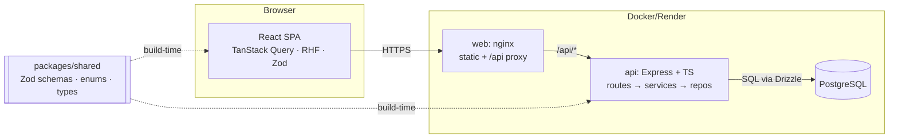
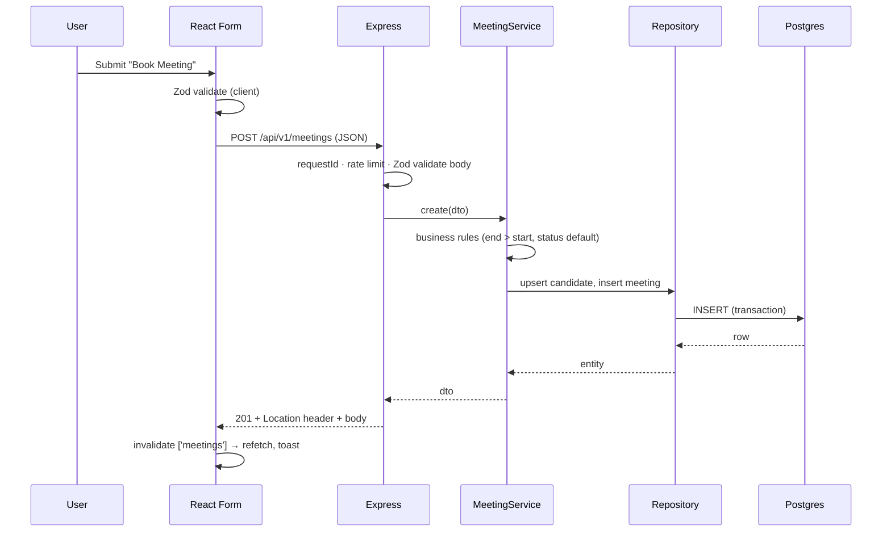
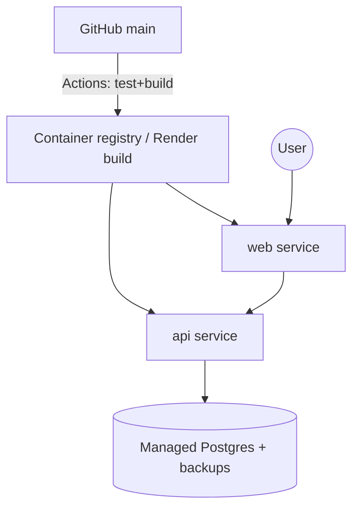

# 8. System Architecture

> **Historical proposal.** Data access was later changed from Drizzle to Prisma — see [ADR-003](../../../discussion/finally/adr/ADR-003-data-access.md).

### 8.1 Component diagram

### 8.2 Request lifecycle (create meeting)

### 8.3 Deployment topology

Local: `docker compose up --build` → `web:8080`, `api:3000`, `db:5432` (volume `pgdata`).
