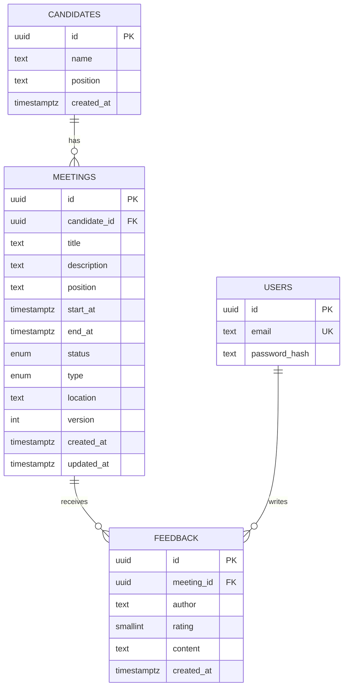
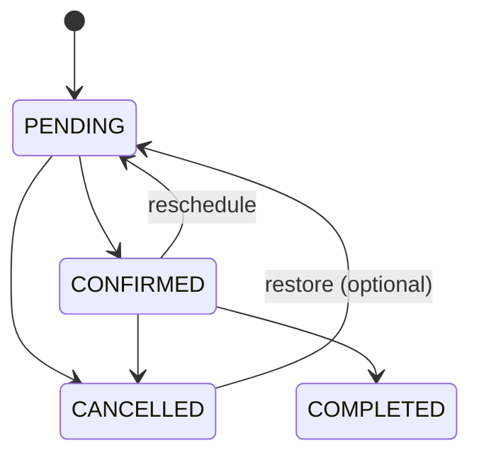

# 9. Data Model

**Fields and constraints**

- `meetings.title` NOT NULL, 1–120 chars. `description` ≤ 2000, nullable.
- `start_at < end_at` via `CHECK`; duration cap (e.g. ≤ 8h) enforced in service, not DB.
- `status` enum: `PENDING` (default), `CONFIRMED`, `CANCELLED`, `COMPLETED`.
- `type` enum: `ONSITE`, `ZOOM`, `GOOGLE_MEET`. `location` ≤ 300 (room or URL; URL scheme validated `http(s)` only).
- `position` is denormalised on the meeting (role applied *for this meeting*), constants validated against shared list.
- `meetings.candidate_id` FK `ON DELETE RESTRICT` (candidates are never deleted in this scope). `feedback.meeting_id` FK `ON DELETE CASCADE`.
- `version` integer incremented per update → optimistic locking.
- `feedback.rating` nullable, CHECK 1–5; `content` required ≤ 2000.
- `candidates` unique on `lower(name)`+`position`? **[ASM]** Name collisions are possible in reality; for this scope, free-text name is matched case-insensitively to an existing candidate (autocomplete suggests), otherwise created. Documented limitation.

**Indexes (justified by queries):**
`meetings(start_at)` – dashboard/sort; `meetings(status, start_at)` – filtered lists; `meetings(candidate_id, start_at desc)` – history; `feedback(meeting_id)`. Trigram search not needed; `ILIKE` on a small table is fine.

**Status lifecycle**

Transitions enforced in the service (`409`/`422` on illegal ones). Edit via PATCH may change any field but status must follow the table. *Optional simplification:* allow any status via edit and document it — I recommend enforcing, it is ~20 lines.

**Date/time:** all instants stored `timestamptz` (UTC); API uses ISO-8601 with offset (`2025-10-12T03:00:00.000Z`); form collects local date + start + end and converts using the browser zone; display via `Intl.DateTimeFormat`. "Upcoming" = `end_at >= now()` and status ≠ CANCELLED.

**Migrations:** drizzle-kit generated SQL files committed; api container runs `migrate` on boot (idempotent) before listening; seed script (dev + demo) separate and idempotent.
