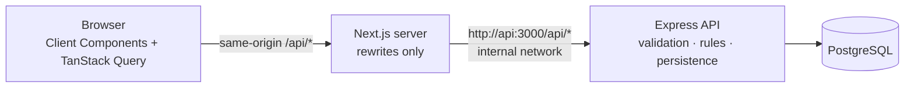

# Technical Design Proposal — API Communication, Security, Logging & Observability

สถานะ: **Decided (14 พ.ย. 2026) — ดู ADR-011, ADR-012, ADR-013 และ implementation-plan v2** · ยังไม่ implement · วันที่: 14 พฤศจิกายน 2026
อ้างอิง: [final-architecture.md](./final-architecture.md), [ADR-008](./adr/ADR-008-deployment.md) (local only), [ADR-010](./adr/ADR-010-frontend-nextjs.md) (Next.js)

---

## 0. Context และข้อจำกัดที่ใช้ตัดสิน

| ข้อเท็จจริง | ผลต่อการออกแบบ |
|---|---|
| โจทย์บังคับ backend เป็น Express/FastAPI/Flask และ "simple REST API" | Express ต้องเป็นเจ้าของ business logic และ REST contract — Next.js ห้ามเป็น backend ตัวที่สอง |
| Frontend = Next.js 15 App Router (ADR-010) | มีทางเลือก proxy / BFF / server fetch |
| รันแบบ local ด้วย Docker Compose เท่านั้น (ADR-008) | ไม่มี CDN, WAF, TLS termination, log aggregator ภายนอก |
| ยังไม่มี auth ใน baseline (ADR-009) — เป็น bonus | ไม่มี token ที่ต้องซ่อนจาก browser ณ ตอนนี้ |
| โค้ดปัจจุบัน: `next.config.ts` rewrite `/api/:path*` → `API_URL`; prod compose เปิด port เฉพาะ web (8080) — api/db ไม่ publish; dev override เปิด 3000/5432 | same-origin ทำงานอยู่แล้ว |
| งบเวลา ~40 ชม. รวมทั้งหมด | งานในเอกสารนี้ควรอยู่ใน **~5–7 ชม.** |

หลักที่ใช้: **เลือกสิ่งที่พิสูจน์ได้ด้วย test และอธิบายได้ในห้องสัมภาษณ์** — ไม่เพิ่ม infrastructure ที่ reviewer ต้องติดตั้งเพิ่ม

---

## 1. Next.js ↔ Backend Communication

### 1.1 ทางเลือก

| # | Pattern | การไหลของ request | ข้อดี | ข้อเสีย / ความเสี่ยง |
|---|---|---|---|---|
| **P1** | Direct browser → Express (cross-origin) | `browser → :3000/api` | ง่ายที่สุด ไม่มีชั้นกลาง | ต้องเปิด port api สู่ host, ต้องตั้ง CORS, cookie ข้าม origin (SameSite=None + Secure) เมื่อมี auth, `API_URL` ฝังใน JS bundle |
| **P2** | Same-origin reverse proxy (Next `rewrites`) — **ปัจจุบัน** | `browser → web:/api → api:3000` | ไม่มี CORS, api ไม่ถูก expose, cookie first-party, ไม่มีโค้ด proxy ให้ดูแล | `API_URL` ถูกอ่านตอน **build** (ต้องเป็น build arg), Next ไม่ validate อะไร, latency hop เพิ่มเล็กน้อย, timeout/body limit ของ proxy ต้องรู้ |
| **P3** | BFF เต็มรูป (Route Handlers / Server Actions เรียก Express) | `browser → Next handler → fetch api` | ซ่อน token/secret ฝั่ง server ได้, aggregate หลาย call, ปรับ response ให้ UI | **ทำ contract ซ้ำสองชั้น** (handler + Express), ต้อง map error/status/headers เอง, test เพิ่มสองเท่า, เสี่ยงที่ logic ไหลไปอยู่ใน Next (ขัดกับโจทย์ที่ให้ backend เป็น Express) |
| **P4** | Hybrid: Server Components อ่านข้อมูลผ่าน internal URL + mutation ผ่าน P2 | read: `Next server → api:3000`; write: P2 | first paint มีข้อมูล (SSR), SEO | สอง data path (server fetch + TanStack Query) ต้อง hydrate/invalidate ให้ตรงกัน, ต้องส่ง cookie ต่อเองเมื่อมี auth, cache semantics ของ Next 15 ต้องคุมเอง (`cache: 'no-store'`) |

### 1.2 การวิเคราะห์

- **BFF มีคุณค่าเมื่อ** (ก) มี credential ที่ browser ห้ามเห็น เช่น OAuth access token ของ third-party, (ข) ต้อง aggregate หลาย service, (ค) ทีม frontend ต้องการ shape ข้อมูลต่างจาก public API — **ไม่มีข้อไหนเป็นจริงในงานนี้**: มี API เดียว, ไม่มี third-party, auth (ถ้าทำ) ออก session cookie โดย Express เองบน same-origin
- **SSR ไม่ได้ประโยชน์ชัดเจน**: เป็นแอปภายใน (recruiter) ไม่ต้อง SEO, ข้อมูลเปลี่ยนบ่อย, ต้อง refetch หลังแก้ไขอยู่แล้ว
- **P1 ขัดกับ security posture ที่ได้มาฟรีจาก P2** (api ไม่ถูก expose, ไม่มี CORS)

### 1.3 ข้อเสนอ — **P2: Same-origin proxy + client-side data fetching** (Confidence: High)

กติกา:
1. Browser เรียก **path แบบ relative `/api/v1/...` เท่านั้น** — ไม่มี `NEXT_PUBLIC_API_URL`
2. Next.js ทำหน้าที่ **render + proxy เท่านั้น** ไม่มี Route Handler/Server Action ที่แตะข้อมูล meeting
3. `API_URL` เป็น build arg (ระบุใน README) — เพราะ rewrites ถูก serialize ตอน `next build`
4. API client ฝั่ง frontend ไฟล์เดียว (`src/lib/api.ts`): ใส่ `Content-Type`, parse error shape เดียว, แปลงเป็น `ApiError { status, code, message, requestId }`
5. Express ตั้ง `app.set('trust proxy', 1)` เพราะอยู่หลัง Next หนึ่ง hop — จำเป็นสำหรับ IP ใน log และ rate limit

**Revisit trigger → ย้ายไป P3 เฉพาะ endpoint ที่ต้องการ:** มี third-party token, ต้อง aggregate, หรือย้าย Express ไปอยู่คนละ origin ที่แชร์ cookie ไม่ได้

**Rejected:** P1 (CORS + expose port), P3 (contract ซ้ำ, logic รั่วเข้า Next), P4 (สอง data path โดยไม่มีผู้ใช้ที่ได้ประโยชน์)

**ความเสี่ยงที่ต้องตรวจตอน implement (ยังไม่ได้ทดสอบ):**
- พฤติกรรม rewrite ของ Next 15 กับ `DELETE` + query string, body ขนาดใหญ่ และ header `X-Forwarded-*` — เขียน smoke test ผ่าน `:8080` ไม่ใช่ยิง Express ตรง
- proxy timeout ของ Next — Express ควรตอบภายใน < 5 วินาทีเสมอ (ตั้ง DB `statement_timeout`)

---

## 2. Server-side API Handling (Express)

| เรื่อง | ข้อเสนอ | เหตุผล |
|---|---|---|
| Layering | `routes` (HTTP, parse) → `services` (rules, version, transitions) → `repositories` (Drizzle) | ตามที่อนุมัติแล้ว; test service ได้โดยไม่มี HTTP |
| Validation | Zod `.strict()` ทุก body/query/params; UUID ใน path ตรวจก่อนถึง DB | กัน mass assignment, กัน DB error 500 จาก UUID ผิดรูป |
| Error model | `{ error: { code, message, details?, requestId } }` + status ที่ถูกต้อง; `AppError` class เดียว; error middleware ตัวเดียว map Zod→400, NotFound→404, VersionConflict→409, BodyTooLarge→413, อื่น ๆ→500 | client handle ได้จาก `code` ไม่ต้อง parse message |
| 500 | ข้อความทั่วไป "Internal error" + `requestId`; stack อยู่ใน log เท่านั้น | ไม่รั่วรายละเอียดภายใน |
| Async errors | Express 5 ส่ง rejected promise เข้า error middleware อัตโนมัติ | ไม่ต้อง wrapper |
| Timeouts | pg pool `connectionTimeoutMillis: 5000`, `statement_timeout: 5000` | กัน request ค้างจน proxy timeout |
| Shutdown | มีแล้ว (SIGTERM → close server → `pool.end()`) | |
| Versioning | `/api/v1` | ตามสัญญา API ที่อนุมัติแล้ว |

---

## 3. Application Security

### 3.1 Threat model แบบย่อ

ระบบ: แอปภายในที่รันบน localhost, ไม่มี auth (baseline), ข้อมูลเป็น demo — ภัยที่สมเหตุสมผลคือ **input ที่ไม่น่าไว้วางใจ, XSS ผ่านข้อความที่ผู้ใช้กรอก, การรั่วของ error/secret, dependency ที่มีช่องโหว่ และ abuse ของ write endpoint** ภัยจากเครือข่าย/TLS อยู่นอกขอบเขตเพราะไม่ได้ deploy

### 3.2 Controls (เรียงตามคุ้มค่า)

| ความเสี่ยง (OWASP Top 10 2021) | Control | ที่ไหน | ระดับ |
|---|---|---|---|
| A03 Injection (SQL) | Drizzle parameterized queries; ห้าม `sql.raw` กับ input | api | **Must** |
| A03 Injection (XSS) | React escape อัตโนมัติ; **ห้าม** `dangerouslySetInnerHTML`; description แสดงแบบ plain text (`white-space: pre-wrap`) | web | **Must** |
| A04 Insecure design / mass assignment | Zod strict, reject `id`/`version` ผิดที่/timestamps; PATCH ว่าง → 400 | api | **Must** |
| A05 Misconfiguration | `helmet()` (มีแล้ว), ปิด `x-powered-by` (มีแล้ว), Next `poweredByHeader: false`, ไม่ publish port api/db ใน prod compose (เป็นแล้ว), container non-root (เป็นแล้ว) | api, web, compose | **Must** |
| A05 Error leakage | error middleware ไม่ส่ง stack/SQL; `NODE_ENV=production` | api | **Must** |
| DoS / abuse | `express.json({ limit: '100kb' })` (มีแล้ว), `pageSize` max 50, `express-rate-limit` เฉพาะ write (เช่น 60 req/นาที/IP, memory store) | api | **Should** |
| Security headers ฝั่ง UI | Next `headers()`: `X-Content-Type-Options: nosniff`, `Referrer-Policy: strict-origin-when-cross-origin`, `X-Frame-Options: DENY` / `frame-ancestors 'none'`, `Permissions-Policy` ปิด camera/mic/geo | web | **Should** |
| CSP | เริ่มด้วย **CSP แบบไม่ใช้ nonce** (`default-src 'self'; img-src 'self' data:; style-src 'self' 'unsafe-inline'; script-src 'self' 'unsafe-inline'; frame-ancestors 'none'; base-uri 'self'; form-action 'self'`) — ยอมรับ `unsafe-inline` เพราะ Next inline bootstrap script ต้องใช้ nonce + dynamic rendering ถ้าจะเข้มกว่านี้ | web | **Should** (ระบุเป็น trade-off) |
| A06 Vulnerable components | `npm audit --audit-level=high` ใน CI, Dependabot (npm + docker + actions), pin เวอร์ชันแน่นอน (ทำแล้ว) | CI | **Should** |
| A02/secrets | `.env` ใน `.gitignore`, มีแค่ `.env.example` ค่า dev; ไม่มี secret ใน image layer หรือ `NEXT_PUBLIC_*` | repo | **Must** |
| A01 Broken access control / IDOR | **N/A ใน baseline** (ไม่มี user) — README ระบุว่าเป็น single-tenant demo; ถ้าทำ auth ดู 3.3 | — | — |
| CSRF | **N/A ใน baseline** (ไม่มี credential); ถ้ามี cookie auth ดู 3.3 | — | — |
| SSRF | rewrite destination มาจาก config ไม่ใช่ input ผู้ใช้; ไม่มี endpoint ที่ fetch URL ที่ผู้ใช้ส่ง | web | ตรวจแล้ว |
| CORS | **ไม่เปิด** (same-origin) — ไม่ติดตั้ง `cors` | api | **Must** (แบบไม่ทำ) |

### 3.3 ถ้าทำ auth (bonus) — สิ่งที่ต้องเพิ่ม

- Express ออก session เป็น **httpOnly, SameSite=Lax, Path=/** cookie (`Secure` เมื่อมี HTTPS — local HTTP จึงต้องเปิดผ่าน env) ไม่เก็บ token ใน `localStorage`
- CSRF: SameSite=Lax + ตรวจ `Origin` header บน method ที่ไม่ใช่ GET (same-origin ทำให้ตรวจง่าย) — ไม่ต้องใช้ CSRF token library
- password hashing ด้วย `argon2id` หรือ `bcrypt` (cost ≥ 12), rate limit login แยก (5 ครั้ง/นาที/IP), ข้อความ error ไม่บอกว่า email มีอยู่หรือไม่
- Next `middleware.ts` ใช้แค่ redirect UX (ไม่มี cookie → `/login`) — **การบังคับสิทธิ์อยู่ที่ Express เสมอ** (middleware ไม่ใช่ security boundary)
- ยังไม่ต้องใช้ BFF (§1.2)

---

## 4. Logging

### 4.1 Library และรูปแบบ

| ทางเลือก | ผล |
|---|---|
| **pino + pino-http** (เสนอ) | JSON structured, เร็ว, มี redact ในตัว, `pino-pretty` สำหรับ dev |
| winston | ยืดหยุ่นแต่ config มากกว่า ไม่มีเหตุผลเพิ่มสำหรับงานนี้ |
| `console.log` | ไม่มี level/structure — ไม่พอสำหรับ senior signal |

- Production (compose): JSON หนึ่งบรรทัดต่อ event ไปที่ stdout → `docker compose logs api`
- Dev: `pino-pretty` ผ่าน env `LOG_PRETTY=true` เท่านั้น (ไม่ใส่ใน prod image)
- Level ตั้งด้วย `LOG_LEVEL` (default `info`; test = `silent`)

### 4.2 นโยบาย log level

| Level | ใช้เมื่อ | ตัวอย่างในระบบนี้ |
|---|---|---|
| `fatal` | process ต้องปิด | migration ล้มตอน boot, ต่อ DB ไม่ได้ตอน start |
| `error` | request ล้มเพราะฝั่งเรา (5xx) หรือ error ที่ไม่คาดคิด | unhandled exception, DB timeout |
| `warn` | ผิดปกติแต่ระบบรับมือได้ / สัญญาณ abuse | 429 rate limited, readiness ล้ม (DB down), 413 |
| `info` | วงจรชีวิตและ access log | server start/stop, หนึ่งบรรทัดต่อ request (method, route, status, durationMs, requestId) |
| `debug` | รายละเอียดสำหรับ dev | ค่า query ที่ parse แล้ว (ไม่มีข้อมูลส่วนตัว), SQL ที่ Drizzle สร้าง |
| `trace` | ไม่ใช้ | — |

**การตัดสินใจที่ต้อง discuss:** 4xx (400/404/409/422) log เป็น `info` ไม่ใช่ `warn` — เพราะเป็นพฤติกรรมปกติของ client (validation ไม่ผ่าน, version conflict) ถ้าเป็น `warn` จะกลบสัญญาณจริง ยกเว้น 413/429 ที่บ่งชี้ abuse

### 4.3 สิ่งที่ห้าม log (redaction)

- `req.headers.cookie`, `req.headers.authorization`, `set-cookie` → `[Redacted]` ผ่าน pino `redact`
- **ไม่ log request/response body** ทั้งหมด (มีชื่อ candidate และ notes — ถือเป็นข้อมูลส่วนบุคคล)
- ไม่ log `DATABASE_URL` หรือ env ทั้งก้อน
- health check (`/api/health/*`) ไม่เขียน access log (ลด noise จาก Docker healthcheck ทุก 10 วินาที)

### 4.4 Correlation (Request ID)

- Express รับ `X-Request-Id` ถ้ามีและผ่าน format (UUID/≤ 64 chars `[A-Za-z0-9-]`) ไม่งั้นสร้าง `crypto.randomUUID()`
- ส่งกลับใน response header `X-Request-Id` และใน error body `requestId`
- Frontend แสดง requestId ใน error state ("อ้างอิง: abc123") → ผู้ใช้/ผู้ตรวจนำไป `docker compose logs api | grep abc123` ได้
- **ไม่**สร้าง request id ใน Next middleware ใน baseline — Next เป็นแค่ proxy การสร้างที่ Express จุดเดียวพอ

### 4.5 Frontend logging

- ไม่ส่ง log จาก browser ไป server (ไม่มี collector, เพิ่ม endpoint ที่ต้องป้องกัน abuse)
- `app/error.tsx` (error boundary) แสดงข้อความ + ปุ่ม Retry + requestId ถ้ามี; `console.error` ใน dev เท่านั้น
- Next server logs (stdout ของ container web) ใช้ค่า default

---

## 5. Observability

| สัญญาณ | Baseline (ทำ) | Deferred (ไม่ทำ — เหตุผล) |
|---|---|---|
| Health | `/api/health/live`, `/api/health/ready` (มีแล้ว) + Docker `healthcheck` (มีแล้ว) | — |
| Logs | pino JSON + request id + `durationMs` | Loki/ELK — ต้องติดตั้งเพิ่ม, local only |
| Metrics | ไม่มี endpoint; ใช้ `durationMs` ใน access log วิเคราะห์ได้ | `prom-client` `/metrics` + Prometheus/Grafana — ไม่มีใคร scrape ใน local demo, เพิ่ม attack surface |
| Tracing | request id ข้าม browser → Express | OpenTelemetry — มีแค่ 2 hop, ค่า setup > ประโยชน์ |
| Errors | error log level `error` พร้อม stack + requestId | Sentry — external service + DSN secret |
| Version | `GET /api/health/live` คืน `{ status, version }` จาก `APP_VERSION` (git SHA ตอน build) | — |

README ส่วน "Operating locally": ดู log, หา request id, เช็ค health, คำสั่ง `make logs SVC=api`

**Revisit trigger:** deploy จริง / มีมากกว่าหนึ่ง instance / มี SLO → เพิ่ม `/metrics` และ OTel (ตอนนั้น request id และ structured log ที่มีจะต่อยอดได้ทันที)

---

## 6. Testing ของเรื่องเหล่านี้

| Test | ชั้น |
|---|---|
| unknown key ใน body → 400 `VALIDATION_ERROR` | API integration |
| body > 100kb → 413 | API integration |
| UUID ผิดรูป → 400 (ไม่ใช่ 500) | API integration |
| error 500 ไม่มี `stack` ใน response และมี `requestId` | API integration (inject failing repo) |
| response มี `X-Request-Id`; รับค่า valid ที่ส่งมา; ปฏิเสธค่าที่ผิด format แล้วสร้างใหม่ | API integration |
| helmet headers มีอยู่ (`x-content-type-options`) | API integration |
| logger redact cookie/authorization | unit (pino destination stream) |
| request ผ่าน `:8080/api/...` (proxy) ได้ status/headers เหมือนยิงตรง รวม `DELETE ?version=` | Playwright smoke / CI compose job |

---

## 7. Implementation sequence (superseded โดย implementation-plan v2 Phase 1)

| ลำดับ | งาน | ชม. (ประมาณ) | อยู่ใน Day |
|---|---|---|---|
| 1 | `AppError` + error middleware + request id + pino/pino-http + redact + `trust proxy` + DB timeouts | 2 | Day 2 (ก่อน CRUD) |
| 2 | Zod strict helpers สำหรับ body/query/params | 0.5 | Day 2 |
| 3 | rate limit write routes | 0.5 | Day 2 |
| 4 | Frontend `lib/api.ts` + `ApiError` + error boundary แสดง requestId | 1 | Day 3 |
| 5 | Next security headers + CSP + `poweredByHeader: false` | 0.5 | Day 3 |
| 6 | CI: `npm audit --audit-level=high` + Dependabot config | 0.5 | Day 7 |
| 7 | README "Security & Operations" | 0.5 | Day 7 |
| | **รวม** | **~5.5** | อยู่ใน budget เดิม (ใช้จาก contingency บางส่วน) |

## 8. Acceptance criteria

- [ ] browser network tab แสดงเฉพาะ request ไป origin เดียวกัน (`localhost:8080`); port 3000/5432 ไม่เปิดใน prod compose
- [ ] ไม่มี `NEXT_PUBLIC_*` ที่มี URL หรือ secret; ไม่มี Route Handler ที่แตะข้อมูล meeting
- [ ] ทุก error response มีรูปแบบ `{ error: { code, message, requestId } }` และไม่มี stack
- [ ] `docker compose logs api` เป็น JSON หนึ่งบรรทัดต่อ request พร้อม requestId, status, durationMs; ไม่มี body/cookie
- [ ] เปลี่ยน `LOG_LEVEL=debug` ได้โดยไม่ rebuild
- [ ] security tests ใน §6 ผ่านใน CI
- [ ] README อธิบาย trade-off: P2 vs BFF, CSP `unsafe-inline`, ไม่มี auth/IDOR control

## 9. ADRs (สร้างแล้ว)

| ADR | Decision | Confidence |
|---|---|---|
| [ADR-011](./adr/ADR-011-api-communication.md) API communication | P2 same-origin rewrite proxy, client-side fetching, ไม่มี BFF; revisit เมื่อมี third-party token/aggregation | High |
| [ADR-012](./adr/ADR-012-logging-observability.md) Logging & observability | pino JSON, level policy §4.2, request id ที่ Express, ไม่มี metrics/tracing stack | High |
| [ADR-013](./adr/ADR-013-security-baseline.md) Security baseline | controls §3.2 (Must/Should), CSP แบบไม่ใช้ nonce, auth controls §3.3 เมื่อทำ bonus | Medium (CSP) |

## 10. Open questions สำหรับ discussion

1. ~~4xx log เป็น `info` หรือ `warn`?~~ **ตัดสินแล้ว (14 พ.ย. 2026):** 4xx default = `info` เพราะเกิดจากข้อมูล/ผู้ใช้ ไม่ใช่ความผิดพลาดของโปรแกรม; `warn` เป็น **case by case** เมื่อเป็นสัญญาณที่ต้อง investigate (เช่น 429, 413, login/OTP ผิดซ้ำจน lock); 5xx = `error`
2. ~~CSP แบบ `'unsafe-inline'` หรือ nonce-based~~ **ตัดสินแล้ว (14 พ.ย. 2026):** **nonce-based CSP** — `middleware.ts` สร้าง nonce ต่อ request, `script-src 'self' 'nonce-…' 'strict-dynamic'`, ทุกหน้า dynamic rendering; dev mode อนุญาต `'unsafe-eval'` เฉพาะ `NODE_ENV=development`; ต้องมี test ตรวจ header และ Playwright ตรวจว่าไม่มี CSP violation ใน console. Effort (+1–2 ชม.) รับได้เพราะผู้ใช้ใช้ AI 3 ตัวช่วยพัฒนาและรีวิวเองทั้งหมด
3. ~~Rate limit~~ **ตัดสินแล้ว (14 พ.ย. 2026):** login 5/15 นาที (IP+email) · OTP verify 5 ครั้งต่อ challenge แล้ว invalidate · register 3/ชม./IP · write 60/นาที (user id หรือ IP) · read ไม่จำกัด · 429 log `warn` · memory store (instance เดียว; revisit เมื่อ scale → Redis/Postgres) · ปิดใน test ด้วย `RATE_LIMIT_ENABLED=false` + test แยกสำหรับ 429 · ต้องตั้ง `trust proxy` · **ไม่ทำ account lockout** (เสี่ยงถูกล็อกโดยผู้อื่น)
4. ~~ทำ auth bonus หรือไม่~~ **ตัดสินแล้ว (14 พ.ย. 2026):** ทำ login + register + ยืนยันตัวตนด้วย **mock OTP แบบ fixed (`112233`)** — รายละเอียดการออกแบบยังต้องคุย (ดู ADR-009 ซึ่งต้องแก้จาก "ไม่อยู่ใน baseline")
5. ~~`/metrics`~~ **ตัดสินแล้ว (14 พ.ย. 2026):** ไม่ทำ — ใช้ health + structured log (`durationMs`, status, requestId); `/metrics` + Prometheus/Grafana (compose profile) เป็น future work
