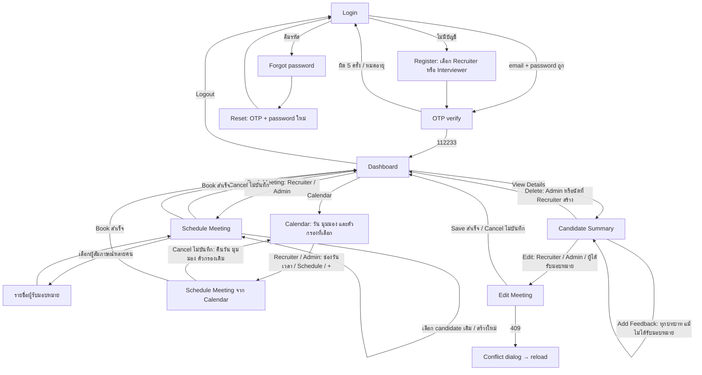
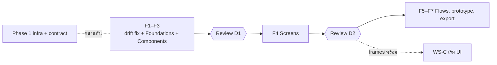

# Figma Design Plan

สถานะ: **Approved (14 พ.ย. 2026) — เริ่ม F1–F3** · วันที่: 14 พฤศจิกายน 2026
อ้างอิง: [DESIGN_GUIDELINES.md](../../design/DESIGN_GUIDELINES.md) · [tokens.json](../../design/tokens/tokens.json) · [ADR-009 auth](./adr/ADR-009-auth.md) · [implementation-plan v2](./implementation-plan.md)

## 1. เป้าหมาย

1. ตอบโจทย์ bonus "UI Design (Figma) is a plus" และส่วน **App Flow** ของโจทย์ ด้วยไฟล์ Figma ที่ public view ได้ ลิงก์จาก README
2. เป็น **source of truth ของ UI ก่อน WS-C เริ่ม** — frontend ทำตาม frame + component เดียวกัน ลดการตีความเอง
3. แสดงวิธีคิดแบบ senior: design system ผูก token → component → screen → flow/prototype → handoff

**ไม่ใช่เป้าหมาย:** pixel-perfect หลายขนาดจอ, illustration/branding เต็มรูป, usability testing

## 2. สิ่งที่ต้องแก้ใน design docs เดิมก่อนเริ่ม (drift ที่พบ)

| ประเด็น | ตอนนี้ใน `docs/design` | ตามการตัดสินล่าสุด | แก้ |
|---|---|---|---|
| Status | มี **Completed** (`info`) | 3 สถานะ: PENDING / CONFIRMED / CANCELLED | ตัด Completed ออกจากตาราง status (เก็บ token `info` ไว้ใช้กับ "Past"/history badge ได้) |
| Stack | "React + TypeScript + Vite" | Next.js 15 (ADR-010) | แก้หัวเอกสาร + workflow ข้อ 3 (path `src/app/globals.css`) |
| หน้าจอ | 4 หน้า (Login, Dashboard, Booking, Summary) | เพิ่ม Register, OTP, Forgot/Reset password; ไม่มี Guest | เพิ่มหัวข้อ 6.x ของหน้าใหม่; ตัด "Continue as Guest" |
| Booking form | ตาม wireframe | candidate ต้อง **เลือกคนเดิม หรือสร้างใหม่แบบ explicit** (ADR-006) | ออกแบบ combobox + ปุ่ม "สร้าง candidate ใหม่" |

แก้ใน PR เดียวกับการสร้าง Figma (design docs อยู่ใน umbrella repo)

## 3. Scope ของหน้าจอ

| # | Screen | Route | States ที่ต้องมี frame |
|---|---|---|---|
| S1 | Login | `/login` | default, field error, invalid credentials, rate limited (429), loading |
| S2 | OTP verify | `/verify` | default, wrong code (เหลือ n ครั้ง), expired/locked challenge, resend; แสดง hint "Demo OTP: 112233" |
| S3 | Register | `/register` | default, validation (email/password ≥ 8), email ซ้ำ (409) |
| S4 | Forgot password | `/forgot-password` | default, "ถ้ามีบัญชีนี้ เราได้ส่ง OTP แล้ว" (ข้อความเดียวกันเสมอ) |
| S5 | Reset password | `/reset-password` | OTP + password ใหม่, success → login |
| S6 | Dashboard — Upcoming Meetings | `/` | loaded (card grid), filter status, pagination, empty (CTA Book Meeting), loading (skeleton), error (Retry + requestId) |
| S11 | Calendar (tab ของ Dashboard) | `/?view=calendar` | Week (time grid + now line + overlap), Month (+n more), Mine/All toggle, mobile Day agenda, TH week |
| S7 | Schedule / Edit Meeting | `/meetings/new`, `/meetings/:id/edit` | create, edit, candidate combobox (เลือก/สร้างใหม่), Onsite vs Online (provider), validation, **409 conflict dialog** |
| S8 | Candidate Summary | `/candidates/:id` | upcoming + history + feedback, add feedback, cancel confirm, delete confirm (destructive), empty history |
| S9 | App shell | ทุกหน้าหลัง login | header (logo, title "Candidate Meeting Scheduler", user menu → Logout) |
| S10 | Global | — | toast (success/error), 404 page, generic error page |

**Breakpoints:** Desktop 1440 (หลัก) + Mobile 390 สำหรับ S1, S2, S6, S7, S8 (หน้าที่มี layout ต่างกันจริง) — หน้าอื่น desktop อย่างเดียว
**Theme:** Light เป็นหลัก; Dark ใช้ variable mode `Dark` ของ collection `Color` และมี frame แยกใน page `04 Screens — Dark` (เพิ่ม 16 พ.ย. 2026)

## 4. โครงไฟล์ Figma

| Page | เนื้อหา |
|---|---|
| `00 Cover` | ชื่อโปรเจกต์, เวอร์ชัน, ลิงก์ repo, สถานะ |
| `01 Foundations` | Variables (color Light/Dark, spacing, radius), text styles (Inter + IBM Plex Sans Thai), shadow, contrast table |
| `02 Components` | Button (primary/secondary/ghost/destructive × default/hover/disabled/loading), Input, Textarea, Select, Combobox, Date/Time picker, Radio/Toggle group, Badge (status 3 + Past), Card (meeting card), Dialog/AlertDialog, Toast, Skeleton, Pagination, Empty state, Error state, OTP input (6 ช่อง), App header |
| `03 Flows` | User flow diagrams (§5) |
| `04 Screens — Auth` | S1–S5 + states |
| `05 Screens — App` | S6–S10 + states, desktop + mobile |
| `06 Prototype` | ลิงก์ prototype หลัก 2 เส้น (§5) |
| `07 Handoff` | redlines สำคัญ, ตาราง route ↔ frame, หมายเหตุ behavior (409, 429, requestId) |

กติกา: ทุกสีและ spacing ต้องผูก Variable (ห้าม hex ตรง) · component ใช้ Auto Layout + variants ตั้งชื่อตรงกับ shadcn/ui เพื่อ map กับโค้ด

## 5. User flows

**Prototype ที่ลิงก์ให้กดได้:**
- P1 Auth: Login → OTP → Dashboard (+ Register → OTP)
- P2 Core: List → Schedule → Book สำเร็จ → List → Candidate Summary → Edit → Save สำเร็จ / Cancel → List
- P3 Calendar: Calendar → Schedule → Cancel → Calendar เดิม; Book สำเร็จ → List

**พฤติกรรมระหว่างรอและการกลับจากฟอร์ม**

สิทธิ์มอบหมายเป็นไปตาม [ADR-016](./adr/ADR-016-interviewer-assignments.md): Interviewer แก้/ยกเลิกเฉพาะนัดที่ได้รับมอบหมาย แต่ไม่สร้าง/ลบ/เปลี่ยนรายชื่อ เปิดนัดอื่นเป็นรายละเอียดแบบอ่านอย่างเดียวพร้อม feedback ตัวกรอง “มอบหมายให้ฉัน” ใช้การมอบหมาย ไม่ใช่ผู้สร้าง

| เหตุการณ์ | ผลที่ผู้ใช้เห็น |
|---|---|
| กด action ที่ส่ง API | ปุ่มแสดง spinner และกดซ้ำไม่ได้ หาก error แสดงข้อความและกลับมากดได้ |
| เปลี่ยนหน้า / โหลดข้อมูลใหม่ | แสดง loading; รายการและปฏิทินที่มีข้อมูลอยู่แล้วคงข้อมูลเดิมระหว่างรอ |
| Calendar → Schedule → รีเฟรช → Cancel | กลับวัน มุมมอง Week/Month, status และ Mine/Everyone เดิม โดยไม่สร้างนัด |
| List → Schedule → Cancel | กลับ List โดยไม่สร้างนัด |
| Schedule → Book สำเร็จ | กลับ Dashboard แบบ List และแสดงผลบันทึกสำเร็จ |

Diagram ด้านบนระบุพฤติกรรมปัจจุบันของแอป ภาพ export `user-flows.png` และ prototype ใน Figma ต้องปรับเส้นทางเดียวกันเมื่ออัปเดตไฟล์ออกแบบรอบถัดไป

## 6. วิธีทำ (ใช้ AI + Figma MCP)

| ขั้น | งาน | ผู้ทำ | เครื่องมือ |
|---|---|---|---|
| F0 | ผู้ใช้สร้างไฟล์ Figma ใหม่ (หรือให้สิทธิ์ AI สร้าง) แล้วส่งลิงก์ | ผู้ใช้ | Figma |
| F1 | แก้ drift ใน `docs/design` (§2) | AI | repo |
| F2 | สร้าง Variables จาก `tokens.json` + text styles | AI | Figma MCP (`use_figma`) |
| F3 | สร้าง components (§4 page 02) ผูก Variables | AI | Figma MCP |
| F4 | วาด screens S1–S10 + states | AI | Figma MCP |
| F5 | Flows + prototype links | AI | Figma MCP / FigJam diagram |
| F6 | Export PNG ของ screen หลักไป `docs/design/screens/` + ลิงก์ใน README | AI | Figma MCP (`get_screenshot`) |
| F7 | ตั้ง share เป็น "Anyone with the link can view" | **ผู้ใช้** (การตั้งค่า sharing เป็นการ publish) | Figma |

ข้อจำกัดที่ต้องรู้: AI สร้าง/แก้ใน Figma ผ่าน MCP ได้ แต่คุณภาพ layout ต้องรีวิวด้วยตา; prototype interaction บางแบบอาจต้องต่อสายเองใน Figma

## 7. ลำดับเวลาเทียบกับ implementation-plan v2

- ทำ **ขนานกับ Phase 1** (Phase 1 ไม่มี UI ที่ต้องใช้ design) — ใช้ AI ตัวที่ไม่ได้ทำ Phase 1
- **WS-C เริ่ม Phase 2 ได้เมื่อผ่าน Review D2** (screens อนุมัติ) — ถ้า D2 ช้า WS-C เริ่มจาก C1 (auth pages) ซึ่ง layout ง่ายก่อน
- F5–F7 ทำขนานกับ Phase 2 ได้

| Gate | รีวิวอะไร | เวลารีวิว (ประมาณ) |
|---|---|---|
| Review D1 | drift fix, Variables ครบ Light/Dark, components + variants | 1 ชม. |
| Review D2 | screens ทุกหน้า + states ตรงกับ API contract (error codes, 409, 429) | 1.5 ชม. |
| Review D3 | flows, prototype กดได้, PNG export, sharing | 0.5 ชม. |
| **รวม** | | **~3 ชม.** (เพิ่มจาก 13.5 ชม. ใน implementation-plan) |

## 8. Acceptance criteria

- [ ] ไฟล์ Figma มี page ตาม §4 และ cover ระบุเวอร์ชัน
- [ ] สี/spacing/radius ทุกจุดผูก Variable; สลับ Light/Dark ได้โดยไม่มีสีหลุด
- [ ] Status badge 3 แบบ มีทั้งข้อความและไอคอน (ไม่พึ่งสีอย่างเดียว)
- [ ] S1–S10 ครบทุก state ใน §3; desktop ครบ, mobile ครบสำหรับ S1, S2, S6, S7, S8
- [ ] ข้อความ error ตรงกับ API contract (ข้อความ login ผิดเป็นข้อความเดียว, forgot password ตอบเหมือนกันเสมอ)
- [ ] มี hint "Demo OTP: 112233" ที่หน้า OTP (ตรงกับ README)
- [ ] Prototype P1 และ P2 กดผ่านได้ตลอดเส้น
- [ ] PNG ของ S1, S2, S6, S7, S8 อยู่ใน `docs/design/screens/` และ README ลิงก์ไฟล์ Figma (view-only)
- [ ] component names ตรงกับ shadcn/ui ที่ WS-C จะใช้

## 9. Decisions (14 พ.ย. 2026)

| # | คำถาม | คำตอบ |
|---|---|---|
| D-Q1 | ใครสร้างไฟล์ | AI สร้างผ่าน Figma MCP ใช้ theme Lagoon จาก repo (`docs/design/tokens`) |
| D-Q2 | ภาษา UI | **2 ภาษา (EN/TH)** — ออกแบบ frame หลักเป็น EN และทำ TH ผ่าน text variable/mode `Language: EN/TH`; layout ต้องรองรับข้อความไทยที่ยาวกว่า; ฝั่งโค้ดต้องมี i18n (เพิ่มใน WS-C) |
| D-Q3 | Mobile frames | ทำตาม §3 |
| D-Q4 | Logo | ใช้โลโก้ EGG Digital ที่ผู้ใช้ให้ (`eggdigital.com/.../EGG-Digital-Redesign-2x.png`) บนพื้นเหลือง เป็นค่าชั่วคราว จะเปลี่ยนภายหลัง |
| D-Q5 | Code Connect | ไม่ทำ |

**ผลกระทบต่อ implementation-plan:** WS-C ต้องเพิ่ม i18n (EN/TH) — เสนอ `next-intl` หรือ dictionary แบบง่ายตาม locale cookie; ต้องตัดสินใน R1 ก่อน WS-C เริ่ม

## 10. ข้อจำกัดของ Figma Starter plan (พบระหว่างทำ 14 พ.ย. 2026)

ไฟล์: https://www.figma.com/design/umgd40A9k9R8M2zhtk0Coj (Starter plan)

| ข้อจำกัด | ผล | การปรับแผน |
|---|---|---|
| Variable collection มีได้ **1 mode** | ทำ Light/Dark และ Language EN/TH เป็น mode ไม่ได้ | ทำ **Light อย่างเดียว** (Dark เป็น optional ตาม guideline); ภาษาไทยใช้ text styles `TH/*` (IBM Plex Sans Thai) + frame TH แยก |
| ไฟล์มีได้ **3 pages** | ใช้โครง 8 pages ใน §4 ไม่ได้ | `01 Design System` (cover, foundations, components), `02 Flows & Prototype`, `03 Screens` (auth + app + handoff แบ่งด้วย Section) |

ถ้าอัปเกรดเป็น Professional ภายหลัง: เพิ่ม mode Dark/TH ได้โดยไม่ต้องสร้าง component ใหม่ (ทุกอย่างผูก variable แล้ว)

## 11. Progress

| ขั้น | สถานะ |
|---|---|
| F1 drift fix ใน `docs/design` | ✅ |
| F2 Variables: Color 26 (Light), Spacing 9, Radius 5 — scopes + WEB code syntax; Text styles EN/TH 6 roles; Effect styles card/popover | ✅ |
| F3 Components: Button (4 variants × 3 states), Status Badge (Confirmed/Pending/Cancelled/Past), Input (4 states), Meeting Card (Today Yes/No), OTP Input (3 states), App Header (โลโก้ EGG Digital บนพื้น Yolk) | ✅ รอ Review D1 |
| F3+ Components เสริม: Alert (Error/Info/Success), Select (Default/Open), Textarea, Status Filter (segmented), Pagination, Skeleton Card, Dialog, Toast | ✅ |
| F4 Screens (page `03 Screens`, หลังอัปเกรดเป็น Pro) | ✅ Review D2 ผ่าน (14 พ.ย. 2026) — 26 frames ใน 6 sections: **Auth desktop EN** (S1 Login, S1 Error, S2 OTP, S2 Wrong code, S3 Register, S4 Forgot · Sent, S5 Reset) · **Dashboard desktop EN** (S6 loaded, Empty, Loading, Error + requestId) · **Meeting form** (S7 candidate search เปิด combobox + "Create new candidate", S7 Edit validation, S7 Edit 409 conflict dialog) · **Candidate Summary** (S8 + toast, Cancel confirm, Delete confirm, S10 404) · **Mobile 390** (S1, S2, S6, S7, S8) · **Thai desktop** (S1, S2, S6 TH) |
| F4+ S11 Calendar (ADR-014) | ✅ อนุมัติแล้ว · section `Calendar — S11`: Week (time grid 07–20, now line, overlap, ช่องว่าง "+ New meeting"), Week + event popover, Month (+n more), mobile Day agenda (week strip + agenda), Week TH (พ.ศ.) · components ใหม่ `Calendar Event` (4 status) และ `Segmented Control` · S6 ทุก state เพิ่ม toggle List\|Calendar และ Mine\|All |
| F5 User flows | ✅ page `02 Flows & Prototype` frame `F5 User flows` (lanes A–H + legend) |
| F6 Prototype | ✅ page `03 Screens` flow starting points: **P1** Login → OTP → Dashboard · **P2** Dashboard → Schedule → Summary → Edit/Cancel · **P3** Calendar (List↔Calendar, Week↔Month, event → popover → Summary, empty slot → Schedule) |
| F8 Dark theme | ✅ (16 พ.ย. 2026) เพิ่ม mode `Dark` ใน collection `Color` (ค่าตาม `.dark` ใน globals.css) · page `04 Screens — Dark` สำเนาครบ 7 sections / 31 frames · ผูกสี hardcode 160 จุดเข้ากับ variable · overlay dialog เป็นดำ 60% · PNG ที่ `docs/design/screens/dark/` |
| F7 Export | ✅ `docs/design/screens/*.png` (9 ไฟล์) + ลิงก์ใน `docs/design/README.md` · **ค้าง:** ตั้ง share link (Anyone with link can view) ต้องทำเองใน Figma |

**หมายเหตุ F4:** ย้าย component `App Header · Mobile` ไป `01 Design System` แล้ว · M · S6 (mobile) ยังไม่มี toggle List|Calendar · หลังอัปเกรด Pro แล้ว ข้อจำกัด 1 mode / 3 pages ใน §10 ไม่มีผลอีก — เพิ่ม Dark mode และ Language mode ได้ถ้าต้องการ

**ทางไปต่อสำหรับ F4:** (1) รอให้ quota ของ Starter plan reset (ดูรายละเอียดที่ https://developers.figma.com/docs/figma-mcp-server/rate-limits-access/), (2) อัปเกรด plan ของ team ที่เป็นเจ้าของไฟล์ (ปลด limit 3 pages / 1 mode ไปด้วย), หรือ (3) วาด screens เองใน Figma โดยใช้ components ที่สร้างไว้ (ทุก component ผูก token แล้ว)
