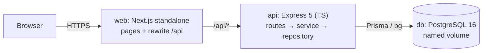
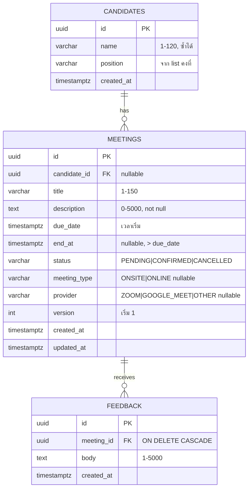

# Final Architecture — Candidate Meeting Scheduler

สถานะ: **Proposed — รออนุมัติก่อน implement** · วันที่: 13 พฤศจิกายน 2026
> **Change 13 พ.ย. 2026:** ผู้ใช้กำหนด stack — Frontend **Next.js** (TS), Backend Node.js TS (Express), PostgreSQL, Docker, GitHub, Figma สำหรับ flow/design → ดู [ADR-010](./adr/ADR-010-frontend-nextjs.md) ซึ่งแทนที่ Vite + nginx ในเอกสารนี้
>
> **Change 13 พ.ย. 2026 (2):** ไม่ deploy สาธารณะ — รัน local ด้วย Docker Compose + GitHub Actions CI เท่านั้น ([ADR-008](./adr/ADR-008-deployment.md)) acceptance ข้อ public URL/HTTPS ถูกยกเลิก
>
> **Change 14 พ.ย. 2026:** auth (register, login + mock OTP 2FA, forgot password) อยู่ใน scope แล้ว ([ADR-009](./adr/ADR-009-auth.md)); การสื่อสาร/security/logging ตาม [ADR-011](./adr/ADR-011-api-communication.md)–[013](./adr/ADR-013-security-baseline.md); แผนงานล่าสุดคือ [implementation-plan v2](./implementation-plan.md) — ส่วนที่ขัดกันในเอกสารนี้ให้ถือ ADR เป็นหลัก

อ่านคู่กับ [implementation-plan.md](./implementation-plan.md) และ [adr/](./adr/)

ที่มาของแต่ละการตัดสินใจระบุเป็น **[A]** Claude, **[B]** Codex, **[C]** Cursor, **[R]** ข้อเท็จจริงจาก repo, **[New]** ข้อเสนอใหม่ในรีวิวนี้

---

## 1. สรุปหนึ่งย่อหน้า

Modular monolith สามชิ้นที่ deploy เป็น container ทั้งหมด: **React + TS + Vite** (nginx เสิร์ฟ static + proxy `/api`) → **Express 5 + TS** → **PostgreSQL 16** โดยใช้ product scope ของ [A] (dashboard, booking form, candidate summary) บน engineering discipline ของ [B] (date/time contract, optimistic version ทุก write, error semantics, ประมาณเป็นชั่วโมง, deploy vertical slice ตั้งแต่วันแรก) และ**ปรับให้เข้ากับโครง repo ที่มีอยู่จริง** [R] (submodule แยก frontend/backend, compose, design tokens)

---

## 2. ข้อเท็จจริงจากโจทย์ vs Engineering preference

| ประเภท | รายการ |
|---|---|
| **Fact (mandatory)** | CRUD meeting (title, description, due date, status) · list มี pagination · persist · React/Vue · Express/FastAPI/Flask · REST · README · container FE+BE+DB · deploy · public GitHub |
| **Fact (wireframe — ไม่ได้ระบุว่า optional)** | Dashboard card, Booking form, Candidate Summary |
| **Fact (optional)** | Login/guest, design file, tests, CI/CD |
| **Preference (ของเรา)** | TypeScript, Prisma, Tailwind/shadcn, TanStack Query, optimistic locking, Node 24, Compose บน VM |

---

## 3. System Architecture

- **Same-origin** ผ่าน nginx → ไม่ต้อง CORS/cross-site cookie [A][B]
- nginx upstream กำหนดผ่าน env (`API_UPSTREAM`, default `api:3000`) เพื่อใช้ได้ทั้ง Compose และ host อื่น [New — แก้ข้อวิจารณ์ CL-03]
- Backend layering: `routes` (HTTP + Zod parse) → `services` (rules, transitions, version check) → `repositories` (Prisma) [A][B]
- Error format: `{ error: { code, message, details? } }` — ไม่อ้างว่าเป็น RFC 9457 [B]
- Health: `GET /api/health/live`, `GET /api/health/ready` (ping DB) [B]

---

## 4. Data Model

กติกา:
- `candidate_id` nullable → meeting แบบ generic (ตามโจทย์ core) ยังใช้ได้ [B]; booking form ของ wireframe บังคับมี candidate
- **Identity ด้วย `candidateId` เท่านั้น** ฟอร์มให้ "เลือกคนเดิม" (autocomplete แสดงชื่อ+ตำแหน่ง+วันที่สร้าง) หรือ "สร้างใหม่" แบบ explicit ไม่ merge ตามชื่อ [B] — แก้ [A] §9 [ASM]
- สร้าง candidate + meeting แรกใน transaction เดียว [B]
- `candidates` ลบไม่ได้ใน scope นี้ (`ON DELETE RESTRICT`) [A][B]
- ไม่มี `rating`, ไม่มี `COMPLETED`, ไม่มี `users` ใน baseline [B — ยอมรับใน summary ของ A]
- "Interview Notes" ใน wireframe = feedback entries แบบมี timestamp (append-only) [B] — **open question Q5**
- Status transitions: `PENDING⇄CONFIRMED`, `PENDING|CONFIRMED→CANCELLED`, `CANCELLED→PENDING`; สร้างเป็น CANCELLED ไม่ได้; ผิดกติกา → `409` [B]
- Cross-field: `provider` ต้อง null เมื่อ ONSITE; `end_at > due_date` เมื่อมี; ตรวจบน record ที่รวม patch แล้ว [B]
- Indexes: `meetings(due_date, id)`, `meetings(candidate_id, due_date, id)`, `feedback(meeting_id, created_at)` [B]

**Date/time contract** [B, ตัดส่วนเกิน]
- Request: RFC 3339 พร้อม offset (`2026-11-20T10:00:00+07:00`); ไม่มี offset/date-only → `400`
- Response: UTC `...Z`; UI แสดงด้วย `Intl.DateTimeFormat` + แสดง timezone ของ browser ข้างฟอร์ม
- "Upcoming" = `due_date >= now()` และ status ≠ CANCELLED; "History" = `due_date < now()`
- **ไม่**ทำการเลือก offset ตอน DST ซ้ำ (Asia/Bangkok ไม่มี DST) — บันทึกเป็น known limitation [New — ตัดจาก B]

---

## 5. API (`/api/v1`)

| Method | Path | สำเร็จ | ข้อผิดพลาดหลัก |
|---|---|---|---|
| GET | `/meetings?page&pageSize&status&from&to&candidateId&mine` | 200 `{items, page, pageSize, total}` | 400 |
| GET | `/meetings?view=range&from&to&status&mine` (ช่วง ≤ 42 วัน, ≤ 500 รายการ, ADR-014) | 200 `{items}` | 400 |
| POST | `/meetings` | 201 + `Location` | 400, 404 (candidateId), 422 |
| GET | `/meetings/:id` | 200 (รวม candidate, feedback) | 400, 404 |
| PATCH | `/meetings/:id` (body มี `version`) | 200 | 400, 404, 409, 422 |
| DELETE | `/meetings/:id?version=n` | 204 | 400, 404, 409 |
| POST | `/meetings/:id/cancel` (body `version`) | 200 | 404, 409 |
| POST | `/meetings/:id/feedback` | 201 | 400, 404 |
| GET | `/candidates?q=` (limit 10) | 200 | 400 |
| POST | `/candidates` | 201 | 400 |
| GET | `/candidates/:id` (profile + upcoming + history) | 200 | 404 |
| GET | `/health/live`, `/health/ready` | 200 / 503 | |

Pagination: `pageSize` default 10, max 50; หน้าเกิน → 200 + `items: []`; หลังลบรายการสุดท้ายของหน้า UI ถอยหนึ่งหน้า; เรียง `due_date, id` (deterministic) [B]
Validation: Zod strict (reject unknown keys, `id`, timestamps); PATCH ว่าง → 400; trim title ก่อนตรวจ [B]
ไม่ทำ: count+page ใน repeatable-read transaction [ตัดจาก B]

---

## 6. Frontend

| Route | หน้า (wireframe) | หมายเหตุ |
|---|---|---|
| `/` | Upcoming Meetings — สลับ **List \| Calendar** (Week/Month, mobile = Day agenda) + toggle Mine/All (ADR-014) | card: "ชื่อ – ตำแหน่ง", "Oct 12, 2025 · 10:00 AM – 11:00 AM", badge status, View Details |
| `/meetings/new` | Schedule a New Meeting | candidate select/create, position, date, start/end, type+provider, notes |
| `/meetings/:id/edit` | Edit (ฟอร์มเดียวกัน) | ส่ง `version`; 409 → แจ้ง "ข้อมูลถูกแก้ไขแล้ว" + reload |
| `/candidates/:id` | Candidate Summary | Meeting Info, Notes/Feedback, History; Edit / Cancel / Add Feedback / Delete |

- **Next.js 15 App Router** + TypeScript (ADR-010) + TanStack Query + React Hook Form + Zod (form schema ฝั่ง frontend)
- Tailwind v4 + shadcn/ui ตาม `docs/design/` (ธีม Lagoon) [R]
- ทุกหน้ามี loading / empty (CTA "Book Meeting") / error state; confirm dialog ก่อน cancel/delete [A]
- Cancel ≠ Delete: cancel เก็บ history; delete ลบถาวรพร้อม feedback [A][B]

---

## 7. Contract sharing ข้าม submodule

**ปัญหา:** [A]/[C] เสนอ `packages/shared` บน npm-workspaces แต่ repo จริงเป็น 2 submodule แยก repo [R] จึงแชร์ package ตรง ๆ ไม่ได้โดยไม่เพิ่ม publish/link pipeline

**ตัดสินใจ:** backend Zod schema = source of truth; frontend มี `src/api/types.ts` + form schema ของตัวเอง; drift ถูกจับโดย Playwright smoke + README ระบุ contract ใน backend README ([ADR-004](./adr/ADR-004-contract-sharing.md))

---

## 8. Security (ขนาดพอดีโจทย์)

helmet, `express.json({ limit: '100kb' })`, Zod strict, parameterized query (Prisma), React escape (ไม่ render HTML), rate limit แบบง่ายบน write, ไม่ log body, `.env.example` เท่านั้นใน git, container รันเป็น non-root, DB port ไม่ publish ใน production compose
ไม่มี auth ใน baseline → README ระบุชัดว่าเป็น **public demo ห้ามใส่ข้อมูลจริง** [B]

---

## 9. Testing

| ชั้น | เครื่องมือ | ขอบเขต |
|---|---|---|
| Unit | Vitest | status transitions, date parsing, cross-field rules |
| API integration | Vitest + Supertest + **Postgres จริง** (CI service) | CRUD happy path, validation 400/422, 404, version 409 (PATCH/DELETE/cancel), pagination edges, candidate transaction rollback |
| Component | Vitest + RTL | MeetingForm validation เท่านั้น |
| E2E smoke | Playwright 1 flow | create → list → edit → cancel → delete บน compose |
| Release checklist | manual | fresh clone, `make up`, restart persistence, deep link refresh, public URL |

เป้า ~25–35 tests ที่มีความหมาย ไม่ตั้ง coverage % เป็น gate [B]

---

## 10. Docker / Deployment / CI

- Dockerfile multi-stage ทั้งสอง service, base `node:24-alpine`, runtime non-root; API entrypoint = migrate แล้ว start (replica เดียว) [A]
- Compose ที่มีอยู่ [R] + เพิ่ม `healthcheck` ของ api, `restart: unless-stopped`, seed ผ่านคำสั่งแยก `make seed` (ไม่ seed ทุก boot) [B]
- **Deploy (primary):** VM เดียว + Docker Compose + HTTPS (Caddy หน้า nginx หรือ platform TLS) [B] — ตรง R10 เคร่งที่สุด
- **Deploy (fallback):** Fly.io รัน web, api และ Postgres เป็น container โดยเก็บข้อมูลบน persistent volume [New — Q2 ไม่อนุญาตให้ใช้ managed DB จึงตัด Render + managed PG ออก]
- Backup: `make backup` (`pg_dump`) + ทดสอบ restore หนึ่งครั้ง; volume ≠ backup [B]
- CI (GitHub Actions; repo GitHub ตามโจทย์ แม้ global rule ใช้ GitLab): ในแต่ละ submodule — `npm ci` → lint → typecheck → test (backend มี Postgres service) → docker build. Umbrella: compose build + Playwright smoke. Deploy เริ่มแบบ manual; อัตโนมัติถ้ามีเวลา [B]

---

## 11. Decisions (สรุป)

| # | Decision | Source | ADR |
|---|---|---|---|
| D1 | Scope: core CRUD gate → thin candidate journey; ไม่มี rating/COMPLETED/users | A + B | [ADR-001](./adr/ADR-001-scope.md) |
| D2 | Stack: React/TS/Vite + Express 5/TS + PG16, Node 24 LTS | A, B, R | [ADR-002](./adr/ADR-002-stack-runtime.md) |
| D3 | Prisma ORM + `prisma migrate` SQL migrations committed (เปลี่ยนจาก Drizzle: ผู้พัฒนาคุ้นเคยและทีมใช้ Prisma) | A → revised | [ADR-003](./adr/ADR-003-data-access.md) |
| D4 | Contract: backend Zod authority, frontend types แยก | New | [ADR-004](./adr/ADR-004-contract-sharing.md) |
| D5 | `dueDate` = start instant + optional `endAt`; RFC 3339 offset in, UTC out | B | [ADR-005](./adr/ADR-005-datetime.md) |
| D6 | Candidate identity ด้วย ID, explicit create | B | [ADR-006](./adr/ADR-006-candidate-identity.md) |
| D7 | Optimistic `version` บน PATCH/DELETE/cancel → 409 | B | [ADR-007](./adr/ADR-007-concurrency.md) |
| D8 | Same-origin nginx; Compose บน VM (primary), Render (fallback) | A + B | [ADR-008](./adr/ADR-008-deployment.md) |
| D9 | Auth ไม่อยู่ baseline; bonus หลัง deploy gate | B (+A ถ้ามีเวลา) | [ADR-009](./adr/ADR-009-auth.md) |
| D10 | Risk-based testing + 1 E2E smoke | B | (อยู่ใน §9) |

## 12. Rejected alternatives

| ทางเลือก | ที่มา | เหตุผลที่ปฏิเสธ |
|---|---|---|
| npm-workspaces + `packages/shared` | A, C | ขัดกับ submodule layout ที่มีอยู่ [R]; ต้อง restructure repo หรือ publish package |
| Match candidate ด้วยชื่อ | A, C | รวม history ผิดคน |
| Generic CRUD อย่างเดียว | B baseline | เสี่ยงไม่ตรง wireframe ที่ไม่ได้ระบุ optional |
| SQLite "1-line swap" | Cursor summary | Drizzle แยก dialect schema; enum/timestamptz ไม่มีใน SQLite |
| `COMPLETED`, `rating` | A | โจทย์ไม่สั่ง; เพิ่ม rule/test |
| One-shot migrate service, credential แยก, repeatable-read pagination, DST ambiguity UI | B | เกินขนาดสำหรับ replica เดียวและ timezone ไทย |
| Approach C (Redis/event bus/CQRS) | A, B | ไม่มี requirement รองรับ |
| Vercel FE + API แยก | A, B | cross-origin + 3 config โดยไม่จำเป็น |
| Node 20 | A, C | EOL แล้ว |
| DaisyUI | Cursor summary | ไม่มีในข้อเสนอใด; repo มี shadcn tokens แล้ว |

## 13. Risks

| Risk | โอกาส | ผลกระทบ | Mitigation |
|---|---|---|---|
| Candidate journey ล้นเวลา | สูง | core เสร็จช้า | core CRUD gate วัน 3 ก่อนแตะ candidate; cut order (implementation-plan §4) |
| ไม่มี VM/โดเมนพร้อม | กลาง | deploy (M) ไม่ผ่าน | Day 1 spike deploy hello-world; fallback Render ภายในวันเดียวกัน |
| Contract drift FE/BE | กลาง | bug runtime | type ใน FE ตาม backend README; Playwright smoke ใน CI |
| แปลง FE เป็น TS + Tailwind v4 ใช้เวลาเกิน | ต่ำ-กลาง | Day 1 ช้า | ทำทันทีตอนโค้ดยังน้อย; timebox 2 ชม. |
| Migration ล้มตอน boot | ต่ำ | api ไม่ขึ้น | healthcheck ready; test migration บน DB ว่างใน CI |
| Public demo ไม่มี auth ถูก spam | ต่ำ | ข้อมูลรก | rate limit + `make seed` reset + README เตือน |
| Submodule ทำให้ reviewer clone ไม่ครบ | กลาง | รันไม่ได้ | README ใช้ `git clone --recurse-submodules` + `make init`; ทดสอบ fresh clone |

## 14. Open questions

| # | คำถาม | คำตอบ (13 พ.ย. 2026) | กระทบ |
|---|---|---|---|
| Q1 | Wireframe ทั้ง 3 หน้าเป็น acceptance หรือไม่ | ✅ **ทำแบบบาง** (D1) | scope ~10 ชม. |
| Q2 | Production DB ต้องเป็น container หรือ managed ได้ | ✅ **ต้องเป็น container** → ตัด Render + managed PG ออก | ADR-008 |
| Q3 | มี VM/โดเมน/งบหรือไม่ | ⏳ **ไม่ระบุ** → เลือกใน Day 1 spike: VPS + Compose ก่อน; ถ้าไม่ได้ → Fly.io (Postgres container บน volume) | ADR-008 |
| Q4 | งบเวลาจริงกี่ชั่วโมง | ✅ **~40 ชม.** | ตาม implementation-plan |
| Q5 | Interview Notes = feedback entries (append-only) ใช่ไหม | ใช่ | data model |
| Q6 | ทำ auth/guest หรือไม่ ถ้าทำ guest ทำได้ทุกอย่างบน demo? | ไม่ทำใน baseline | ADR-009 |
| Q7 | GitHub (ตามโจทย์) แม้ทีมปกติใช้ GitLab — ยืนยัน | GitHub + Actions | CI |
| Q8 | Submodule เป็น requirement ส่วนตัวหรือรวมเป็น monorepo ได้ | คง submodule | ADR-004 |

## 15. Implementation sequence (ย่อ — รายละเอียดใน implementation-plan.md)

1. Spike: Node 24 pin, FE → TS + Tailwind, Prisma + migration แรก, deploy hello-world ไป target
2. Core CRUD API + tests (gate)
3. Core UI: list/form/edit/delete + pagination (gate: mandatory ครบ local)
4. Full compose + deploy จริง (gate: mandatory ครบ public)
5. Candidate journey: candidates API, booking form, summary, feedback
6. CI, Playwright smoke, README, release checklist
7. Bonus ถ้าเหลือเวลา: auth, design export

## 16. Acceptance criteria

**Mandatory (ต้องผ่านทั้งหมด)**
- [ ] สร้าง/แก้ไข/ลบ meeting ได้จาก UI ด้วย title, description, dueDate, status และข้อมูลยังอยู่หลัง `docker compose down && up`
- [ ] list มี pagination; pageSize เกิน 50 → 400; หน้าเกิน → รายการว่าง
- [ ] REST API ตามตาราง §5 ตอบ status code ที่ระบุ
- [ ] `git clone --recurse-submodules` → `make init && make up` → แอปทำงานที่ `localhost:8080` บนเครื่องว่าง
- [ ] web, api, db เป็น container ทั้งหมด
- [ ] ~~Public URL~~ (ยกเลิก — local only) · refresh deep link บน `localhost:8080` ไม่ 404
- [ ] README: setup, env, API, decisions, limitations, deploy URL
- [ ] repo public, Conventional Commits

**Wireframe (target)**
- [ ] Dashboard card แสดง "ชื่อ – ตำแหน่ง", ช่วงเวลา, status, View Details
- [ ] Booking form เลือก candidate เดิมหรือสร้างใหม่แบบ explicit; ชื่อซ้ำไม่ถูก merge
- [ ] Candidate summary แสดง upcoming, history, feedback; Cancel ต่างจาก Delete
- [ ] แก้ไขพร้อมกันสองแท็บ → แท็บที่สองได้ 409 และข้อความชัดเจน

**Bonus**
- [ ] CI เขียวทุก push (lint, typecheck, test with Postgres, docker build)
- [ ] Playwright smoke ผ่านบน compose
- [ ] (ถ้าทำ) login/logout + guest
