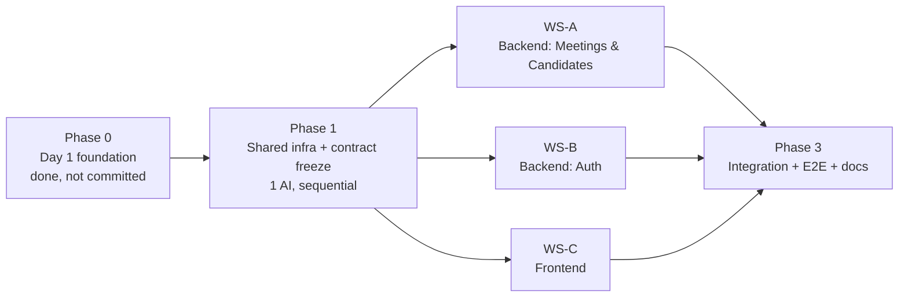

# Implementation Plan (v2)

สถานะ: **Approved scope — v2 ปรับหลังตัดสิน auth/security/logging** · วันที่: 14 พฤศจิกายน 2026
อ้างอิง: [final-architecture.md](./final-architecture.md) · [api-security-observability-proposal.md](./api-security-observability-proposal.md) · [ADR index](./adr/README.md)

## 0. สิ่งที่เปลี่ยนจาก v1

| เรื่อง | v1 | v2 |
|---|---|---|
| Deploy | VPS/Fly.io | **Local Docker only** + GitHub Actions CI (ADR-008) |
| Frontend | Vite + nginx | **Next.js 15** (ADR-010) |
| Auth | ไม่อยู่ baseline | **Register, login + mock OTP 2FA, forgot password, logout** (ADR-009) |
| Security | พื้นฐาน | **Nonce CSP, rate limits, error/log policy** (ADR-011–013) |
| Guest, `/metrics` | — | Future work |
| กำลังคน | 1 คน ~40 ชม. | **AI 3 ตัวพัฒนาขนานกัน + ผู้ใช้รีวิวทุก PR** → คอขวดคือ **เวลารีวิว** ไม่ใช่เวลาเขียนโค้ด |

## 1. หลักการทำงานขนาน

1. **แต่ละ workstream เป็นเจ้าของไฟล์/โฟลเดอร์ของตัวเอง** — ห้ามสอง AI แก้ไฟล์เดียวกันพร้อมกัน
2. ไฟล์ร่วม (`app.ts`, `db/schema/index.ts`, `package.json`, `layout.tsx`) แก้ได้เฉพาะใน **Phase 1** หรือโดย workstream ที่ระบุเป็นเจ้าของเท่านั้น
3. หนึ่ง workstream = หนึ่ง branch = หนึ่ง PR ต่อ milestone; เป้าหมาย ≤ ~400 บรรทัดที่ไม่ใช่ test/migration เพื่อให้รีวิวได้
4. ทุก PR ต้อง: CI เขียว, มี test ตาม acceptance, อธิบาย trade-off ใน description, ไม่มี dependency ใหม่ที่ไม่อยู่ใน ADR
5. Contract (API path, request/response, error code) ถูก **freeze ใน Phase 1** เป็นไฟล์ `backend/docs/api-contract.md` — frontend ทำงานจาก contract ได้โดยไม่ต้องรอ backend

## 2. Phases และ workstreams

### Phase 0 — Day 1 foundation ✅ (ทำแล้ว ยังไม่ commit)
Node 24, Next.js 15 scaffold + Tailwind tokens, Prisma (เดิม Drizzle) + migration `meetings`, health endpoints, compose healthchecks, CI workflows 3 repo

**Review gate R0:** ผู้ใช้รีวิว diff Day 1 → commit + push `feature/day1-foundation` → merge `main` → bump submodule pointer ใน umbrella

### Phase 1 — Shared infrastructure + contract freeze (AI ตัวเดียว ทำก่อนแยกงาน)

| งาน | Repo | ไฟล์ที่เป็นเจ้าของ |
|---|---|---|
| `AppError` + error middleware + error codes | backend | `src/http/errors.ts`, `src/http/error-handler.ts` |
| pino + pino-http + redact + request id + level policy (ADR-012) | backend | `src/observability/*` |
| Zod helpers สำหรับ body/query/params (strict) | backend | `src/http/validate.ts` |
| `trust proxy`, DB `statement_timeout`, env validation ด้วย Zod (fail-fast mock OTP ใน production) | backend | `src/config.ts`, `src/db/client.ts` |
| Rate limiter factory (`RATE_LIMIT_ENABLED`) | backend | `src/http/rate-limit.ts` |
| Schema แยกไฟล์ต่อ domain + migration: `users`, `sessions`, `otp_challenges`, `candidates`, `feedback`, ฟิลด์ใหม่ของ `meetings` (`candidate_id`, `end_at`, `meeting_type`, `provider`, `created_by`) | backend | `prisma/schema.prisma`, `prisma/migrations/*` (เดิม `src/db/schema/*.ts`, `drizzle/0001_*.sql`) |
| Route mounting ใน `app.ts` (`/api/v1/auth`, `/meetings`, `/candidates` เป็น router ว่าง) + interface `requireAuth` | backend | `src/app.ts`, `src/http/auth-guard.ts` (interface) |
| Test helpers: reset DB ต่อ test, `loginAs()` | backend | `test/helpers/*` |
| **API contract** ทุก endpoint (auth + meetings + candidates + feedback) | backend | `docs/api-contract.md` |
| `src/lib/api.ts` (`ApiError`), TanStack Query provider, `middleware.ts` (nonce CSP + redirect `/login`), security headers, layout + app shell | frontend | `src/lib/*`, `middleware.ts`, `src/app/layout.tsx`, `src/app/providers.tsx`, `next.config.ts` |
| shadcn/ui base components (Button, Input, Card, Badge, Dialog, Toast, Skeleton) | frontend | `src/components/ui/*` |

**Review gate R1 (สำคัญที่สุด):** รีวิว contract + schema + infra — หลังจากนี้การแก้ contract ต้องเป็น PR แยกและแจ้งทุก workstream
ประมาณ: AI ~4–6 ชม. · รีวิว ~1.5 ชม.

### Phase 2 — Parallel workstreams (AI 3 ตัว)

| | WS-A Backend: Meetings & Candidates | WS-B Backend: Auth | WS-C Frontend |
|---|---|---|---|
| ไฟล์ที่เป็นเจ้าของ | `src/modules/meetings/*`, `candidates/*`, `feedback/*` + tests | `src/modules/auth/*` (users, sessions, otp, password), `src/http/auth-guard.ts` (implementation) + tests | `src/app/(auth)/*`, `src/app/(app)/*`, `src/features/*` + tests |
| ห้ามแตะ | auth module, schema (ขอแก้เป็น PR แยก) | meetings/candidates/feedback | backend ทั้งหมด |
| ระหว่างพัฒนา | ใช้ `loginAs()` stub ใน test | — | mock API ตาม contract (MSW) จนกว่า backend พร้อม |
| **PR 1** | **A1** Meetings CRUD: list+pagination, get, create, PATCH (version), DELETE `?version`, cancel, transitions, `created_by` | **B1** Register + OTP verify (REGISTER) + `OtpProvider`/`MockOtpProvider` + bcrypt | **C1** Auth pages: login, OTP, register, forgot/reset, logout |
| **PR 2** | **A2** Candidates (search, create, detail+history) + transaction candidate+meeting | **B2** Login + OTP 2FA + sessions (idle 8h / abs 7d) + logout + `requireAuth` จริง + Origin check | **C2** Dashboard (cards, filter, pagination, states) + Meeting form (create/edit, candidate select/create, 409) |
| **PR 3** | **A3** Feedback (append) + cascade on delete | **B3** Forgot/reset password + revoke sessions + auth rate limits | **C3** Candidate Summary (info, notes/feedback, history, Edit/Cancel/Delete/Add Feedback) |
| Test หลัก | 400, 404, 409 version, pagination edges, transitions, transaction rollback, 401 เมื่อไม่ login | OTP หมดอายุ/ใช้ซ้ำ/ผิด 5 ครั้ง, session หมดอายุ, logout ลบ session, enumeration, 429, fail-fast production, ไม่ log password/OTP | form validation, error แสดง requestId, redirect เมื่อ 401, ไม่มี CSP violation |
| ประมาณ AI | ~8–10 ชม. | ~8–10 ชม. | ~10–12 ชม. |
| ประมาณรีวิว | ~2 ชม. | ~2.5 ชม. (security-sensitive) | ~2.5 ชม. |

**C4 Calendar (PR 4 ของ WS-C, ADR-014):** Week + Month + mobile Day agenda, Mine/All, click-to-create — ~6–8 ชม. frontend + A: `view=range` และ `mine` ~1 ชม.

**ลำดับ merge:** B2 ต้อง merge ก่อนเปิด `requireAuth` จริงบน route ของ A (ก่อนนั้นใช้ stub ใน test) · WS-C ต่อ backend จริงหลัง A1 + B2 merge
**Review gates:** R-A1..A3, R-B1..B3, R-C1..C3 ตามลำดับที่ PR พร้อม; **B1–B3 รีวิวละเอียดที่สุด** โดยใช้ ADR-013 เป็น checklist

### Phase 3 — Integration, E2E, docs (AI 1–2 ตัว)

| งาน | Repo |
|---|---|
| ต่อ frontend กับ backend จริง (ถอด MSW), แก้ drift ตาม contract | frontend |
| Playwright smoke บน compose: register → OTP → login → OTP → create → edit → two-tab 409 → cancel → delete → logout + ตรวจ CSP violation | umbrella |
| `make seed`: demo user + candidates + meetings | backend |
| CI: `npm audit --audit-level=high`, Dependabot, umbrella compose smoke + Playwright | ทั้งหมด |
| README: setup, env, demo account + mock OTP, API, decisions (ลิงก์ ADR), security & operations, limitations, future work | ทั้งหมด |
| Fresh-clone rehearsal | umbrella |

**Release gate R-Final:** checklist §5 ผ่านทั้งหมด · ประมาณ: AI ~4–6 ชม. · รีวิว ~1.5 ชม.

## 3. งบเวลาของผู้ใช้ (คอขวดจริง)

| Gate | รีวิวโดยประมาณ |
|---|---|
| R0 Day 1 | 0.5 ชม. |
| R1 Contract + infra | 1.5 ชม. |
| R-A1..A3 | 2 ชม. |
| R-B1..B3 | 2.5 ชม. |
| R-C1..C3 | 2.5 ชม. |
| R-Final | 1.5 ชม. |
| ทดสอบด้วยมือ + แก้ตามรีวิว | 3 ชม. |
| **รวม** | **~13.5 ชม.** |

ตัวเลขเป็นการประมาณ ไม่ใช่การวัดจริง ปรับหลัง R1

## 4. Cut order (ถ้าเวลารีวิวไม่พอ)

1. Playwright → manual release checklist
2. Forgot password → future work
3. Candidate autocomplete → dropdown + ปุ่มสร้างใหม่
4. Meeting type/provider
5. Feedback แยก → notes field เดียว

**ห้ามตัด:** CRUD + pagination + persistence, 3 containers, README, version 409, candidateId identity, login + OTP 2FA + logout, nonce CSP, error/log policy, auth rate limits

## 5. Release checklist (R-Final)

**Core**
- [ ] `git clone --recurse-submodules` → `make init && make up` บนเครื่องว่าง → `localhost:8080` ใช้งานได้
- [ ] สร้าง meeting → `docker compose down && make up` → ข้อมูลยังอยู่
- [ ] `pageSize=51` → 400; `page=999` → รายการว่าง
- [ ] สองแท็บแก้ meeting เดียวกัน → แท็บที่สองได้ 409 + ข้อความชัด
- [ ] refresh deep link (`/candidates/<id>`) ไม่ 404

**Auth & security**
- [ ] register → OTP `112233` → เข้าระบบ; login ทุกครั้งต้อง OTP
- [ ] OTP ผิด 5 ครั้ง → challenge ใช้ไม่ได้ + log `warn`
- [ ] login ผิด 6 ครั้งใน 15 นาที → 429
- [ ] forgot password → OTP → password ใหม่ → session เดิมใช้ไม่ได้
- [ ] logout → cookie หาย; เรียก API → 401
- [ ] เรียก `/api/v1/meetings` โดยไม่มี cookie → 401
- [ ] `NODE_ENV=production` + mock OTP → api ไม่ start
- [ ] CSP header มี nonce ที่เปลี่ยนทุก request; console ไม่มี CSP violation
- [ ] network tab มีแค่ origin `localhost:8080`; port 3000/5432 ไม่เปิดใน prod compose

**Logging**
- [ ] `docker compose logs api` เป็น JSON มี `requestId`, `status`, `durationMs`; ไม่มี password, OTP, cookie, body
- [ ] error ในหน้าเว็บแสดง requestId ที่ค้นเจอใน log
- [ ] `LOG_LEVEL=debug` เปลี่ยนได้โดยไม่ rebuild

**Repo**
- [ ] CI เขียวทั้ง 3 repo บน commit สุดท้าย
- [ ] ไม่มี secret ใน git (ค่า dev ใน `.env.example` เท่านั้น)
- [ ] README ระบุ: mock OTP, local only, accepted risks (ADR-013), future work (guest, `/metrics`, deploy)

## 6. Commit / branch

- Branch ต่อ workstream: `feature/<ws>-<desc>` เช่น `feature/auth-login-otp`, `feature/meetings-crud` (ไม่มี Jira key เพราะเป็น take-home)
- Conventional Commits: `feat(auth): ...`, `feat(meetings): ...`, `feat(web): ...`
- หลัง merge ใน submodule → umbrella `chore: bump backend to <sha>`
- ไม่ force-push `main`
