# คู่มือการใช้งาน: ระบบนัดสัมภาษณ์ผู้สมัคร (Candidate Meeting Scheduler)

ระบบนี้ช่วยทีมสรรหาจัดการนัดสัมภาษณ์ผู้สมัครได้ในที่เดียว ทำได้ตั้งแต่สร้างนัด ดูนัดเป็นรายการหรือปฏิทิน แก้ไข
ยกเลิก ลบ ไปจนถึงจดบันทึกผลสัมภาษณ์และดูประวัติของผู้สมัครแต่ละคน

ภาพทั้งหมดในคู่มือถ่ายจากระบบจริงด้วยข้อมูล demo (`make seed`) ในภาษาไทย

## สารบัญ

1. [เริ่มต้นใช้งาน](#1-เริ่มต้นใช้งาน)
2. [สมัครสมาชิก เข้าสู่ระบบ และรหัส OTP](#2-สมัครสมาชิก-เข้าสู่ระบบ-และรหัส-otp)
3. [หน้านัดหมาย: มุมมองรายการ](#3-หน้านัดหมาย-มุมมองรายการ)
4. [หน้านัดหมาย: มุมมองปฏิทิน](#4-หน้านัดหมาย-มุมมองปฏิทิน)
5. [สร้างนัดสัมภาษณ์](#5-สร้างนัดสัมภาษณ์)
6. [หน้าผู้สมัคร: ข้อมูล บันทึก และประวัติ](#6-หน้าผู้สมัคร-ข้อมูล-บันทึก-และประวัติ)
7. [แก้ไข ยกเลิก และลบนัด](#7-แก้ไข-ยกเลิก-และลบนัด)
8. [ภาษา ธีม และการใช้บนมือถือ](#8-ภาษา-ธีม-และการใช้บนมือถือ)
9. [คำถามที่พบบ่อย](#9-คำถามที่พบบ่อย)

## 1. เริ่มต้นใช้งาน

| วิธีรัน | คำสั่ง | เปิดที่ |
|---|---|---|
| ใช้งานออนไลน์ (demo) | ไม่ต้องติดตั้ง | https://meeting-manager-web.onrender.com |
| พัฒนา (hot reload) | `make dev` | http://localhost:3001 |
| เหมือน production ใน Docker | `make up` | http://localhost:8080 |

ลงข้อมูลตัวอย่างด้วย `make seed` แล้วเข้าระบบด้วยบัญชี demo:

| ช่อง | ค่า |
|---|---|
| อีเมล | `demo@example.com` |
| รหัสผ่าน | `demo-password-123` |
| รหัส OTP | `112233` |

> ระบบนี้เป็นเวอร์ชัน demo ไม่มีการส่งอีเมลหรือ SMS จริง ทุกบัญชีใช้รหัส OTP `112233`

## 2. สมัครสมาชิก เข้าสู่ระบบ และรหัส OTP

### เข้าสู่ระบบ

กรอกอีเมลและรหัสผ่าน แล้วกด **เข้าสู่ระบบ** ถ้าเปิดหน้าอื่นโดยยังไม่ได้เข้าระบบ ระบบจะพามาที่หน้านี้ก่อน
เมื่อเข้าระบบสำเร็จจะกลับไปยังหน้าที่ตั้งใจจะเปิด

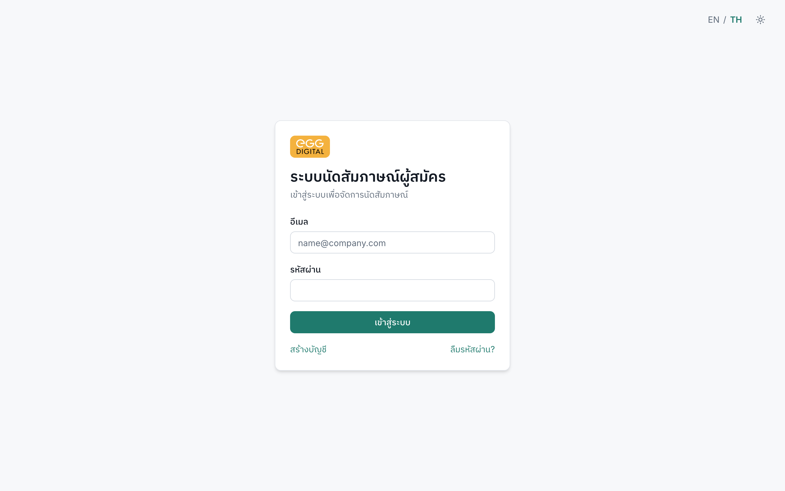

### ยืนยันตัวตนด้วย OTP (2 ขั้นตอน)

หลังรหัสผ่านถูกต้อง ระบบขอรหัส 6 หลัก พิมพ์ทีละช่องหรือวางทั้ง 6 หลักในช่องแรกก็ได้ ถ้ารหัสหมดอายุ กด
**ส่งรหัสอีกครั้ง**

### สมัครสมาชิก

กด **สร้างบัญชี** จากหน้าเข้าสู่ระบบ ใส่อีเมลที่ทำงาน รหัสผ่านอย่างน้อย 8 ตัวอักษร และยืนยันรหัสผ่าน จากนั้นยืนยันอีเมลด้วย
OTP แบบเดียวกับตอนเข้าระบบ

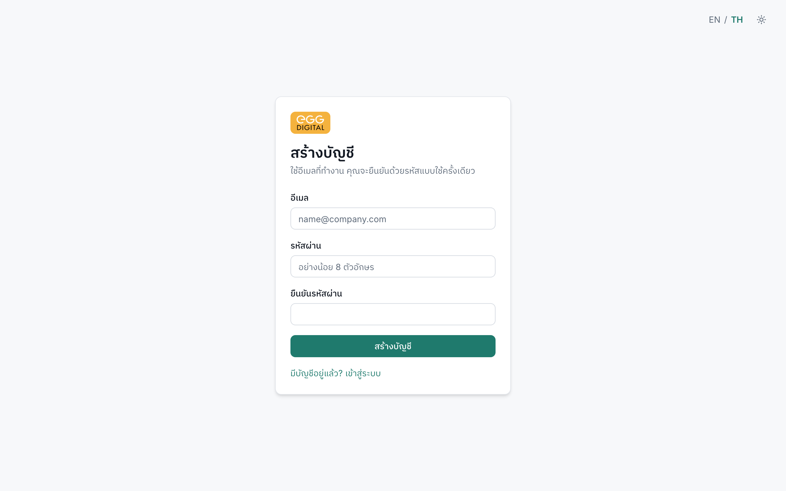

ตอนสมัครให้เลือก **บทบาท** ระบบจะแสดงเฉพาะปุ่มที่บทบาทนั้นใช้ได้

| บทบาท | ทำอะไรได้ |
|---|---|
| ผู้สรรหา (Recruiter) ค่าเริ่มต้น | สร้าง แก้ไข และยกเลิกนัดของทุกคนได้ ลบได้เฉพาะนัดที่ตัวเองสร้าง |
| ผู้สัมภาษณ์ (Interviewer) | ดูนัดและปฏิทิน และเพิ่มบันทึกผลสัมภาษณ์ |
| ผู้ดูแลระบบ (Admin) | ทำได้ทุกอย่าง เลือกเองตอนสมัครไม่ได้ ผู้ดูแลระบบกำหนดผ่านรายชื่ออีเมล |

ข้อมูล demo มีสองบัญชี: `demo@example.com` เป็นผู้ดูแลระบบ และ `interviewer@example.com` เป็นผู้สัมภาษณ์ ใช้รหัสผ่าน
`demo-password-123` และ OTP `112233` เหมือนกัน (ภาพหน้าจอในคู่มือถ่ายก่อนเพิ่มช่องเลือกบทบาท)

### ลืมรหัสผ่าน

กด **ลืมรหัสผ่าน?** ใส่อีเมล รับรหัส OTP แล้วตั้งรหัสผ่านใหม่ ระบบจะแสดงข้อความเดียวกันเสมอไม่ว่าอีเมลนั้นจะมีบัญชี
หรือไม่ เพื่อไม่ให้ใครใช้หน้านี้ตรวจสอบว่าอีเมลไหนมีบัญชีอยู่

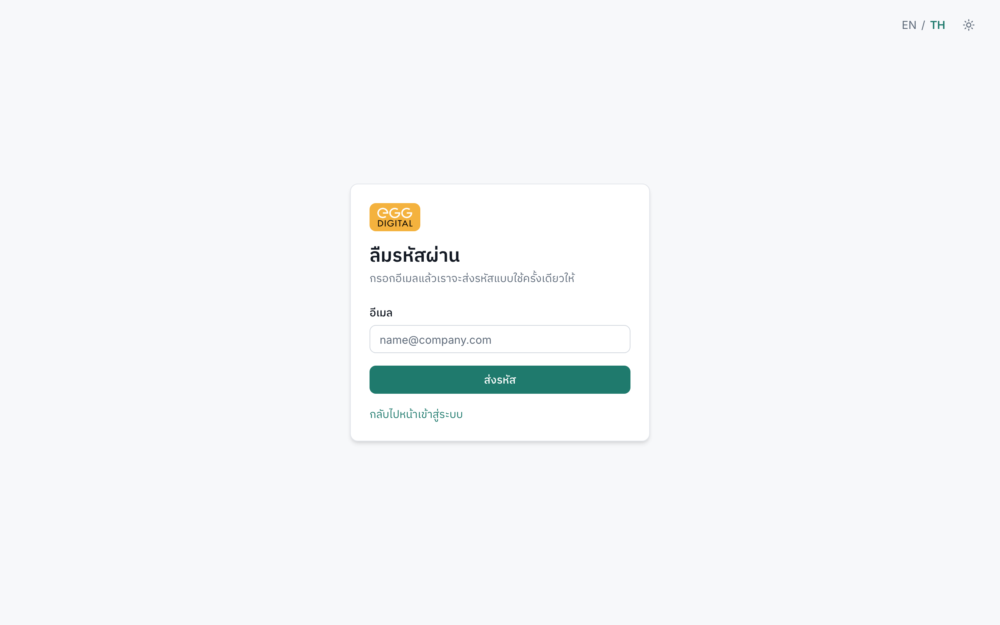

### ออกจากระบบ

กดวงกลมชื่อย่อมุมขวาบน แล้วเลือก **ออกจากระบบ**

## 3. หน้านัดหมาย: มุมมองรายการ

หน้าแรกหลังเข้าระบบคือ **นัดหมายที่กำลังจะมาถึง** แต่ละการ์ดแสดง:

- ชื่อผู้สมัครและตำแหน่งที่สมัคร (นัดที่ไม่ผูกกับผู้สมัคร เช่น ประชุมทีม จะแสดงหัวข้อแทน)
- วันที่และช่วงเวลา
- รูปแบบนัด: ที่สถานที่ หรือออนไลน์ (Zoom, Google Meet หรืออื่น ๆ)
- สถานะ: **ยืนยันแล้ว**, **รอยืนยัน**, **ยกเลิกแล้ว** และ **ผ่านไปแล้ว** (นัดที่เวลาเลยไปแล้ว)
- ปุ่ม **ดูรายละเอียด**

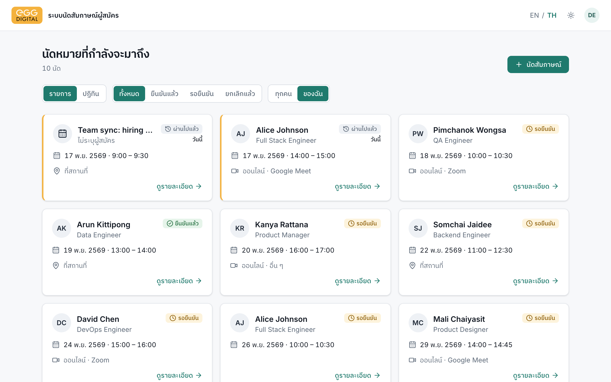

ตัวกรองด้านบน:

| ตัวกรอง | ใช้ทำอะไร |
|---|---|
| รายการ / ปฏิทิน | สลับมุมมอง |
| ทั้งหมด / ยืนยันแล้ว / รอยืนยัน / ยกเลิกแล้ว | กรองตามสถานะ |
| ทุกคน / ของฉัน | ดูนัดของทั้งทีม หรือเฉพาะนัดที่คุณสร้าง |

รายการแบ่งเป็นหน้า ด้านล่างจะบอกว่ากำลังดูรายการที่เท่าไรจากทั้งหมด และมีปุ่มก่อนหน้า/ถัดไป ตัวกรองที่เลือกจะถูกเก็บไว้ใน URL
จึงแชร์ลิงก์หรือกด back ได้โดยตัวกรองไม่หาย

## 4. หน้านัดหมาย: มุมมองปฏิทิน

### รายสัปดาห์

แสดงนัดตามช่วงเวลาจริงของแต่ละวัน เส้นสีแดงคือเวลาปัจจุบัน โซนเวลาแสดงที่มุมซ้ายบน (เช่น GMT+7) และใช้ตามเครื่องของผู้ใช้

- ใช้ **วันนี้**, `<` และ `>` เพื่อเลื่อนสัปดาห์
- **คลิกช่องว่าง** ในปฏิทินเพื่อสร้างนัดใหม่ ระบบจะกรอกวันและเวลาเริ่มให้ (ปัดลงทีละ 30 นาที)
- นัดสั้นกว่า 45 นาทีจะแสดงเป็นบรรทัดเดียว ถ้าชื่อยาวจะถูกตัดท้าย

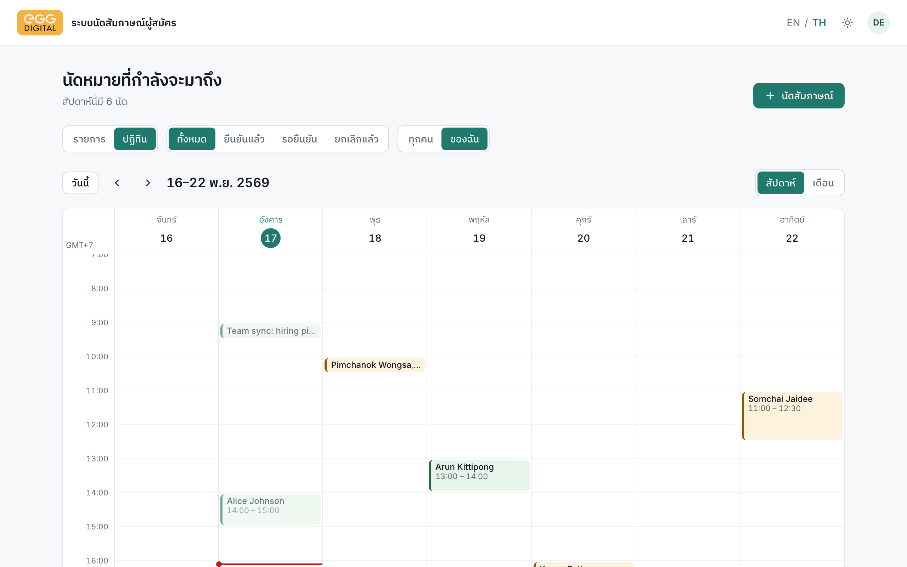

คลิกนัดเพื่อเปิดสรุปย่อ มีปุ่ม **แก้ไขนัดหมาย** และ **ดูรายละเอียด**

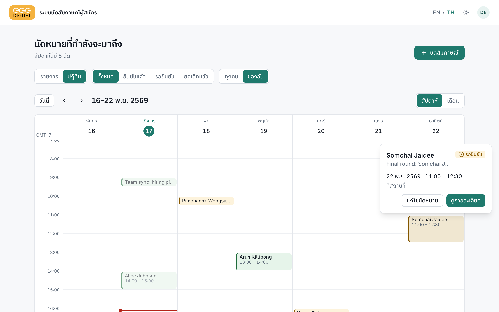

### รายเดือน

กด **เดือน** มุมขวาเพื่อดูทั้งเดือน วันที่มีนัดมากจะแสดง "อีก n นัด" ส่วนการคลิกวันจะเปิดฟอร์มนัดใหม่ของวันนั้นที่เวลา 09:00

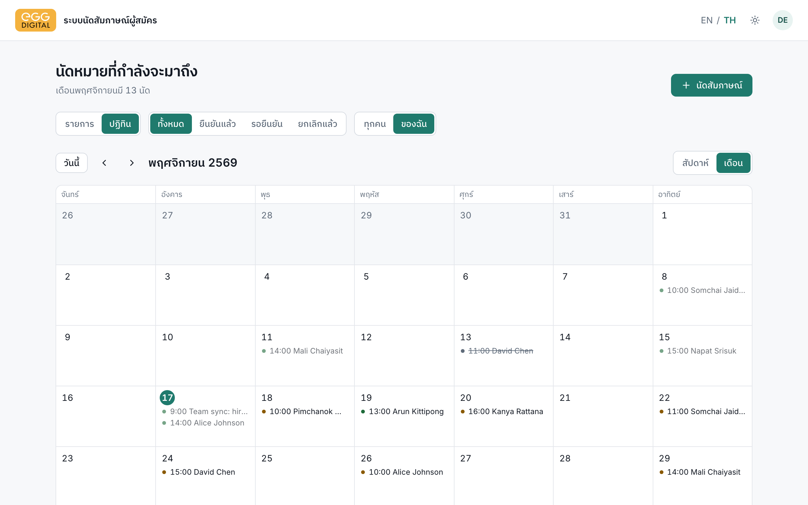

## 5. สร้างนัดสัมภาษณ์

กด **+ นัดสัมภาษณ์** มุมขวาบน หรือคลิกช่องว่างในปฏิทิน

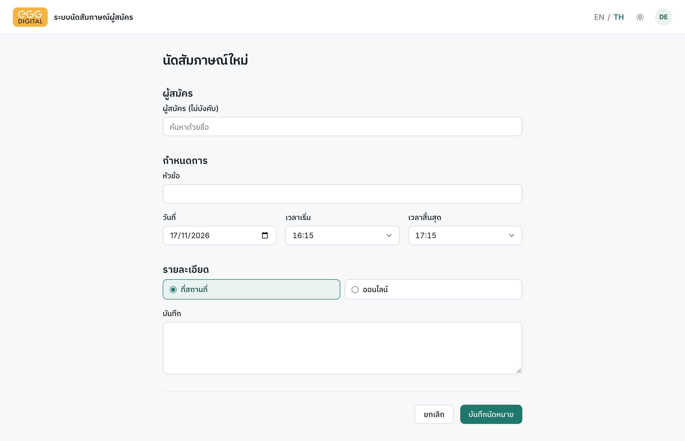

| ส่วน | ช่อง | หมายเหตุ |
|---|---|---|
| ผู้สมัคร | ผู้สมัคร | พิมพ์ชื่อเพื่อค้นหาผู้สมัครที่มีอยู่ ถ้าไม่พบให้เลือก **สร้างผู้สมัครใหม่** แล้วใส่ชื่อและเลือกตำแหน่ง เว้นว่างได้ถ้าเป็นนัดที่ไม่เกี่ยวกับผู้สมัคร |
| กำหนดการ | หัวข้อ | บังคับกรอก ไม่เกิน 150 ตัวอักษร |
| | วันที่ เวลาเริ่ม เวลาสิ้นสุด | เลือกเวลาได้ทีละ 15 นาที และเวลาสิ้นสุดต้องหลังเวลาเริ่ม (การคลิกช่องปฏิทินจะปัดเวลาเริ่มลงทีละ 30 นาที) |
| รายละเอียด | รูปแบบ | ที่สถานที่ หรือออนไลน์ (ถ้าออนไลน์ เลือก Zoom, Google Meet หรืออื่น ๆ) |
| | สถานะ | นัดใหม่เริ่มเป็น **รอยืนยัน** เปลี่ยนเป็น **ยืนยันแล้ว** ได้จากหน้าแก้ไขนัด |
| | บันทึก | รายละเอียดเพิ่มเติม เช่น ห้องประชุม หรือสิ่งที่ผู้สมัครต้องเตรียม |

กด **บันทึกนัดหมาย** ถ้ากรอกไม่ครบหรือไม่ถูกต้อง ระบบจะแสดงข้อความใต้ช่องนั้นและย้ายเคอร์เซอร์ไปที่ช่องแรกที่ผิด

หากต้องการออกโดยไม่บันทึก กด **ยกเลิก** เมื่อเปิดฟอร์มจากปฏิทิน ระบบจะกลับไปวัน มุมมอง และตัวกรองเดิม แม้รีเฟรชหน้าฟอร์มไปแล้ว หากเปิดจากหน้ารายการ จะกลับหน้ารายการ ปุ่มนี้ไม่ได้ยกเลิกนัดที่บันทึกไว้

ระหว่างส่งข้อมูล ปุ่มจะแสดงวงหมุนและกดซ้ำไม่ได้ หากเกิดข้อผิดพลาดจะแสดงข้อความและเปิดให้ลองใหม่ เมื่อบันทึกสำเร็จ ระบบจะกลับหน้ารายการนัดหมาย

## 6. หน้าผู้สมัคร: ข้อมูล บันทึก และประวัติ

กด **ดูรายละเอียด** จากการ์ดหรือจากปฏิทิน จะเปิดหน้าของผู้สมัครคนนั้น ถ้านัดไม่ได้ผูกกับผู้สมัคร จะเปิดฟอร์มแก้ไขนัดแทน

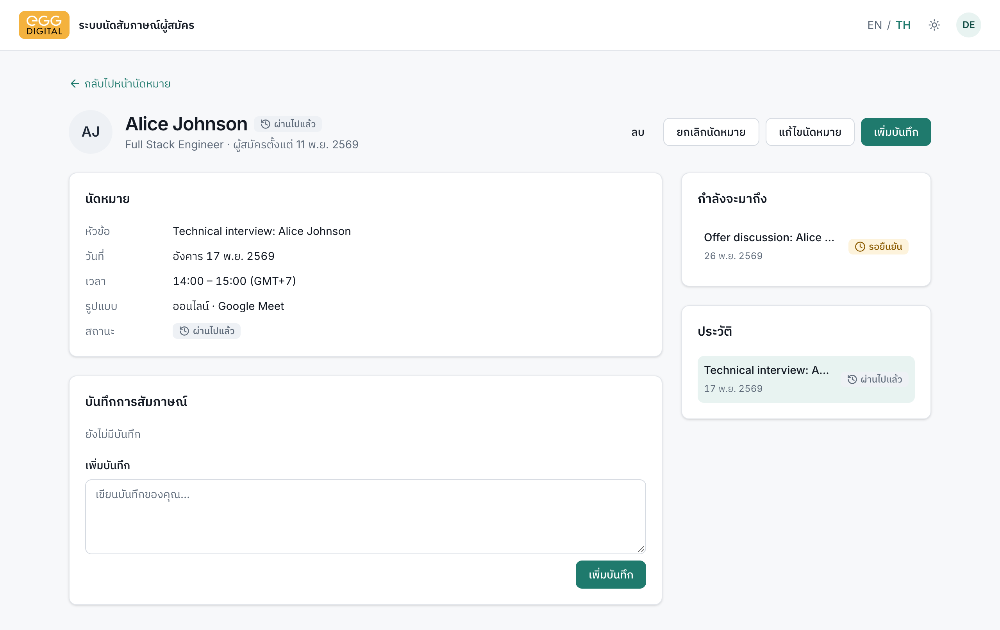

| ส่วน | สิ่งที่แสดง |
|---|---|
| ส่วนหัว | ชื่อ ตำแหน่ง วันที่เริ่มเป็นผู้สมัคร และสถานะของนัด |
| นัดหมาย | หัวข้อ วันที่ เวลา (พร้อมโซนเวลา) รูปแบบ และสถานะ |
| บันทึกการสัมภาษณ์ | บันทึกของทุกคนในทีมเรียงตามเวลา พร้อมช่อง **เพิ่มบันทึก** (ไม่เกิน 5000 ตัวอักษร) |
| กำลังจะมาถึง | นัดถัดไปของผู้สมัครคนนี้ |
| ประวัติ | นัดที่ผ่านไปแล้ว คลิกเพื่อดูนัดนั้นได้ |

ปุ่มด้านบนขวา: **ลบ**, **ยกเลิกนัดหมาย**, **แก้ไขนัดหมาย** และ **เพิ่มบันทึก**

## 7. แก้ไข ยกเลิก และลบนัด

### แก้ไข

กด **แก้ไขนัดหมาย** ฟอร์มจะมีข้อมูลเดิมกรอกไว้แล้ว แก้เฉพาะช่องที่ต้องการแล้วกด **บันทึกการแก้ไข**

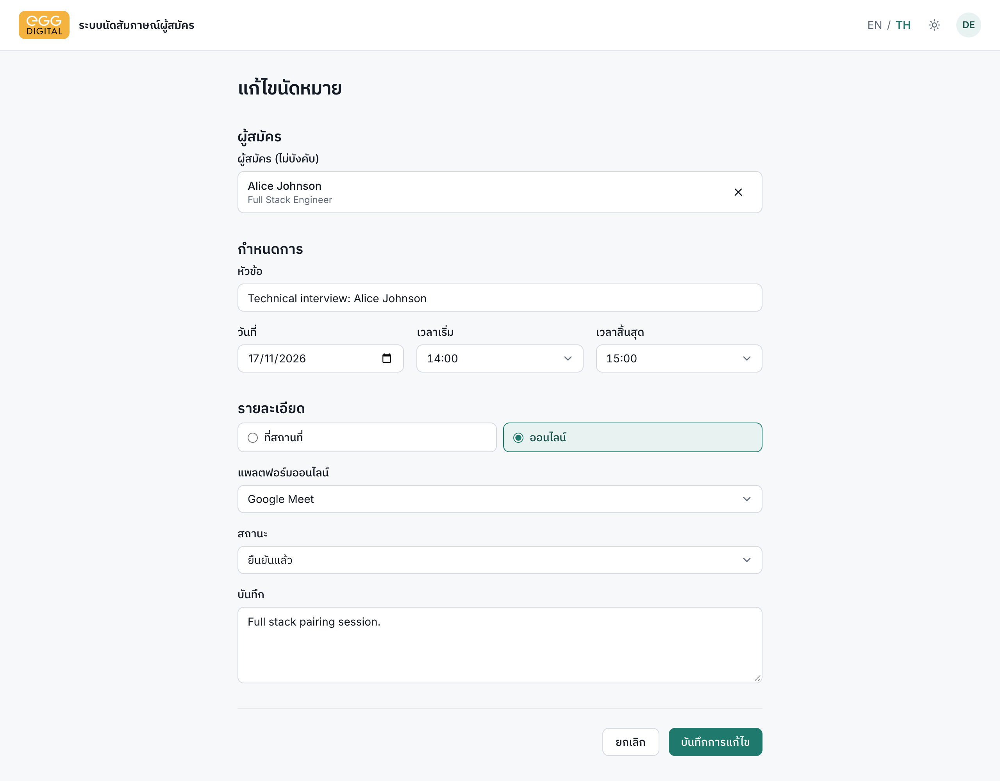

### ยกเลิก และลบ

| การกระทำ | ผลลัพธ์ |
|---|---|
| **ยกเลิกนัดหมาย** | นัดยังอยู่ในประวัติโดยมีสถานะ "ยกเลิกแล้ว" เปิดกลับมาใหม่ได้ด้วยการแก้ไขสถานะเป็น **รอยืนยัน** ก่อน แล้วจึงเปลี่ยนเป็น **ยืนยันแล้ว** ได้ |
| **ลบ** | ลบนัดและบันทึกทั้งหมดของนัดนั้นสำหรับทุกคน ย้อนกลับไม่ได้ |

ทั้งสองแบบมีหน้าต่างให้ยืนยันก่อนเสมอ

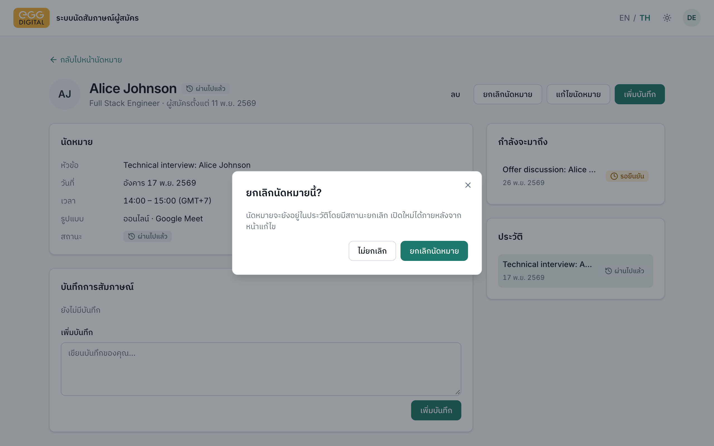

### ถ้ามีคนอื่นแก้ไขนัดเดียวกันพร้อมกัน

ระบบตรวจสอบเวอร์ชันของนัดทุกครั้งที่บันทึก ถ้ามีคนแก้นัดนั้นไปก่อน จะขึ้นข้อความ "นัดหมายนี้ถูกเปลี่ยนแปลง" และ
ไม่เขียนทับงานของคนอื่น ให้กด **โหลดใหม่** เพื่อดูข้อมูลล่าสุดแล้วลองอีกครั้ง ถ้านัดถูกลบไปแล้ว หน้าแก้ไขจะแจ้งว่าไม่พบนัด

## 8. ภาษา ธีม และการใช้บนมือถือ

- **ภาษา:** กด **EN / TH** มุมขวาบน ระบบจำภาษาที่เลือกไว้ และรูปแบบวันที่จะเปลี่ยนตาม (เช่น ภาษาไทยใช้ปี พ.ศ.)
- **ธีม:** กดไอคอนพระอาทิตย์หรือพระจันทร์ แล้วเลือก สว่าง / มืด / ตามระบบ

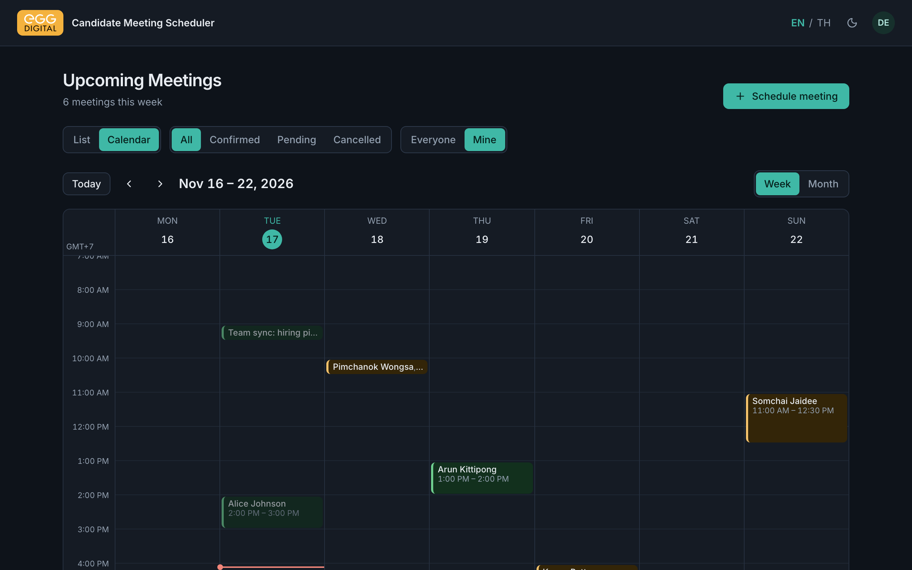

- **มือถือ:** หน้าจอกว้างไม่ถึง 768px จะแสดงปฏิทินรายสัปดาห์เป็นรายการแยกตามวัน แต่ละวันมีปุ่ม **+** สำหรับสร้างนัดในวันนั้น

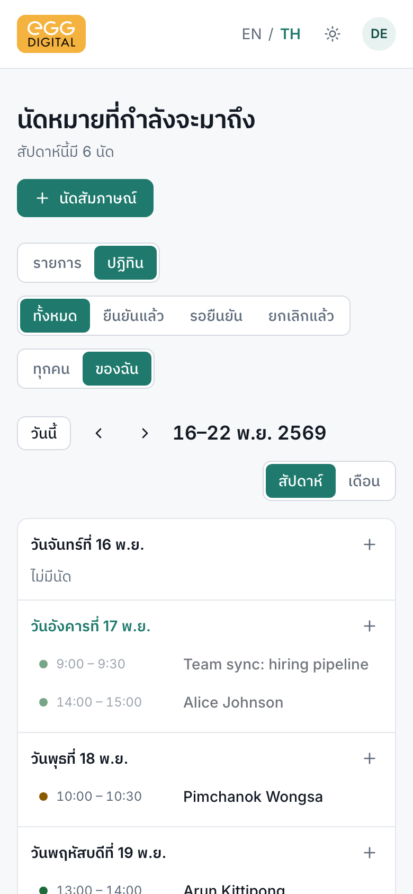

## 9. คำถามที่พบบ่อย

**เปิด http://localhost:3000 แล้วเห็น `NOT_FOUND`**
พอร์ต 3000 เป็นของ API ซึ่งไม่มีหน้าเว็บ ให้เปิด http://localhost:3001 แทน (หรือ :8080 ถ้าใช้ `make up`)

**ขึ้นข้อความ "ลองหลายครั้งเกินไป" (`RATE_LIMITED`)**
ระบบจำกัดจำนวนครั้งของการเข้าระบบ สมัคร และขอรหัส OTP เพื่อป้องกันการเดารหัส ให้รอสักครู่แล้วลองใหม่ ค่าจำกัดปรับได้ด้วยตัวแปร
`RATE_LIMIT_*` (ดู README ของ backend)

**รหัส OTP ไม่ผ่าน**
ระบบ demo ใช้ `112233` สำหรับทุกบัญชี รหัสใช้ได้ภายในเวลาที่กำหนด ถ้ารหัสหมดอายุให้กด **ส่งรหัสอีกครั้ง** แต่ถ้าลองผิดครบ
จำนวนครั้งที่กำหนด รหัสชุดนั้นจะถูกล็อกและส่งซ้ำไม่ได้ ให้กด **กลับไปหน้าเข้าสู่ระบบ** แล้วเริ่มเข้าสู่ระบบใหม่

**เวลาที่แสดงไม่ตรงกับที่ตั้งไว้**
ระบบเก็บเวลาเป็น UTC และแสดงตามโซนเวลาของเครื่องผู้ใช้ ดูโซนที่ใช้อยู่ได้ที่มุมซ้ายบนของปฏิทิน (เช่น GMT+7)

**ข้อมูล demo หายหรือรก**
รัน `make seed` อีกครั้ง คำสั่งนี้รีเซ็ตเฉพาะข้อมูลของบัญชี demo บัญชีอื่นไม่ได้รับผลกระทบ
